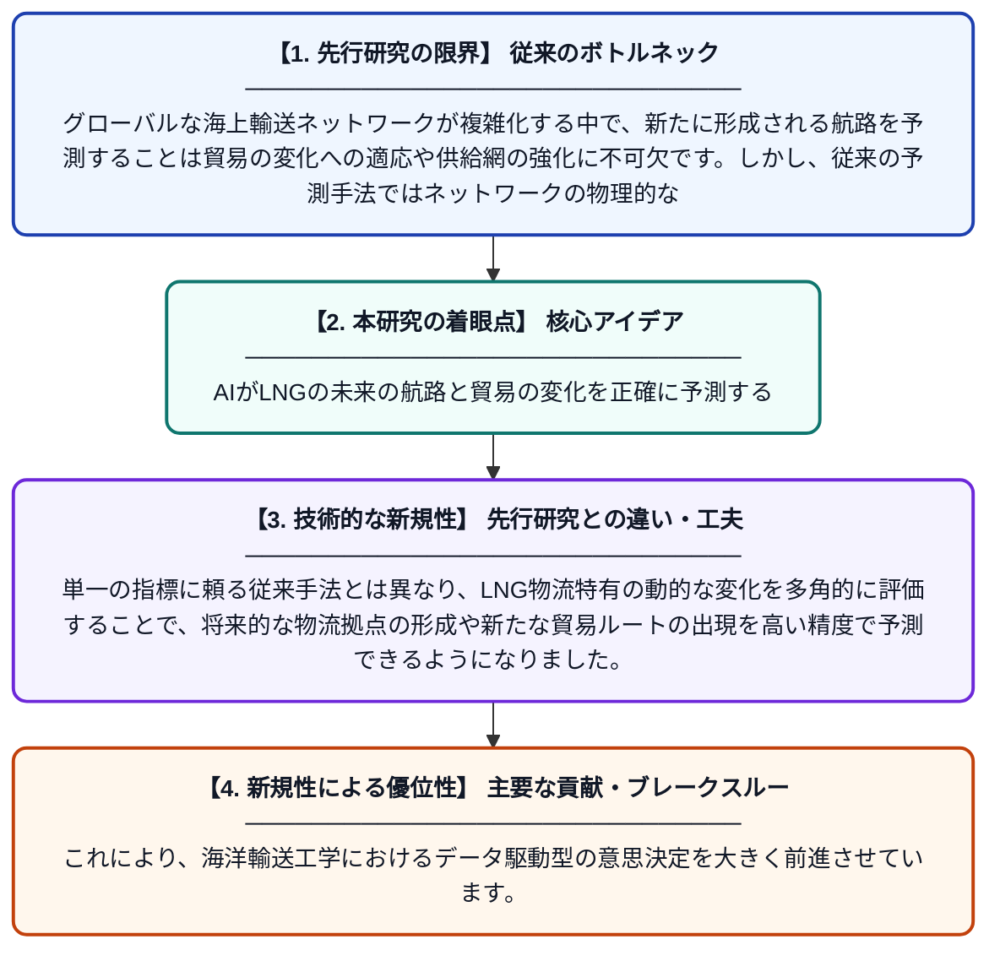

# 世界のLNG海上物流ネットワークにおける潜在的な相互作用パターンのマイニング：海洋輸送工学のための複数指標に基づくリンク予測手法

**Original Title**: *Mining latent interaction patterns of global LNG maritime logistics networks: A multi-indicator-based link prediction method for marine transport engineering*

> **💡 一言要約**: AIがLNGの未来の航路と貿易の変化を正確に予測する

| 項目 | 内容 |
|---|---|
| **著者** | H Yu, Y Zhang, F Chen, Y Lu, Z Wang, J Zhou, L Xu |
| **掲載誌** | Ocean Engineering 2026 |
| **アラートキーワード** | logistics |
| **原文リンク** | [https://www.sciencedirect.com/science/article/pii/S0029801826046858](https://www.sciencedirect.com/science/article/pii/S0029801826046858) |
| **PDF版要約** | [README.pdf](./README.pdf) |

---

## 📊 新規性の図解（先行研究との違いと本研究のブレークスルー）

## 📝 要約

世界の液化天然ガス（LNG）海上輸送ネットワークにおける将来の航路接続を予測するための新しいフレームワークを提案しています。ネットワーク構造とノード属性を統合した複数指標を用いることで、貿易パターンの変化を捉え、サプライチェーンの回復力を高めることを目指しています。

## ❓ どんな問題に取り組んだか

グローバルな海上輸送ネットワークが複雑化する中で、新たに形成される航路を予測することは貿易の変化への適応や供給網の強化に不可欠です。しかし、従来の予測手法ではネットワークの物理的な構造と、港湾自体の特性を十分に組み合わせて分析できていないという課題がありました。

## ✨ 何が新しい？何がすごい？（新規性）

本研究の新規性は、ネットワークの接続構造（トポロジー）と港湾の属性という複数の指標を高度に統合した「マルチインジケーター結合リンク予測フレームワーク」を開発した点にあります。単一の指標に頼る従来手法とは異なり、LNG物流特有の動的な変化を多角的に評価することで、将来的な物流拠点の形成や新たな貿易ルートの出現を高い精度で予測できるようになりました。これにより、海洋輸送工学におけるデータ駆動型の意思決定を大きく前進させています。

## 🎓 大学1年生向けの解説

私たちが使うエネルギーであるLNG（液化天然ガス）は、巨大な船によって世界中の港へ運ばれています。この論文は、「今はまだつながっていない港と港が、将来新しく航路として結ばれるかどうか」をAIのような技術で予測する方法を開発したものです。SNSの「おすすめの友達」を表示する仕組みを、海の貿易ルートの予測に応用したようなイメージです。これによって、将来のエネルギー供給がどう変わるかを先読みし、より安定した物流の計画を立てることが可能になります。
