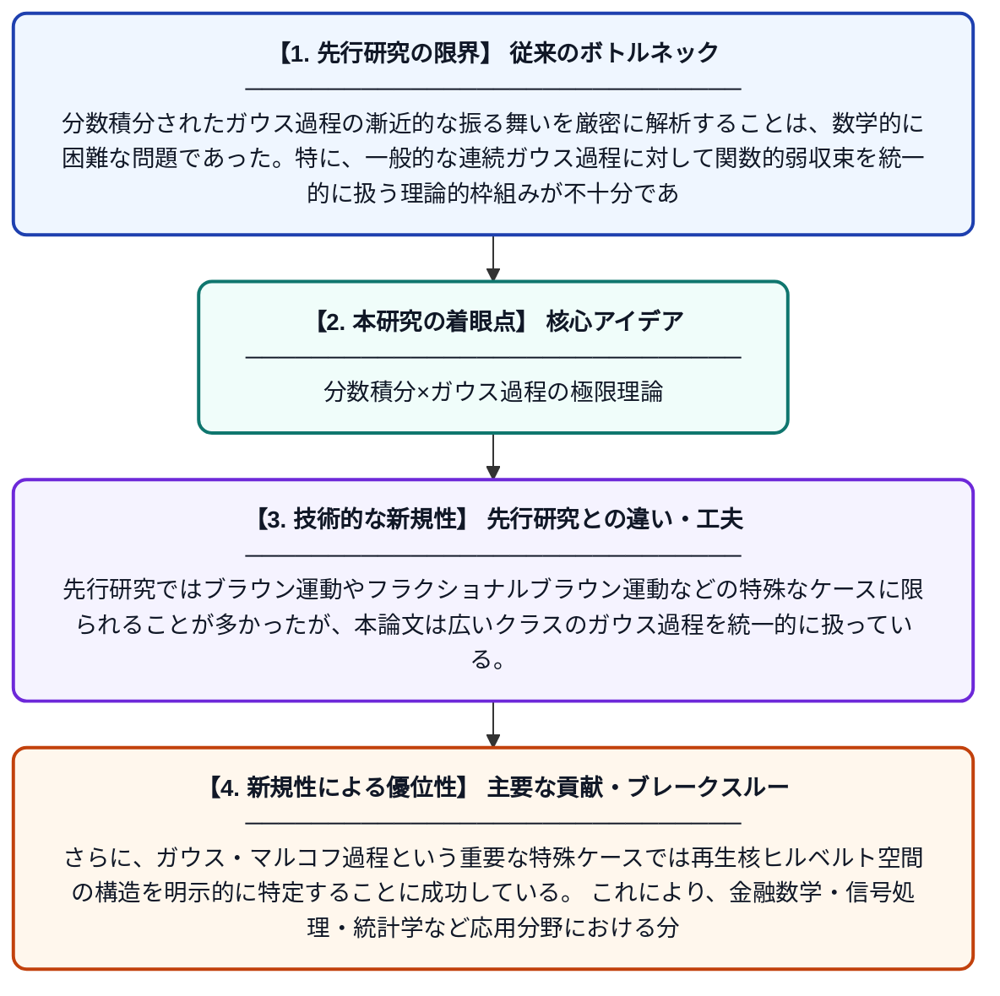

# 分数積分されたガウス過程の漸近理論：ガウス・マルコフ過程を中心として

**Original Title**: *Asymptotics for fractionally integrated Gaussian processes, with a focus on the Gauss-Markov case*

> **💡 一言要約**: 分数積分×ガウス過程の極限理論

| 項目 | 内容 |
|---|---|
| **著者** | B Pacchiarotti, M Simoncelli |
| **掲載誌** | Modern Stochastics: Theory and Applications 2026 |
| **アラートキーワード** | gaussian process |
| **原文リンク** | [https://vmsta.org/journal/VMSTA/article/357/text](https://vmsta.org/journal/VMSTA/article/357/text) |
| **PDF版要約** | [README.pdf](./README.pdf) |

---

## 📊 新規性の図解（先行研究との違いと本研究のブレークスルー）

## 📝 要約

本論文は、一般的な連続ガウス過程のリーマン・リュービル型分数積分に対する関数的弱収束を中心とした漸近理論を研究している。特に、基礎となるガウス過程がガウス・マルコフ過程である場合に着目し、再生核ヒルベルト空間の構造を活用した詳細な解析を行っている。これにより、分数積分を通じて生成される確率過程の極限挙動を明らかにしている。

## ❓ どんな問題に取り組んだか

分数積分されたガウス過程の漸近的な振る舞いを厳密に解析することは、数学的に困難な問題であった。特に、一般的な連続ガウス過程に対して関数的弱収束を統一的に扱う理論的枠組みが不十分であった。ガウス・マルコフ過程という重要な特殊ケースにおける再生核の具体的な特徴づけも課題であった。

## ✨ 何が新しい？何がすごい？（新規性）

本研究は、一般連続ガウス過程の分数リーマン・リュービル積分に対して、関数的弱収束という強い意味での漸近理論を体系的に構築した点が新しい。先行研究ではブラウン運動やフラクショナルブラウン運動などの特殊なケースに限られることが多かったが、本論文は広いクラスのガウス過程を統一的に扱っている。さらに、ガウス・マルコフ過程という重要な特殊ケースでは再生核ヒルベルト空間の構造を明示的に特定することに成功している。これにより、金融数学・信号処理・統計学など応用分野における分数積分過程の理論的基盤が強化される。

## 🎓 大学1年生向けの解説

「ガウス過程」とは、正規分布（ベル型の曲線）に従うランダムな動きを記述する数学モデルで、株価や気温の変動などをモデル化するのに使われます。「分数積分」とは、通常の積分を分数乗に拡張したもので、長期記憶を持つランダム現象の表現に役立ちます。この論文では、そのようなランダムな動きを分数積分したとき、長い時間が経った後にどのような振る舞いに近づくのかを数学的に厳密に調べています。特に「ガウス・マルコフ過程」という、過去の情報が現在だけに影響する種類のランダム過程に注目し、その積分の極限的な性質を詳しく解析しました。この結果は、複雑なランダム現象の予測や統計的推測に役立つ理論的土台を提供します。
