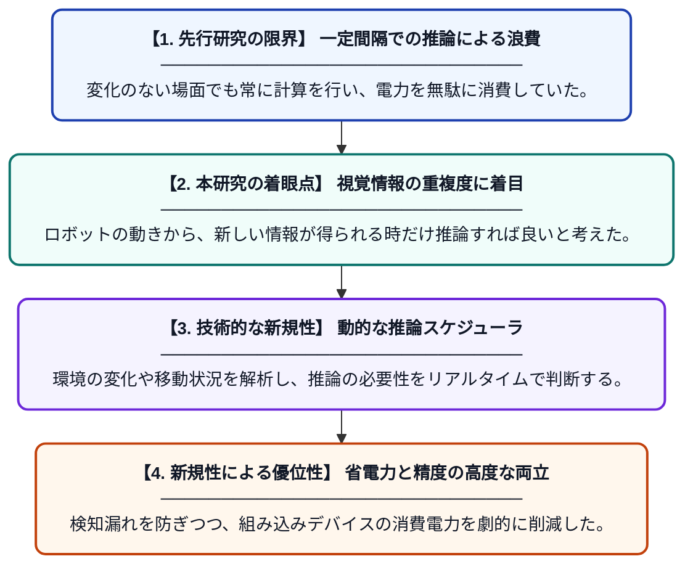

# 省電力ロボット自律走行のためのエネルギー効率を考慮したオープン語彙検知スケジューリング

**Original Title**: *Energy-Aware Open-Vocabulary Detection Scheduling for Low-Power Robotic Autonomy*

> **💡 一言要約**: 無駄な計算を賢く省いてロボットの電池を劇的に長持ちさせる

| 項目 | 内容 |
|---|---|
| **著者** | A Basit, M Shafique |
| **掲載誌** | arXiv preprint arXiv:2611.07663 2026 |
| **アラートキーワード** | Open-Vocabulary Object ... |
| **PDF** | [https://arxiv.org/pdf/2611.07663](https://arxiv.org/pdf/2611.07663) |
| **原文リンク** | [https://arxiv.org/pdf/2611.07663](https://arxiv.org/pdf/2611.07663) |
| **PDF版要約** | [README.pdf](./README.pdf) |

---

## 📊 新規性の図解（先行研究との違いと本研究のブレークスルー）

## 📝 要約

オープン語彙物体検知（OVD）を搭載したロボットにおいて、無駄な計算を削減しバッテリー消費を抑えるスケジューリング手法を提案しています。ロボットが停止中や既知の場所を移動している際の「低価値なフレーム」での推論をスキップすることで、検知精度を維持しつつ電力効率を大幅に向上させました。

## ❓ どんな問題に取り組んだか

従来のオープン語彙物体検知は計算負荷が非常に高く、ロボットが同じ景色を見ている時や何も変化がない時でも一定間隔で推論を繰り返すため、バッテリーを急速に消耗します。特に計算資源が限られた組み込みデバイスでは、高い検知能力と長時間の自律走行を両立させることが困難でした。

## ✨ 何が新しい？何がすごい？（新規性）

本研究の新規性は、ロボットの運動状態や環境の変化をリアルタイムに評価し、推論の実行タイミングを動的に決定する「エネルギー適応型スケジューリング」を導入した点にあります。従来の一律な推論とは異なり、地図の再訪問や安定した視点など、情報の重複が多い場面を検知して計算リソースを節約します。これにより、検知精度への影響を最小限に抑えながら、ロボットの運用時間を大幅に延長することに成功しました。

## 🎓 大学1年生向けの解説

ロボットが「目の前にあるものが何か」を判断するAIは、実はものすごく電気を使います。でも、ロボットが止まっている時や、さっき見た場所をもう一度通る時に、何度も必死に計算するのは効率が悪いです。この研究は、ロボットが「今は計算しなくて大丈夫」と賢く判断して手抜きをすることで、電池を長持ちさせる仕組みを作りました。これによって、賢いロボットがより長い時間、外で活動できるようになります。
