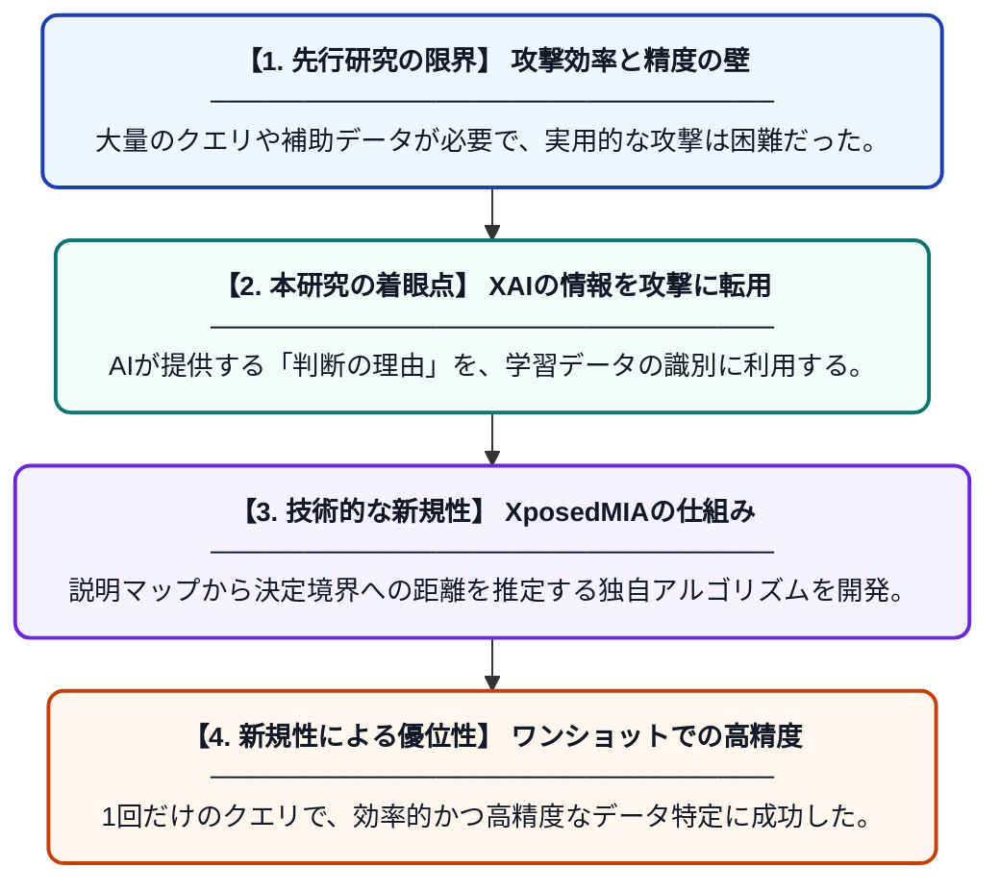

# 説明可能なAI（XAI）を悪用したワンショット・メンバーシップ推論攻撃

**Original Title**: *Exploiting Explainable Artificial Intelligence (XAI) for One-Shot Membership Inference Attacks*

> **💡 一言要約**: AIの説明機能がプライバシー漏洩の鍵になる

| 項目 | 内容 |
|---|---|
| **著者** | O Hamdache |
| **掲載誌** | 2026 |
| **アラートキーワード** | one shot |
| **原文リンク** | [https://search.proquest.com/openview/55605f83481e8d42538dc19fcd52b545/1?pq-origsite=gscholar&cbl=2026366&diss=y](https://search.proquest.com/openview/55605f83481e8d42538dc19fcd52b545/1?pq-origsite=gscholar&cbl=2026366&diss=y) |
| **PDF版要約** | [README.pdf](./README.pdf) |

---

## 📊 新規性の図解（先行研究との違いと本研究のブレークスルー）

## 📝 要約

AIの判断根拠を説明するXAIの情報を逆手に取り、特定のデータがモデルの学習に使われたかを特定する攻撃手法「XposedMIA」を提案しています。AIが提供する説明から決定境界までの距離を推定することで、わずか1回のクエリで高い精度のプライバシー侵害が可能であることを示しました。

## ❓ どんな問題に取り組んだか

従来のメンバーシップ推論攻撃（MIA）は、モデルの出力確率を何度も取得したり大量の補助データを必要としたりするため、攻撃の効率に限界がありました。また、良かれと思って導入されたXAIの「説明」機能が、どれほど深刻なプライバシーリスクを孕んでいるかは不明確でした。

## ✨ 何が新しい？何がすごい？（新規性）

本研究の核心は、XAIが出力する特徴量の重要度マップを、モデルの決定境界までの距離に変換する「XposedMIA」フレームワークを開発した点にあります。先行研究とは異なり、補助的なデータセットや複数のクエリを必要とせず、わずか1回のクエリで攻撃を完結させる「ワンショット攻撃」を実現しました。これにより、MLaaSプラットフォームが提供する説明機能が、攻撃者にとって強力な武器になり得ることを証明しました。

## 🎓 大学1年生向けの解説

AIが「なぜその答えを出したのか」を教えてくれる便利な機能（XAI）がありますが、実はそれがプライバシーを脅かすかもしれません。この研究は、AIの説明を分析することで、特定の個人のデータがAIの学習に使われたかどうかを、たった1回の質問で見破る方法を見つけました。AIが学習済みのデータに対しては、そうでないデータとは異なる「説明」の出し方をする癖を突いたものです。この発見は、AIの便利さとプライバシー保護のバランスをどう取るべきか、新しい課題を突きつけています。
