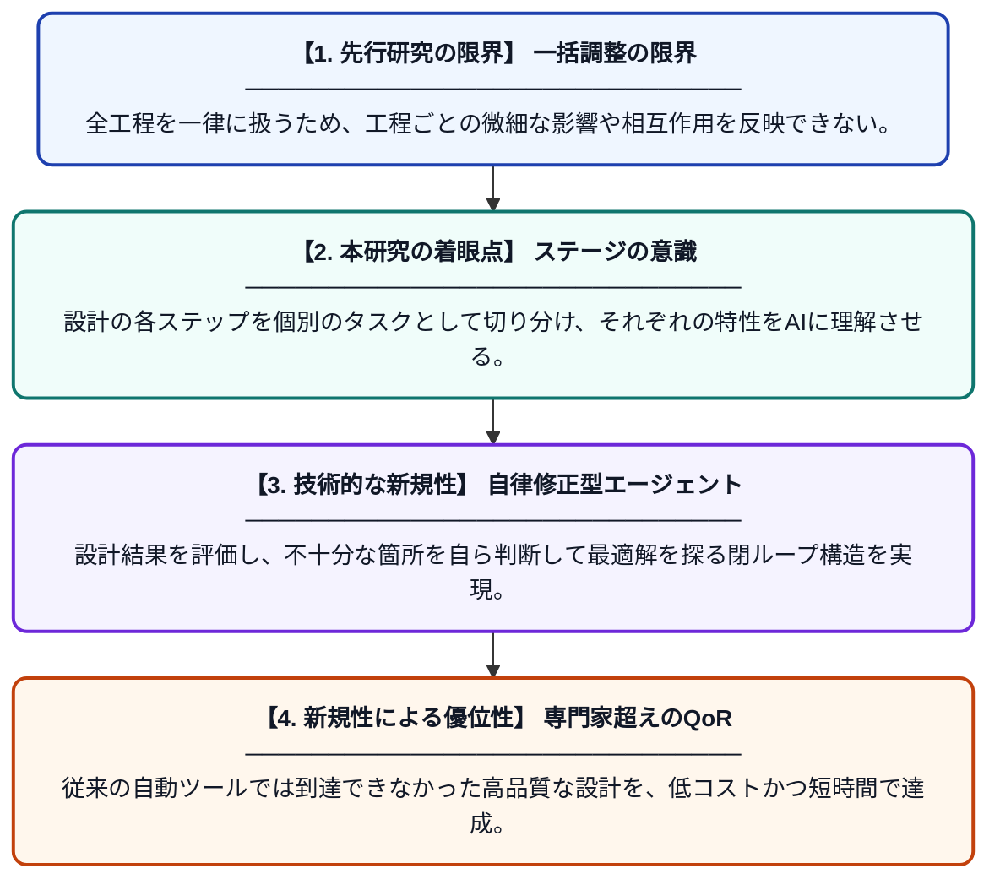

# AgenticPD：クローズドループ物理設計最適化のためのステージ認識型エージェントフレームワーク

**Original Title**: *AgenticPD: A Stage-Aware Agentic Framework for Closed-Loop Physical Design Optimization*

> **💡 一言要約**: 工程別AIエージェントが半導体設計を劇的に最適化

| 項目 | 内容 |
|---|---|
| **著者** | S Ren, Z Cheng, Y Han, L Shen, L Jin, W Tian, R Fu… |
| **掲載誌** | arXiv preprint arXiv … 2026 |
| **アラートキーワード** | optimization |
| **PDF** | [https://flians.github.io/pdf/AgenticPD.pdf](https://flians.github.io/pdf/AgenticPD.pdf) |
| **Git リポジトリ** | [https://github.com/Flians/AgenticPD](https://github.com/Flians/AgenticPD) |
| **原文リンク** | [https://flians.github.io/pdf/AgenticPD.pdf](https://flians.github.io/pdf/AgenticPD.pdf) |
| **PDF版要約** | [README.pdf](./README.pdf) |

---

## 📊 新規性の図解（先行研究との違いと本研究のブレークスルー）

## 📝 要約

半導体の物理設計（物理配置や配線）において、設計の各工程を個別に認識し最適化するAIエージェントフレームワーク「AgenticPD」を提案しました。従来の一括的なパラメータ調整とは異なり、設計結果をフィードバックとして受け取りながら試行錯誤を繰り返すことで、高品質な回路設計を効率的に実現します。

## ❓ どんな問題に取り組んだか

半導体設計の物理設計工程は、あるステージでの選択が後続工程に大きく影響するため、全体を最適化するのが非常に困難でコストがかかります。既存の手法は、設計全体を単一の数値調整問題として扱うか、LLMで単にスクリプトを生成するだけであり、工程間の複雑な相互作用を考慮した柔軟な修正ができていませんでした。

## ✨ 何が新しい？何がすごい？（新規性）

本研究の最大の特徴は、物理設計を「工程（ステージ）を理解したエージェントによる協調作業」として再定義した点にあります。配置や配線といった各段階に特化したエージェントが、実行結果を分析して自律的に戦略を練り直すクローズドループ環境を構築しました。これにより、従来のLLMベース手法を凌駕する設計品質（QoR）と、人間のような柔軟な意思決定の両立を達成しています。

## 🎓 大学1年生向けの解説

最新のスマートフォンなどのチップを作るには、何億もの部品をどこに置くか決める複雑な作業が必要です。今までは、すべての調整を一度に行うのが難しく、時間がかかっていました。この研究では、各作業ステップ（配置や配線など）に詳しい「AIの専門家チーム」を作り、チームで話し合いながら設計図を何度もブラッシュアップさせる仕組みを作りました。これにより、まるで人間が付きっきりで直しているかのような高い精度の設計が、AIによって自動でできるようになったのです。
