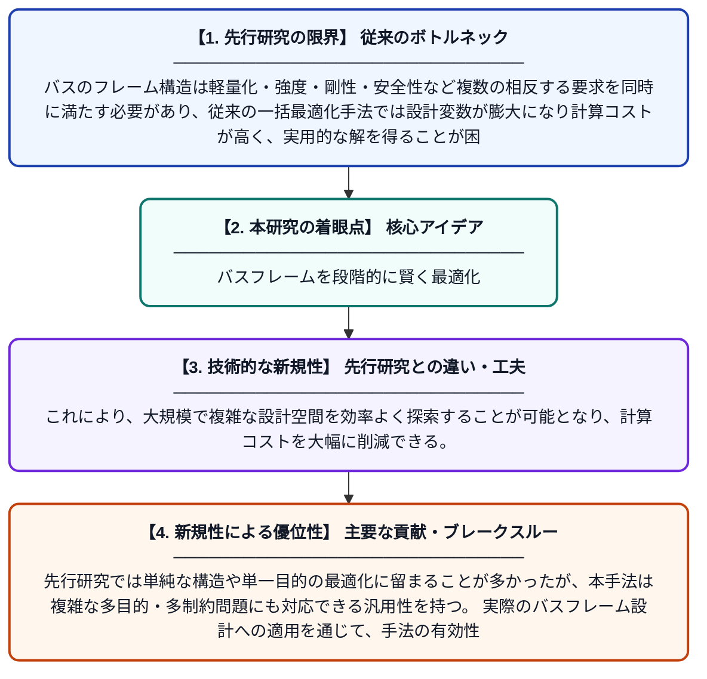

# バスフレームにおける梁構造のマルチレベル構造最適化設計

**Original Title**: *Multi-level structural optimization design of beam structures in bus frame: W. Xu et al*

> **💡 一言要約**: バスフレームを段階的に賢く最適化

| 項目 | 内容 |
|---|---|
| **著者** | W Xu, J Chen, A Tang, D Wang |
| **掲載誌** | Structural and Multidisciplinary Optimization 2026 |
| **アラートキーワード** | optimization |
| **原文リンク** | [https://link.springer.com/article/10.1007/s00158-026-04377-9](https://link.springer.com/article/10.1007/s00158-026-04377-9) |
| **PDF版要約** | [README.pdf](./README.pdf) |

---

## 📊 新規性の図解（先行研究との違いと本研究のブレークスルー）

## 📝 要約

本研究では、プラグインフルキャリングバスのフレームを構成する梁構造に対して、多段階（マルチレベル）の構造最適化設計手法を提案した。第1段階の最適化では全体的な構造レイアウトを決定し、続く段階でより詳細な設計変数を最適化することで、複雑な多目的最適化問題を効率的に解くことを実現している。提案手法は複雑な制約条件を持つ多目的最適化問題に広く適用可能であることが示された。

## ❓ どんな問題に取り組んだか

バスのフレーム構造は軽量化・強度・剛性・安全性など複数の相反する要求を同時に満たす必要があり、従来の一括最適化手法では設計変数が膨大になり計算コストが高く、実用的な解を得ることが困難であった。特にプラグインハイブリッド型のフルキャリングバスは構造的に複雑であり、効率的な最適化手法の開発が求められていた。

## ✨ 何が新しい？何がすごい？（新規性）

本研究の新規性は、従来の単一段階による最適化ではなく、問題を複数のレベルに分解して順次最適化するマルチレベル手法を採用した点にある。これにより、大規模で複雑な設計空間を効率よく探索することが可能となり、計算コストを大幅に削減できる。先行研究では単純な構造や単一目的の最適化に留まることが多かったが、本手法は複雑な多目的・多制約問題にも対応できる汎用性を持つ。実際のバスフレーム設計への適用を通じて、手法の有効性と実用性が実証されている。

## 🎓 大学1年生向けの解説

バスの骨格（フレーム）は、軽くて丈夫であることが求められますが、それを同時に満たす設計を見つけるのはとても難しい問題です。この研究では、その難しい設計問題を「まず大まかに決めて、次に細かく決める」という段階的な方法で解くアプローチを提案しました。一度に全部考えようとすると計算が大変すぎるため、問題を分けて順番に解くことで効率よく良い設計を見つけることができます。まるでテスト勉強を「まず全体を把握してから、苦手分野を重点的に勉強する」のと似た考え方です。この手法によって、実際のバス設計に役立つ軽量かつ安全なフレーム構造を提案することに成功しました。
