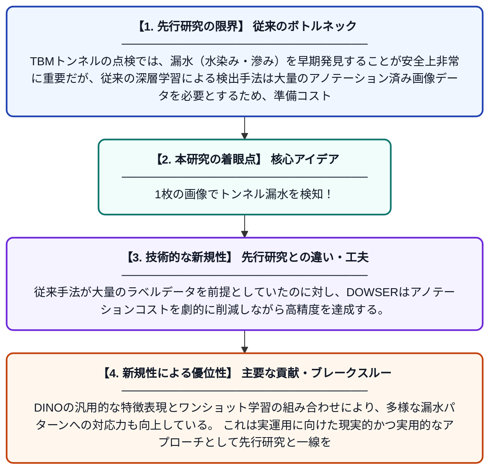

# TBMトンネル検査のためのDINOベースワンショット漏水認識ネットワーク「DOWSER」

**Original Title**: *DOWSER: A DINO-based One-shot Water Seepage Recognition network for TBM tunnel inspection*

> **💡 一言要約**: 1枚の画像でトンネル漏水を検知！

| 項目 | 内容 |
|---|---|
| **著者** | Z Ye, N Wang, H Zhu, Q Zhang, Z Li, J Ninić |
| **掲載誌** | Tunnelling and Underground Space Technology 2026 |
| **アラートキーワード** | one shot |
| **原文リンク** | [https://www.sciencedirect.com/science/article/pii/S0886779826005158](https://www.sciencedirect.com/science/article/pii/S0886779826005158) |
| **PDF版要約** | [README.pdf](./README.pdf) |

---

## 📊 新規性の図解（先行研究との違いと本研究のブレークスルー）

## 📝 要約

本論文では、TBM（トンネル掘削機）で掘られたトンネル内の漏水箇所を、たった1枚のアノテーション済みサンプルだけで高精度にセグメンテーション（領域分割）できるフレームワーク「DOWSER」を提案している。DINOと呼ばれる自己教師あり学習モデルの強力な特徴表現能力を活用し、従来の大量ラベルデータを必要とする手法の課題を克服している。これにより、トンネル点検における漏水検知の効率化・自動化が期待される。

## ❓ どんな問題に取り組んだか

TBMトンネルの点検では、漏水（水染み・滲み）を早期発見することが安全上非常に重要だが、従来の深層学習による検出手法は大量のアノテーション済み画像データを必要とするため、準備コストが高い。トンネル環境は照明条件や表面状態が複雑で、漏水領域の見た目も多様であるため、少ないデータで汎化性能を持つモデルを作ることが難しかった。

## ✨ 何が新しい？何がすごい？（新規性）

本研究の最大の新規性は、DINOという自己教師あり事前学習モデルが持つ豊かな視覚特徴を活用し、わずか1枚のアノテーション画像（ワンショット学習）でトンネル漏水のセグメンテーションを実現した点にある。従来手法が大量のラベルデータを前提としていたのに対し、DOWSERはアノテーションコストを劇的に削減しながら高精度を達成する。DINOの汎用的な特徴表現とワンショット学習の組み合わせにより、多様な漏水パターンへの対応力も向上している。これは実運用に向けた現実的かつ実用的なアプローチとして先行研究と一線を画す貢献である。

## 🎓 大学1年生向けの解説

地下を掘るトンネルでは、壁から水が染み出す「漏水」を早く見つけることがとても大切です。これを自動的にAIに見つけさせたいのですが、AIを学習させるためには普通たくさんの「正解データ」を人手で作る必要があり、それが大変でした。この研究では「DINO」という賢いAIの仕組みを使って、正解データがたった1枚だけでも漏水を正確に見つけられるシステム「DOWSER」を作りました。まるで人間が写真を1枚見ただけで似たものを探せるように、AIにも同じことをさせるイメージです。これにより、トンネルの安全点検をより簡単・迅速に自動化できるようになります。
