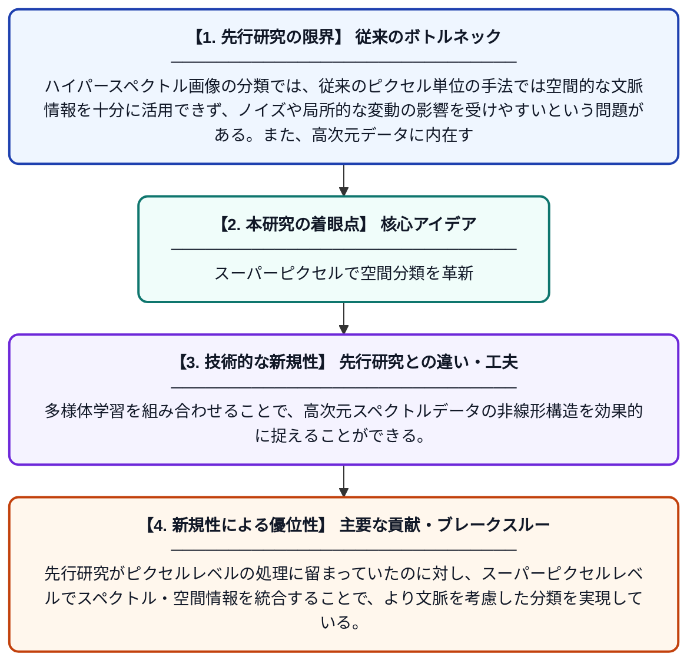

# ピクセル単位手法を超えて：ハイパースペクトル画像のスペクトル空間分類のためのスーパーピクセルレベルスペクトル類似度指標

**Original Title**: *Beyond pixel-wise methods: superpixel-level spectral similarity metric for spectral-spatial classification in hyperspectral images*

> **💡 一言要約**: スーパーピクセルで空間分類を革新

| 項目 | 内容 |
|---|---|
| **著者** | Y Wang, X Li, X Sun, E Zhao, C Yu |
| **掲載誌** | Optics & Laser Technology 2026 |
| **アラートキーワード** | manifold learning |
| **原文リンク** | [https://www.sciencedirect.com/science/article/pii/S0030399226013642](https://www.sciencedirect.com/science/article/pii/S0030399226013642) |
| **PDF版要約** | [README.pdf](./README.pdf) |

---

## 📊 新規性の図解（先行研究との違いと本研究のブレークスルー）

## 📝 要約

本論文は、ハイパースペクトル画像の分類において、従来のピクセル単位処理の限界を克服するため、スーパーピクセルを単位としたスペクトル類似度指標を提案している。多様体学習を活用することで、データの非線形な内在構造を捉え、スペクトル情報と空間情報を統合した高精度な分類を実現する。これにより、ノイズへの耐性向上と分類精度の改善が期待される。

## ❓ どんな問題に取り組んだか

ハイパースペクトル画像の分類では、従来のピクセル単位の手法では空間的な文脈情報を十分に活用できず、ノイズや局所的な変動の影響を受けやすいという問題がある。また、高次元データに内在する非線形構造を線形手法では適切に表現できないことも課題であった。

## ✨ 何が新しい？何がすごい？（新規性）

本研究は、個々のピクセルではなくスーパーピクセル（隣接する類似ピクセルのまとまり）を単位とする新しいスペクトル類似度指標を導入した点が独自性である。多様体学習を組み合わせることで、高次元スペクトルデータの非線形構造を効果的に捉えることができる。先行研究がピクセルレベルの処理に留まっていたのに対し、スーパーピクセルレベルでスペクトル・空間情報を統合することで、より文脈を考慮した分類を実現している。

## 🎓 大学1年生向けの解説

ハイパースペクトル画像とは、通常の写真よりもはるかに多くの色（波長）の情報を持つ特殊な画像で、農業や地質調査などに使われます。従来は画像の1点1点（ピクセル）を個別に分析していましたが、この研究では近くにある似た点をグループ（スーパーピクセル）にまとめて分析する方法を提案しています。グループ単位で分析することで、周囲との関係を考慮できるため、より正確に地面の種類や物質を識別できるようになります。また、データの複雑な構造を「多様体学習」という手法で読み解くことで、精度がさらに向上しています。
