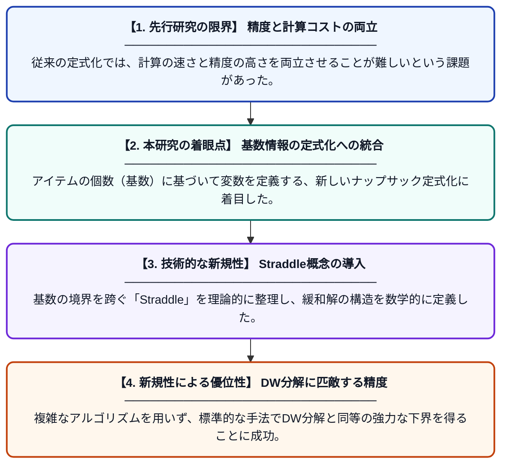

# Straddleと基数インデックス付きナップサック定式化のDantzig–Wolfe下界

**Original Title**: *Straddles and the Dantzig–Wolfe Bound of Cardinality-Indexed Knapsack Formulations*

> **💡 一言要約**: ナップサック問題の強力な下界を効率的に導き出す

| 項目 | 内容 |
|---|---|
| **著者** | MS Anjum, J Desai, I Murthy |
| **アラートキーワード** | generalized assignment ... |
| **PDF** | [https://optimization-online.org/wp-content/uploads/2026/11/main-4.pdf](https://optimization-online.org/wp-content/uploads/2026/11/main-4.pdf) |
| **原文リンク** | [https://optimization-online.org/wp-content/uploads/2026/11/main-4.pdf](https://optimization-online.org/wp-content/uploads/2026/11/main-4.pdf) |
| **PDF版要約** | [README.pdf](./README.pdf) |

---

## 📊 新規性の図解（先行研究との違いと本研究のブレークスルー）

## 📝 要約

容量制約のあるリソースへアイテムを割り当てる整数計画問題において、基数（アイテム数）でインデックス化した新しいナップサック定式化を提案しました。この手法により、複雑な計算を要するDantzig–Wolfe分解と同等の強力な下界を効率的に得られることを理論的に証明しています。

## ❓ どんな問題に取り組んだか

一般化割当問題（GAP）などの組合せ最適化問題では、最適解を早く見つけるために、線形計画緩和による精度の高い「下界（バウンド）」が必要です。しかし、精度の高い下界を求める手法は計算が非常に複雑になるという課題がありました。

## ✨ 何が新しい？何がすごい？（新規性）

本研究は、アイテムの個数（基数）を変数の添え字に組み込む新しい定式化を導入し、その緩和解がDantzig–Wolfe分解の下界と数学的に一致することを解明しました。さらに、基数の境界を跨ぐ要素を「Straddle」として定義し、その構造を利用することで、複雑な分解アルゴリズムを使わずに強力な緩和モデルを構築できることを示しました。これにより、理論的な強固さと計算上の利便性を両立させています。

## 🎓 大学1年生向けの解説

「カバンに荷物を詰める」というようなパズル的な問題をコンピュータで解くとき、答えの目安（ヒント）をいかに正確に出せるかが重要です。この研究では、荷物の重さだけでなく「全部で何個入るか」という情報を数式にうまく組み込む方法を考えました。これによって、これまで非常に難しかった計算を、よりシンプルで正確な方法で解けるようにしたのがすごいところです。大学の数学やプログラミングで使う「最適化」の技術を大きく前進させる内容です。
