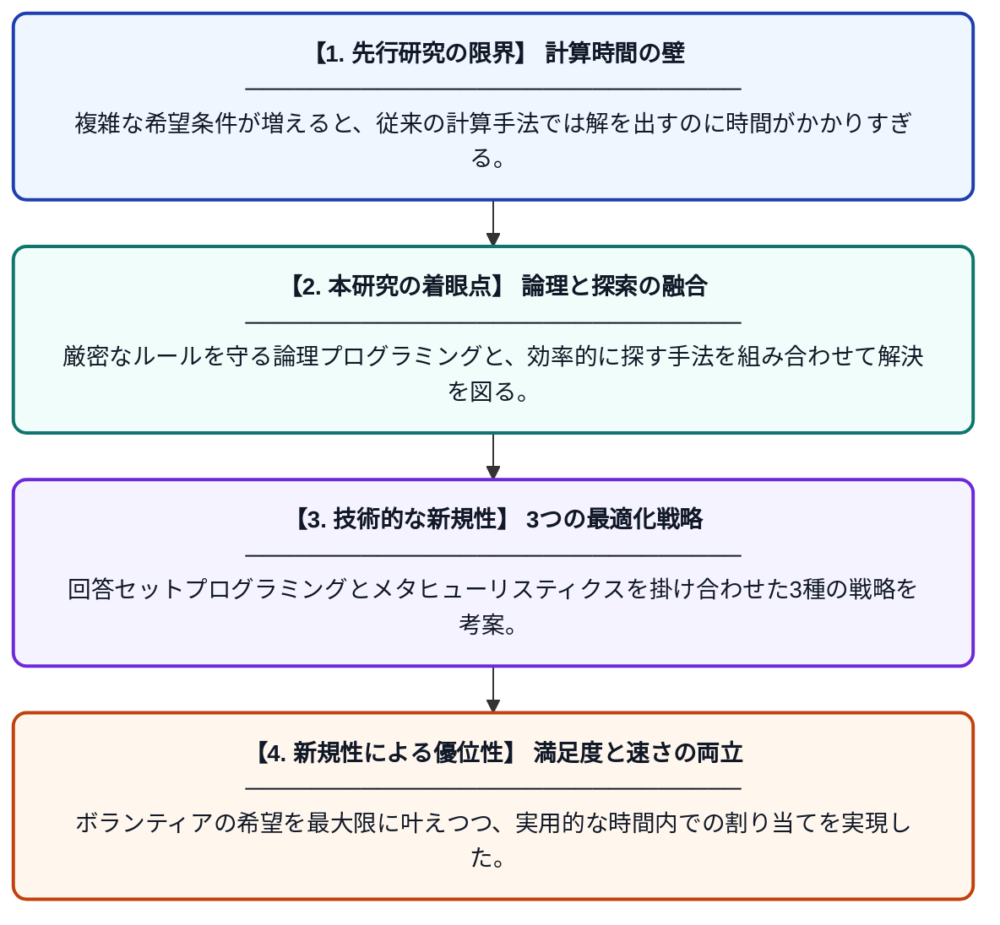

# ボランティアの希望を考慮した割り当て問題への回答セットプログラミングとメタヒューリスティクスの適用

**Original Title**: *Applying Answer Set Programming and Metaheuristics to the Volunteer Assignment Problem with Preferences*

> **💡 一言要約**: AIと最適化手法でボランティアの希望を最大化

| 項目 | 内容 |
|---|---|
| **著者** | FR Dutra, TP Valente, CV Araújo, AM Arruda |
| **掲載誌** | Encontro Nacional de Inteligência … 2026 |
| **アラートキーワード** | generalized assignment ... |
| **PDF** | [https://sol.sbc.org.br/index.php/eniac/article/download/47079/46836](https://sol.sbc.org.br/index.php/eniac/article/download/47079/46836) |
| **Git リポジトリ** | [https://github.com/FRianOD/VAP-Artigo](https://github.com/FRianOD/VAP-Artigo) |
| **原文リンク** | [https://sol.sbc.org.br/index.php/eniac/article/download/47079/46836](https://sol.sbc.org.br/index.php/eniac/article/download/47079/46836) |
| **PDF版要約** | [README.pdf](./README.pdf) |

---

## 📊 新規性の図解（先行研究との違いと本研究のブレークスルー）

## 📝 要約

ボランティアの希望を最大限に反映しつつ最適な配置を決定する「ボランティア割り当て問題」に対し、計算効率を高める手法を提案した研究です。NP困難とされる複雑な組み合わせ問題に対し、回答セットプログラミング（ASP）とメタヒューリスティクスを組み合わせた3つの戦略を評価し、実用的な解決策を示しています。

## ❓ どんな問題に取り組んだか

ボランティアの割り当ては、参加者の多様な希望や制約を考慮する必要があり、組み合わせが膨大になるため計算が非常に困難（NP困難）です。これまでの総当たり的な手法では、現実的な時間内に最適な配置を見つけることができず、運営上の大きな課題となっていました。

## ✨ 何が新しい？何がすごい？（新規性）

論理的な制約を厳密に扱う回答セットプログラミング（ASP）と、広大な探索空間を効率的に調べるメタヒューリスティクスを融合させた点が最大の特徴です。ボランティアの満足度（希望の合致）を最大化するために、3つの異なる計算戦略を比較評価することで、精度の高い解を高速に導き出すフレームワークを構築しました。これにより、複雑な人間系の制約と数学的な最適化を同時に実現する新しいアプローチを提示しています。

## 🎓 大学1年生向けの解説

ボランティアのイベントで「誰がどの仕事をしたいか」という希望を全員分叶えるのは、パズルを解くように非常に難しい作業です。この研究では、コンピュータに「守るべきルール」と「みんなの希望」を教え、賢く答えを探させる特別なプログラム（ASPとメタヒューリスティクス）を開発しました。これを使えば、何千通りもある組み合わせの中から、みんなが一番ハッピーになれる配置図をあっという間に作ることができます。
