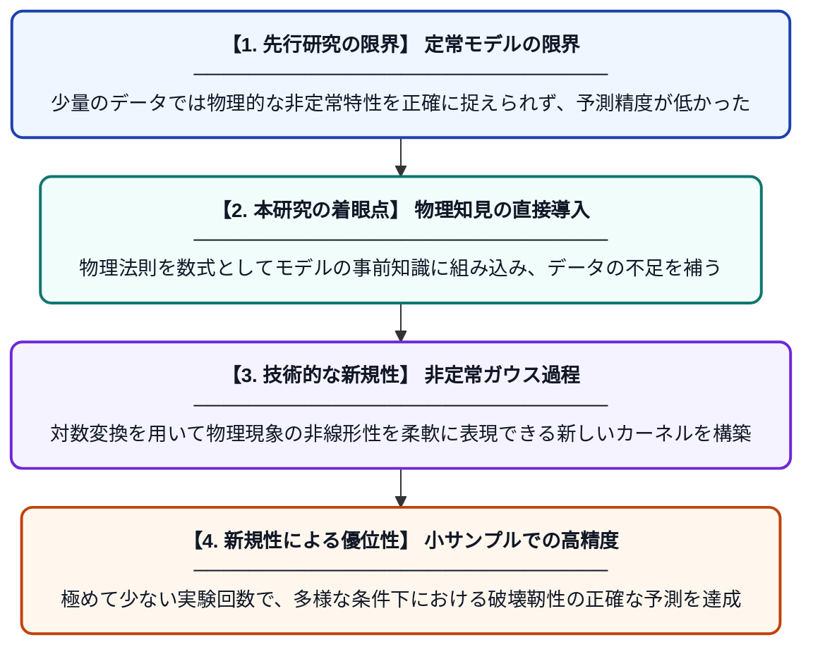

# 岩石-コンクリート界面の破壊靭性を小サンプルで予測する物理法則に基づいた非定常ガウス過程モデル

**Original Title**: *Physics-informed non-stationary Gaussian process for small-sample prediction of rock-concrete interface fracture toughness*

> **💡 一言要約**: 物理知識とAIの融合で、微小データから破壊を予測

| 項目 | 内容 |
|---|---|
| **著者** | H Jia, X He, J Liu, Y Song, L Wang |
| **掲載誌** | Theoretical and Applied Fracture Mechanics 2026 |
| **アラートキーワード** | gaussian process |
| **原文リンク** | [https://www.sciencedirect.com/science/article/pii/S0167844226006415](https://www.sciencedirect.com/science/article/pii/S0167844226006415) |
| **PDF版要約** | [README.pdf](./README.pdf) |

---

## 📊 新規性の図解（先行研究との違いと本研究のブレークスルー）

## 📝 要約

データが少ない環境下でも岩石とコンクリートの接合面の破壊靭性を高精度に予測できる、物理的知見を取り入れた非定常ガウス過程フレームワークを提案しました。対数変換を介して物理的な事前知識をモデルに埋め込むことで、従来の統計手法では困難だった複雑な物理特性の再現に成功しています。

## ❓ どんな問題に取り組んだか

ダムやトンネル等の構造物の安全評価において、岩石とコンクリートの界面の破壊靭性を把握することは不可欠ですが、実験コストが高くサンプル数が不足しがちです。また、破壊特性は条件により複雑に変化するため、従来の定常的なガウス過程モデルでは正確な予測が困難という課題がありました。

## ✨ 何が新しい？何がすごい？（新規性）

本研究の最大の貢献は、物理法則を対数変換の形で組み込んだ「非定常ガウス過程」を構築し、極小サンプルでの学習精度を飛躍的に向上させた点にあります。従来のモデルがデータの均質性を前提としていたのに対し、物理的背景に基づいた柔軟なカーネルを設計することで、非線形な物理現象をより忠実に表現できるようになりました。これにより、限られた実験データからでも広範な条件下での挙動を高い信頼性で予測可能です。

## 🎓 大学1年生向けの解説

岩石とコンクリートの「つなぎ目」がどれくらいの力で壊れるかを予測する研究です。通常、AIに予測させるには大量の実験データが必要ですが、この研究では「物理のルール」をあらかじめAIに教え込む工夫をしました。これにより、わずかな実験データしかなくても、まるでベテラン技術者のように正確な予測を出すことができます。この技術は、大きなダムや橋の安全性を少ないコストで守ることに役立ちます。
