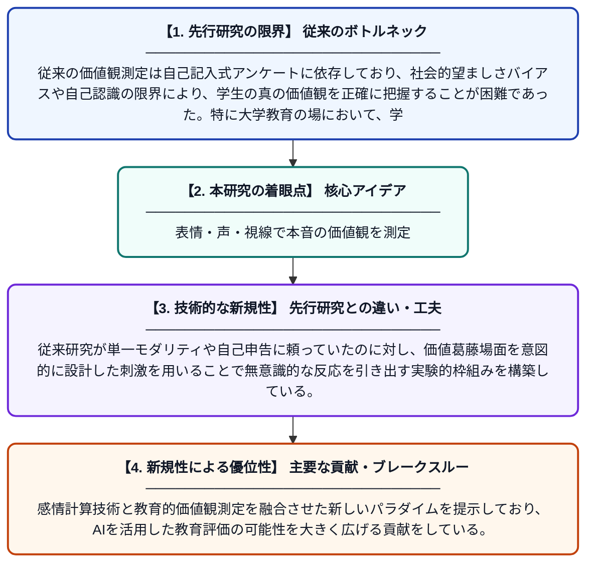

# マルチモーダル感情計算を活用した大学生の価値観の潜在的測定

**Original Title**: *Implicit measurement of college students' values driven by multimodal affective computing*

> **💡 一言要約**: 表情・声・視線で本音の価値観を測定

| 項目 | 内容 |
|---|---|
| **著者** | W Hu, D Wang |
| **掲載誌** | International Journal of Information and Communication Technology 2026 |
| **アラートキーワード** | affective computing |
| **PDF** | [https://www.inderscience.com/storage/f476819235111210.pdf](https://www.inderscience.com/storage/f476819235111210.pdf) |
| **原文リンク** | [https://www.inderscienceonline.com/doi/pdf/10.1504/IJICT.2026.155109](https://www.inderscienceonline.com/doi/pdf/10.1504/IJICT.2026.155109) |
| **PDF版要約** | [README.pdf](./README.pdf) |

---

## 📊 新規性の図解（先行研究との違いと本研究のブレークスルー）

## 📝 要約

本論文は、マルチモーダル感情計算を用いた価値観の潜在的測定パラダイムを提案する。価値観が対立する刺激に対する学生の微表情・音声韻律・視線追跡データを収集し、従来のアンケート調査では捉えられなかった無意識的な価値観を推定する手法を構築している。これにより、自己申告バイアスを排除した、より客観的な価値観測定が可能となる。

## ❓ どんな問題に取り組んだか

従来の価値観測定は自己記入式アンケートに依存しており、社会的望ましさバイアスや自己認識の限界により、学生の真の価値観を正確に把握することが困難であった。特に大学教育の場において、学生が意識的に操作しにくい潜在的な価値観を客観的に測定する手法が不足していた。

## ✨ 何が新しい？何がすごい？（新規性）

本研究は、微表情・音声韻律・視線追跡という三種類の生理的・行動的シグナルを組み合わせたマルチモーダルアプローチにより、価値観を非侵襲的かつ潜在的に測定する点が独創的である。従来研究が単一モダリティや自己申告に頼っていたのに対し、価値葛藤場面を意図的に設計した刺激を用いることで無意識的な反応を引き出す実験的枠組みを構築している。感情計算技術と教育的価値観測定を融合させた新しいパラダイムを提示しており、AIを活用した教育評価の可能性を大きく広げる貢献をしている。

## 🎓 大学1年生向けの解説

人が本当にどんな価値観（何を大切にしているか）を持っているかは、アンケートに答えてもらうだけでは正確にわかりません。なぜなら、人は「良い答え」を書こうとしてしまうからです。この研究では、わざと価値観が衝突するような場面を見せたときの「顔の微妙な変化（微表情）」「声のトーン」「目線の動き」をコンピュータで分析することで、本人も気づいていない本音の価値観を読み取ろうとしています。カメラやマイクなどの機器を使って自動的にデータを取るため、バイアスなく客観的に測定できるのが特徴です。将来的には、この技術を使って学生一人ひとりに合った教育ができるようになるかもしれません。
