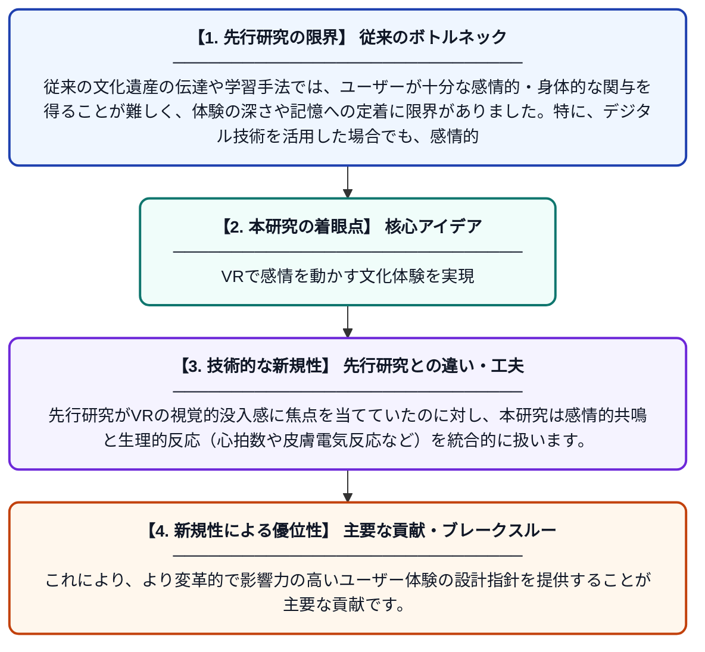

# バーチャルリアリティにおける没入型文化的ストーリーテリング：文化遺産と学習における感情的・生理的エンゲージメントの向上

**Original Title**: *Immersive Cultural Storytelling in Virtual Reality: Enhancing Affective and Physiological Engagement for Heritage and Learning*

> **💡 一言要約**: VRで感情を動かす文化体験を実現

| 項目 | 内容 |
|---|---|
| **著者** | V Soni, HM Chattoraj, V Dutt |
| **掲載誌** | Computing Conference 2026 |
| **アラートキーワード** | affective computing |
| **原文リンク** | [https://link.springer.com/chapter/10.1007/978-3-032-24804-6_28](https://link.springer.com/chapter/10.1007/978-3-032-24804-6_28) |
| **PDF版要約** | [README.pdf](./README.pdf) |

---

## 📊 新規性の図解（先行研究との違いと本研究のブレークスルー）

## 📝 要約

本論文は、バーチャルリアリティ（VR）を用いた文化的ストーリーテリングが、ユーザーの感情的・生理的な関与をどのように高めるかを探求しています。アフェクティブコンピューティングと人間とコンピュータのインタラクション（HCI）の観点から、感情的な共鳴と生理的反応がユーザー体験設計に与える影響を分析しています。文化遺産の継承と教育的学習における没入型体験の有効性を評価することを目的としています。

## ❓ どんな問題に取り組んだか

従来の文化遺産の伝達や学習手法では、ユーザーが十分な感情的・身体的な関与を得ることが難しく、体験の深さや記憶への定着に限界がありました。特に、デジタル技術を活用した場合でも、感情的共鳴や生理的反応を意図的に設計に組み込む取り組みは不足していました。

## ✨ 何が新しい？何がすごい？（新規性）

本研究は、VRによる没入型ストーリーテリングをアフェクティブコンピューティングと組み合わせ、文化遺産・学習分野における感情・生理的エンゲージメントを同時に計測・評価する点が新しいアプローチです。先行研究がVRの視覚的没入感に焦点を当てていたのに対し、本研究は感情的共鳴と生理的反応（心拍数や皮膚電気反応など）を統合的に扱います。これにより、より変革的で影響力の高いユーザー体験の設計指針を提供することが主要な貢献です。

## 🎓 大学1年生向けの解説

VR（バーチャルリアリティ）は、まるでその場にいるような体験ができる技術です。この研究では、VRを使って昔の文化や歴史をストーリーとして体験させると、人がどれだけ感情的に興奮したり、心拍数が上がったりするかを調べました。ゲームや映画を見るときにドキドキするように、VRでの文化体験でも同じような反応が起きるかを科学的に確かめようとしています。これにより、博物館や学校の授業をもっと印象的で楽しいものにできる可能性があります。
