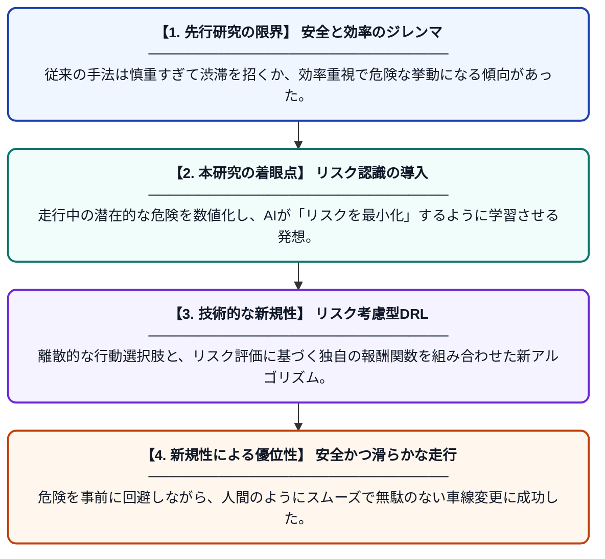

# 高速道路における安全かつ効率的な車線変更：リスクを考慮した深層強化学習アプローチ

**Original Title**: *Autonomous Driving in Highways with Safe and Efficient Lane Changes: Risk-Aware Deep Reinforcement Learning Approaches*

> **💡 一言要約**: リスクを先読みし安全に車線変更する自動運転AI

| 項目 | 内容 |
|---|---|
| **著者** | P Lamei, M Haeri |
| **掲載誌** | AUT Journal of Electrical Engineering 2026 |
| **アラートキーワード** | reinforcement |
| **PDF** | [https://eej.aut.ac.ir/article_6252_fe74074593f21197b7b7be3c08678616.pdf](https://eej.aut.ac.ir/article_6252_fe74074593f21197b7b7be3c08678616.pdf) |
| **原文リンク** | [https://eej.aut.ac.ir/article_6252_fe74074593f21197b7b7be3c08678616.pdf](https://eej.aut.ac.ir/article_6252_fe74074593f21197b7b7be3c08678616.pdf) |
| **PDF版要約** | [README.pdf](./README.pdf) |

---

## 📊 新規性の図解（先行研究との違いと本研究のブレークスルー）

## 📝 要約

高速道路での自動運転において、安全性と走行効率を両立させるための深層強化学習フレームワークを提案しています。リスク認識機能を意思決定プロセスに組み込むことで、複雑な交通流の中でも安全かつ円滑な車線変更を可能にしました。

## ❓ どんな問題に取り組んだか

従来の自動運転システムでは、効率を求めると危険な挙動になり、安全性を優先しすぎると交通の流れを妨げるというジレンマがありました。特に高速道路における動的な車線変更は、周囲の車両との相互作用が複雑で、安全な判断を下すことが困難でした。

## ✨ 何が新しい？何がすごい？（新規性）

本研究の最大の貢献は、離散的なアクションスペースとリスク認識モデルを統合した新しい深層強化学習の枠組みを構築した点にあります。先行研究とは異なり、衝突リスクを動的に評価して報酬設計に直接反映させることで、予測困難な他車の動きに対しても高い適応力を示します。これにより、極めて高い安全性レベルを維持しながら、渋滞を招かない効率的な走行軌道を実現しました。

## 🎓 大学1年生向けの解説

高速道路で車を運転する時、隣の車が急に近づいてきたり、速い車が後ろから来たりすると怖いですよね。この研究は、AIに「危ないかもしれない」というリスクを感じ取る能力を教え、周囲の状況を賢く判断して車線を変える技術です。人間が「今なら安全に追い越せる」と判断するような感覚を、コンピュータが学習できるようにしました。これによって、事故を起こさず、かつスムーズに走れる自動運転車の実現を目指しています。
