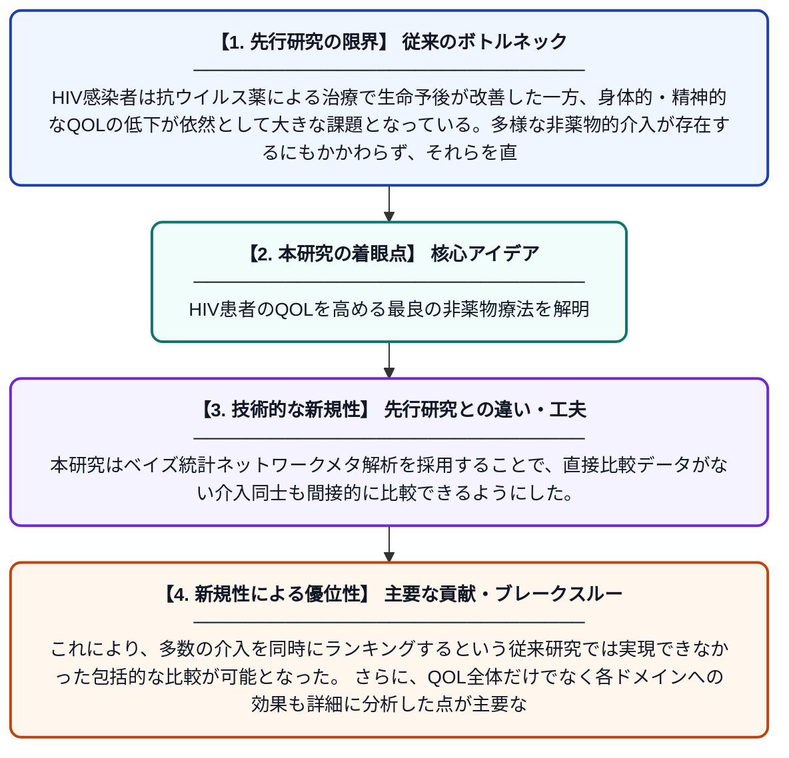

# HIV感染者の健康関連QOL改善における非薬物的介入の有効性：ランダム化比較試験のベイズ統計ネットワークメタ解析

**Original Title**: *Efficacy of Non‐Pharmacological Interventions in Improving Health‐Related Quality of Life in People Living With HIV: A Bayesian Network Meta‐Analysis of Randomized Controlled Trials*

> **💡 一言要約**: HIV患者のQOLを高める最良の非薬物療法を解明

| 項目 | 内容 |
|---|---|
| **著者** | M Shi, Y Zhou |
| **掲載誌** | Worldviews on Evidence‐Based Nursing 2026 |
| **アラートキーワード** | bayesian network |
| **原文リンク** | [https://pmc.ncbi.nlm.nih.gov/articles/PMC13402781/](https://pmc.ncbi.nlm.nih.gov/articles/PMC13402781/) |
| **PDF版要約** | [README.pdf](./README.pdf) |

---

## 📊 新規性の図解（先行研究との違いと本研究のブレークスルー）

## 📝 要約

本研究は、HIV感染者の健康関連QOL（生活の質）を改善するための複数の非薬物的介入（運動療法、心理的サポート、瞑想など）の有効性を、ベイズ統計ネットワークメタ解析を用いて比較・評価した。直接的・間接的エビデンスを統合することで、介入全体としての効果とQOLの各ドメイン（身体・精神など）への影響を包括的に分析した。これにより、どの非薬物的介入が最も効果的かをランキング形式で明らかにした。

## ❓ どんな問題に取り組んだか

HIV感染者は抗ウイルス薬による治療で生命予後が改善した一方、身体的・精神的なQOLの低下が依然として大きな課題となっている。多様な非薬物的介入が存在するにもかかわらず、それらを直接比較した研究は少なく、どの介入が最も効果的かについての明確なエビデンスが不足していた。

## ✨ 何が新しい？何がすごい？（新規性）

従来の研究では、個々の非薬物的介入の効果を単独で評価するものが多く、複数の介入を横断的に比較することが困難であった。本研究はベイズ統計ネットワークメタ解析を採用することで、直接比較データがない介入同士も間接的に比較できるようにした。これにより、多数の介入を同時にランキングするという従来研究では実現できなかった包括的な比較が可能となった。さらに、QOL全体だけでなく各ドメインへの効果も詳細に分析した点が主要な貢献である。

## 🎓 大学1年生向けの解説

HIVはウイルス感染症で、現在は薬で命を守れるようになりましたが、感染している人たちは体や心のつらさを抱えて生活しています。薬を使わずにQOL（生活の質）を高める方法には、運動や心理カウンセリング、瞑想などさまざまな種類があります。しかし、どの方法が一番効果的かはよくわかっていませんでした。この研究では、多くの研究データを特殊な統計手法（ベイズネットワークメタ解析）でまとめることで、複数の方法を同時に比較してランキングしました。その結果、HIV感染者のQOL改善に最も役立つ非薬物的なアプローチが明らかになりました。
