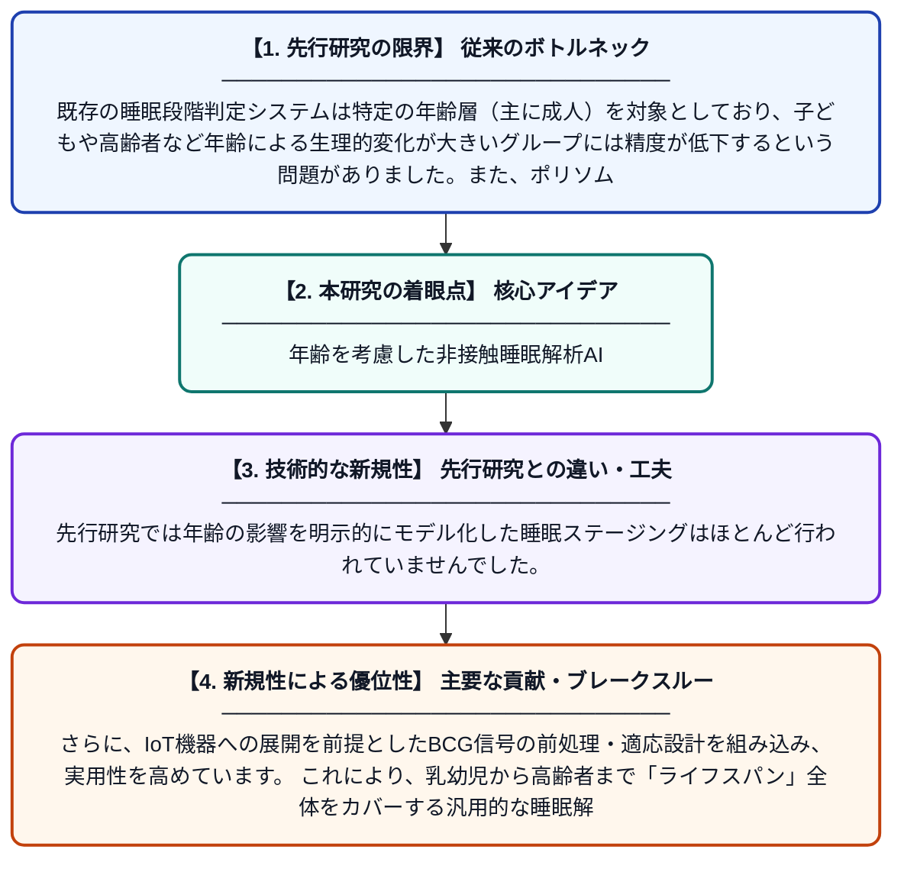

# AweSleep：年齢条件付き表現学習による非接触バリストカルジオグラム（BCG）を用いたライフスパン睡眠ステージング

**Original Title**: *AweSleep: Contactless Ballistocardiogram-based Sleep Staging Across the Lifespan with Age-Conditioned Representation Learning*

> **💡 一言要約**: 年齢を考慮した非接触睡眠解析AI

| 項目 | 内容 |
|---|---|
| **著者** | X Wang, R Gao, Q Zhang, D Lv, R Zhao, X Tang, H Yi |
| **掲載誌** | IEEE Internet of Things Journal 2026 |
| **アラートキーワード** | representation learning |
| **原文リンク** | [https://ieeexplore.ieee.org/abstract/document/11622444/](https://ieeexplore.ieee.org/abstract/document/11622444/) |
| **PDF版要約** | [README.pdf](./README.pdf) |

---

## 📊 新規性の図解（先行研究との違いと本研究のブレークスルー）

## 📝 要約

AweSleepは、ベッドに設置したセンサーで体の微細な振動（BCG信号）を非接触で計測し、子どもから高齢者まで幅広い年齢層の睡眠段階を自動判定するシステムです。年齢情報を学習の中核に据えた「年齢条件付き表現学習」という独自の設計により、年齢によって大きく異なる睡眠生理特性に対応します。IoTデバイスへの実装を前提とした実用的な設計が特徴です。

## ❓ どんな問題に取り組んだか

既存の睡眠段階判定システムは特定の年齢層（主に成人）を対象としており、子どもや高齢者など年齢による生理的変化が大きいグループには精度が低下するという問題がありました。また、ポリソムノグラフィ（PSG）のような従来の睡眠検査は電極の装着が必要で、日常的・長期的な利用が困難です。

## ✨ 何が新しい？何がすごい？（新規性）

AweSleepは非接触BCGセンサーと年齢情報を組み合わせた「年齢条件付き表現学習フレームワーク」を初めて導入し、年齢を付加情報ではなく学習の第一級要素として扱う点が革新的です。先行研究では年齢の影響を明示的にモデル化した睡眠ステージングはほとんど行われていませんでした。さらに、IoT機器への展開を前提としたBCG信号の前処理・適応設計を組み込み、実用性を高めています。これにより、乳幼児から高齢者まで「ライフスパン」全体をカバーする汎用的な睡眠解析が実現されました。

## 🎓 大学1年生向けの解説

睡眠の質を調べるには通常、病院で体中に電極を貼り付ける大掛かりな検査が必要です。AweSleepはベッドの下に置いたセンサーだけで、心臓の鼓動が体に伝わる微小な振動（BCG）を感知し、睡眠の深さを自動で判定します。人は年齢によって睡眠のパターンが大きく変わるため、AIに「今何歳の人を見ているか」を教えることで精度を上げる仕組みを考案しました。これにより、赤ちゃんからお年寄りまで、誰でも自宅で楽に睡眠検査ができるようになることを目指しています。
