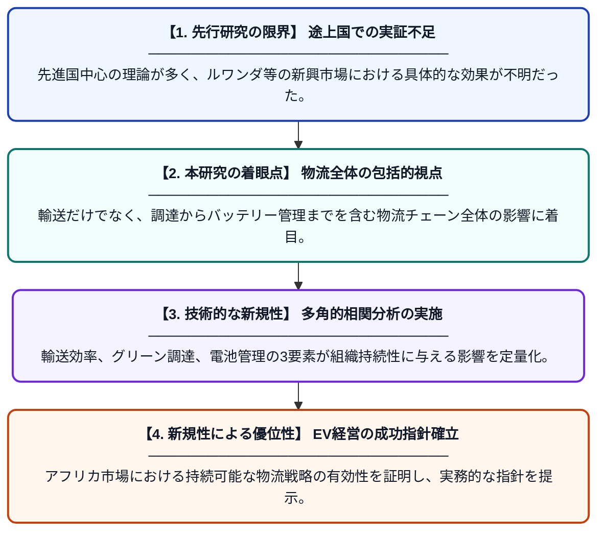

# ルワンダのKabisa Electricにおけるグリーンロジスティクス実践と組織の持続可能性の認識

**Original Title**: *Green Logistics Practices and Perceived Organisational Sustainability at Kabisa Electric in Rwanda*

> **💡 一言要約**: ルワンダのEV物流が切り拓く持続可能な企業経営

| 項目 | 内容 |
|---|---|
| **著者** | T Ndayishimiye, N Gitahi |
| **掲載誌** | Journal of Procurement & Supply Chain 2026 |
| **アラートキーワード** | logistics |
| **PDF** | [https://stratfordjournalpublishers.org/journals/index.php/journal-of-procurement-supply/article/download/3112/3804](https://stratfordjournalpublishers.org/journals/index.php/journal-of-procurement-supply/article/download/3112/3804) |
| **原文リンク** | [https://stratfordjournalpublishers.org/journals/index.php/journal-of-procurement-supply/article/download/3112/3804](https://stratfordjournalpublishers.org/journals/index.php/journal-of-procurement-supply/article/download/3112/3804) |
| **PDF版要約** | [README.pdf](./README.pdf) |

---

## 📊 新規性の図解（先行研究との違いと本研究のブレークスルー）

## 📝 要約

ルワンダの電気自動車（EV）企業を対象に、グリーンロジスティクスの導入が組織の持続可能性に与える影響を調査した研究です。電気輸送の効率化、グリーン調達、およびバッテリー管理の実践が、企業の環境的・経済的な持続可能性とどのように関連しているかを明らかにしています。

## ❓ どんな問題に取り組んだか

電気自動車の普及には、車両自体の性能だけでなく、部品調達やバッテリー廃棄といった物流プロセス全体の持続可能性が不可欠です。しかし、ルワンダのような新興市場において、これらのグリーンロジスティクス実践が実際に企業の持続可能性にどう寄与するかは十分に検証されていませんでした。

## ✨ 何が新しい？何がすごい？（新規性）

本研究は、東アフリカで急成長するEV市場の具体的事例（Kabisa Electric）を通じて、グリーンロジスティクスと組織の持続可能性の直接的な相関を実証した点に新規性があります。特に、単なる「輸送のクリーン化」にとどまらず、部品調達やバッテリーのライフサイクル管理を含めた統合的なアプローチが、組織運営の安定性とブランド価値に寄与することを具体的に示しました。これにより、発展途上国特有のインフラ環境下での持続可能なモビリティモデルを提示しています。

## 🎓 大学1年生向けの解説

この研究は、ルワンダで電気自動車を売っている会社が、どうすれば地球に優しく、かつビジネスとして長く続けていけるかを調べたものです。電気自動車を走らせるだけでなく、部品を買うときや使い終わった電池を処理するときまで「環境への配慮」を徹底することが、結果として会社の信頼や利益につながることを分析しています。環境を守ることが、実はビジネスを成功させる一番の近道になるということを教えてくれる内容です。
