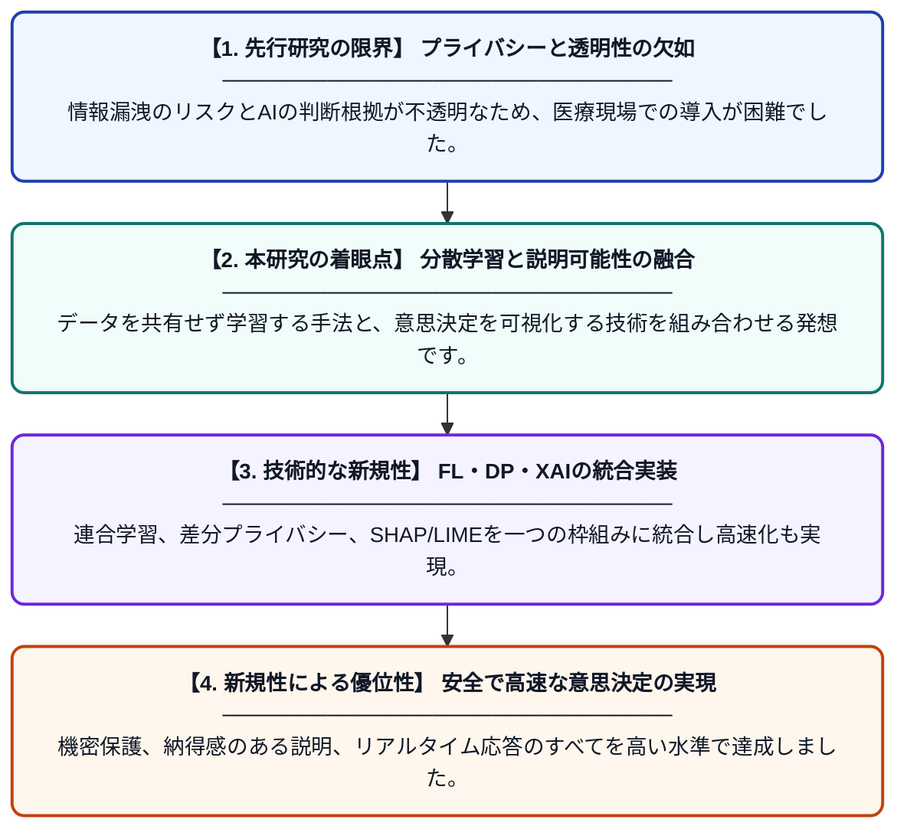

# 知的デジタルヘルスケアマーケティングのためのAI統合型プライバシー保護・説明可能フレームワーク

**Original Title**: *AI-Integrated Privacy-Preserving and Explainable Framework for Intelligent Digital Healthcare Marketing*

> **💡 一言要約**: 安全で納得感のある医療マーケティングAIの構築

| 項目 | 内容 |
|---|---|
| **著者** | UD Gohil |
| **掲載誌** | International Conference on Secure IoT and … 2026 |
| **アラートキーワード** | differential privacy |
| **原文リンク** | [https://ieeexplore.ieee.org/abstract/document/11746868/](https://ieeexplore.ieee.org/abstract/document/11746868/) |
| **PDF版要約** | [README.pdf](./README.pdf) |

---

## 📊 新規性の図解（先行研究との違いと本研究のブレークスルー）

## 📝 要約

患者のプライバシー保護とAIの意思決定の透明性を両立させた、新しいヘルスケアマーケティング用フレームワークを提案しています。連合学習と差分プライバシーを組み合わせてセキュリティを確保し、SHAPやLIMEを用いてAIの判断根拠を可視化します。

## ❓ どんな問題に取り組んだか

デジタルヘルスケアにおいて、患者の機密データ漏洩のリスクと、AIのマーケティング提案が「なぜそうなったのか」不明確であるブラックボックス問題が大きな障壁となっていました。また、リアルタイムで膨大なデータを処理する際の速度不足も課題でした。

## ✨ 何が新しい？何がすごい？（新規性）

本研究の核心は、連合学習(FL)と差分プライバシー(DP)を融合し、データを一箇所に集めることなく高度な匿名性を保ちながら学習する仕組みを実現した点にあります。さらに、SHAPとLIMEという説明可能AI技術を統合することで、マーケティング施策の根拠を明確に提示できるようにしました。加えて、独自のクエリフラグメント・キャッシング・アルゴリズムを導入し、リアルタイム処理の高速化にも成功しています。

## 🎓 大学1年生向けの解説

病院のデータを守りつつ、患者さんに役立つ情報をAIで届けるための研究です。従来はデータを集めると情報漏洩が心配でしたが、この技術ならデータを各所に置いたまま安全に学習できます。さらに、AIが「なぜその提案をしたのか」を人間にもわかる言葉で説明してくれるので、医師や患者も納得して使えます。処理も非常に速いので、待ち時間なくスムーズに動作します。
