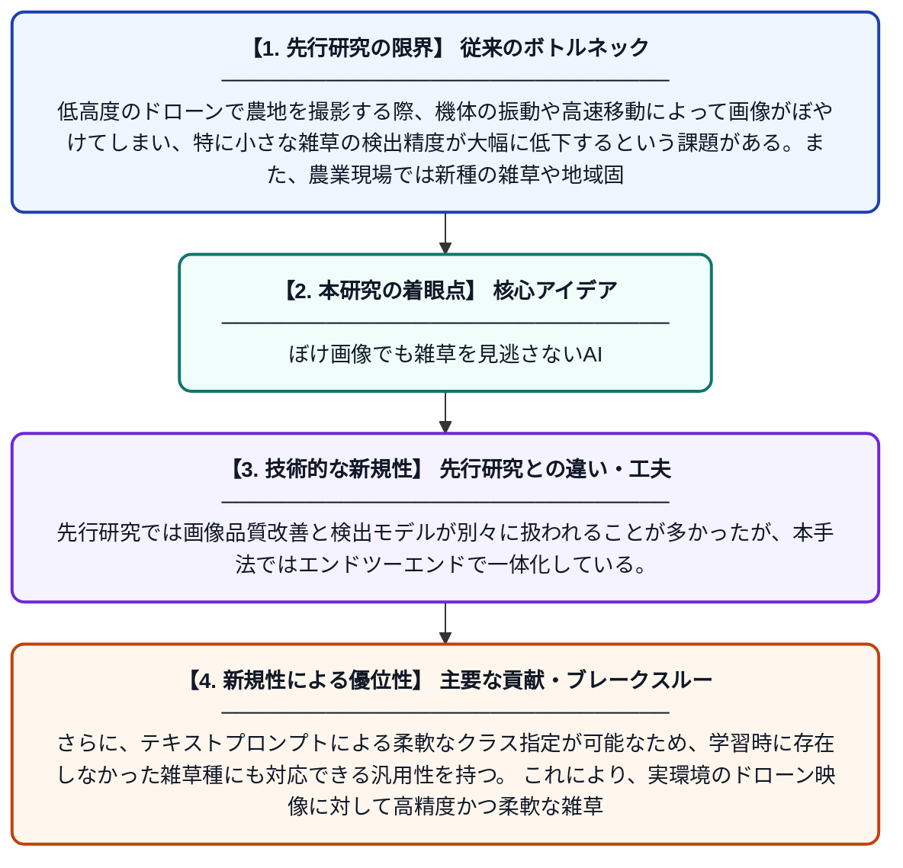

# WDB-YOLO-World: デブラリング強化によるオープン語彙雑草検出手法（低高度リモートセンシング向け）

**Original Title**: *WDB-YOLO-World: Deblurring-Enhanced Open-Vocabulary Weed Detection for Low-Altitude Remote Sensing*

> **💡 一言要約**: ぼけ画像でも雑草を見逃さないAI

| 項目 | 内容 |
|---|---|
| **著者** | S Yang, W Sun, Y Zang, X Gu, Y Yang |
| **掲載誌** | IEEE Journal of Selected Topics in Applied Earth Observations and Remote Sensing 2026 |
| **アラートキーワード** | Open-Vocabulary Object ... |
| **PDF** | [https://ieeexplore.ieee.org/iel8/4609443/4609444/11626540.pdf](https://ieeexplore.ieee.org/iel8/4609443/4609444/11626540.pdf) |
| **原文リンク** | [https://ieeexplore.ieee.org/iel8/4609443/4609444/11626540.pdf](https://ieeexplore.ieee.org/iel8/4609443/4609444/11626540.pdf) |
| **PDF版要約** | [README.pdf](./README.pdf) |

---

## 📊 新規性の図解（先行研究との違いと本研究のブレークスルー）

## 📝 要約

本論文は、低高度ドローン撮影で生じるぼやけた画像や小さな雑草の検出が困難な問題に対し、画像デブラリング（ぼけ除去）と小物体特徴強化を組み合わせた新しい雑草検出システム「WDB-YOLO-World」を提案する。YOLO-Worldのオープン語彙検出機能を活用し、事前に学習していない雑草の種類にも柔軟に対応できる。画像品質の改善と検出精度の向上を同時に実現することで、実用的な精密農業への応用を目指している。

## ❓ どんな問題に取り組んだか

低高度のドローンで農地を撮影する際、機体の振動や高速移動によって画像がぼやけてしまい、特に小さな雑草の検出精度が大幅に低下するという課題がある。また、農業現場では新種の雑草や地域固有の雑草が出現することも多く、従来の固定クラス型検出モデルでは対応が困難であった。

## ✨ 何が新しい？何がすごい？（新規性）

本研究は、オープン語彙検出モデルであるYOLO-Worldに画像デブラリングモジュールと小物体特徴強化機構を統合した点が新しい。先行研究では画像品質改善と検出モデルが別々に扱われることが多かったが、本手法ではエンドツーエンドで一体化している。さらに、テキストプロンプトによる柔軟なクラス指定が可能なため、学習時に存在しなかった雑草種にも対応できる汎用性を持つ。これにより、実環境のドローン映像に対して高精度かつ柔軟な雑草検出を実現した。

## 🎓 大学1年生向けの解説

農業では雑草を早く見つけて取り除くことが大切ですが、ドローンで畑を空撮すると画像がぼやけてしまい、小さな雑草を見落としやすくなります。この研究では、ぼやけを自動で補正する技術と、小さな物体を見つけやすくする技術を組み合わせた雑草検出AIを作りました。さらに、言葉（テキスト）で「この雑草を探して」と指示できるので、AIが知らない種類の雑草にも対応できます。スマホのカメラアプリで言葉を入力して何でも検索できるようなイメージです。これにより、農家さんが効率よく除草作業を行えるようになることが期待されています。
