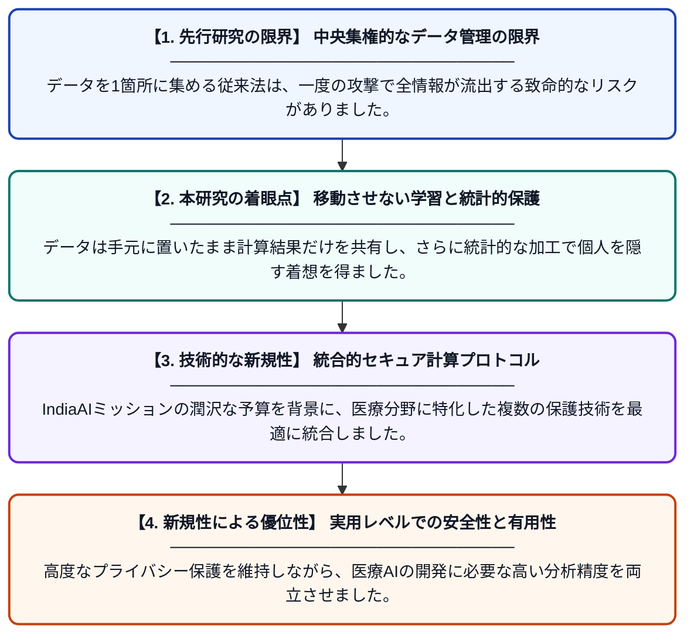

# 技術的枠組みを通じたデータ利活用と個人プライバシーの両立

**Original Title**: *Reconciling Data Utility with Personal Privacy through Technical Frameworks*

> **💡 一言要約**: AI時代のデータ利活用とプライバシーの最適解

| 項目 | 内容 |
|---|---|
| **著者** | P Ashok, S Joshi |
| **掲載誌** | IEEE World Skills Conference on Universal Data … 2026 |
| **アラートキーワード** | differential privacy |
| **原文リンク** | [https://ieeexplore.ieee.org/abstract/document/11766922/](https://ieeexplore.ieee.org/abstract/document/11766922/) |
| **PDF版要約** | [README.pdf](./README.pdf) |

---

## 📊 新規性の図解（先行研究との違いと本研究のブレークスルー）

## 📝 要約

本論文は、インドの「IndiaAIミッション」におけるフェデレーション学習や差分プライバシーなどのプライバシー保護技術の活用を論じています。特に医療分野のデジタルミッションを例に、データの有用性を損なうことなく個人の機密情報を守るための具体的な技術的枠組みを提案しています。

## ❓ どんな問題に取り組んだか

AIの発展には膨大なデータが必要ですが、特に医療データのような機密性の高い情報を集約することは、プライバシー侵害や情報漏洩の深刻なリスクを伴います。データの利活用と個人の保護をいかに技術的に両立させるかが、国家規模の重要課題となっています。

## ✨ 何が新しい？何がすごい？（新規性）

本研究は、インド政府が投じる10,372億ルピー規模の「IndiaAIミッション」という実社会の巨大プロジェクトを背景に、理論と実践を橋渡ししています。フェデレーション学習、差分プライバシー、秘密計算を統合した実用的なフレームワークを提示し、先行研究で課題だった「安全だが精度が低い」というトレードオフを、国家レベルのインフラ（ABDM）への適用を通じて解決しようとしている点が独創的です。

## 🎓 大学1年生向けの解説

インターネットやAIを便利にするためには、私たちのたくさんのデータが必要です。でも、病気の記録などが勝手に見られたり漏れたりするのは困りますよね。この論文では、データを1か所に集めずにAIを賢くする「連合学習」や、データに少しのノイズを混ぜて個人を特定できなくする技術を組み合わせて、秘密を守りつつ社会を良くする方法を解説しています。インドという大きな国が実際に挑戦している最先端の取り組みです。
