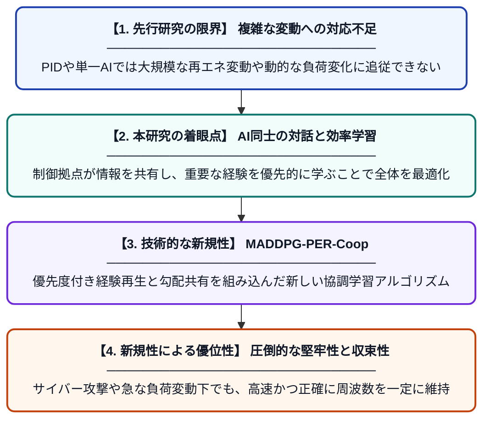

# 再生可能エネルギーを統合した電力系統における堅牢な周波数調整のための協調型マルチエージェント深層強化学習

**Original Title**: *Cooperative multi-agent deep reinforcement learning for robust frequency regulation in renewable-integrated power systems*

> **💡 一言要約**: 再エネの弱点をAIの「協調」で克服する

| 項目 | 内容 |
|---|---|
| **著者** | S Krishnaveni, R Muniraj, R Sambath, R Aruna |
| **掲載誌** | Scientific Reports 2026 |
| **アラートキーワード** | multi agent |
| **PDF** | [https://www.nature.com/articles/s41598-026-77350-7_reference.pdf](https://www.nature.com/articles/s41598-026-77350-7_reference.pdf) |
| **原文リンク** | [https://www.nature.com/articles/s41598-026-77350-7_reference.pdf](https://www.nature.com/articles/s41598-026-77350-7_reference.pdf) |
| **PDF版要約** | [README.pdf](./README.pdf) |

---

## 📊 新規性の図解（先行研究との違いと本研究のブレークスルー）

## 📝 要約

再生可能エネルギーの出力変動による電力網の不安定化を解決するため、新しい深層強化学習フレームワーク「MADDPG-PER-Coop」を提案しています。複数の制御エリアが協調して学習し、情報の共有と重要な経験の優先的な活用により、複雑な電力ネットワークの周波数を高精度に安定化させます。

## ❓ どんな問題に取り組んだか

太陽光や風力などの再生可能エネルギーは発電量が天候に左右されやすく、電力系統の周波数を一定に保つ自動発電制御（AGC）が非常に困難になります。従来のPID制御や単一のAI手法では、大規模で複雑なネットワーク全体の最適化や、急激な負荷変動・サイバー攻撃といった外乱への対応が不十分でした。

## ✨ 何が新しい？何がすごい？（新規性）

本研究の最大の貢献は、マルチエージェント深層決定論的ポリシー勾配（MADDPG）に「優先度付き経験再生（PER）」と「協調型勾配共有」を統合した点にあります。これにより、各エージェントは過去の重要な失敗・成功から効率的に学びつつ、他エリアのエージェントと情報を同期して全体最適を加速させることが可能になりました。先行研究と比較して、学習の収束速度が飛躍的に向上し、未知の負荷変動に対しても極めて高い堅牢性を実現しています。

## 🎓 大学1年生向けの解説

電気は「使う量」と「作る量」が常に一致していないと、周波数が乱れて停電や故障の原因になります。しかし、太陽光発電などは発電量がコロコロ変わるため、このバランス調整がとても難しいのが現状です。この論文では、複数のAIがチームを組んで、お互いに「今の状況はどう？」と教え合いながら、瞬時に発電量を微調整する仕組みを作りました。この「チームプレイ」のおかげで、不安定な自然エネルギーをたくさん導入しても、安心して電気が使えるようになります。
