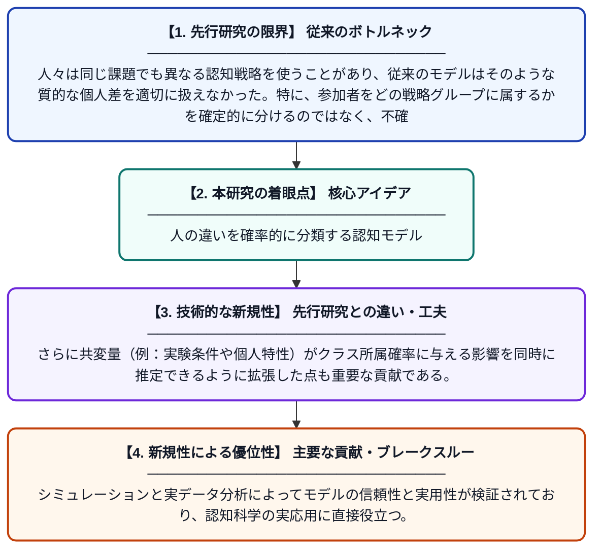

# ベイズ階層潜在混合モデルによる質的異質性と共変量のモデリング

**Original Title**: *Modeling Qualitative Heterogeneity and Covariates with Bayesian Hierarchical Latent-Mixtures*

> **💡 一言要約**: 人の違いを確率的に分類する認知モデル

| 項目 | 内容 |
|---|---|
| **著者** | S Zajdler, JN Rouder, M Schnuerch |
| **掲載誌** | Proceedings of the Annual Meeting of the Cognitive Science Society 2026 |
| **アラートキーワード** | Bayesian hierarchical ... |
| **原文リンク** | [https://escholarship.org/uc/item/46t0w60v](https://escholarship.org/uc/item/46t0w60v) |
| **PDF版要約** | [README.pdf](./README.pdf) |

---

## 📊 新規性の図解（先行研究との違いと本研究のブレークスルー）

## 📝 要約

本論文は、認知モデリングにおいてベイズ階層潜在混合モデルを用い、参加者間の質的な異質性（例えば、異なる認知戦略の使用）を確率的に分類する手法を提案する。さらに、共変量（性別や条件など）がその分類にどう影響するかを組み込んだ枠組みを構築し、広範なシミュレーションと実証データ（真偽判断に関する2つのデータセット）への適用によってその有用性を示した。

## ❓ どんな問題に取り組んだか

人々は同じ課題でも異なる認知戦略を使うことがあり、従来のモデルはそのような質的な個人差を適切に扱えなかった。特に、参加者をどの戦略グループに属するかを確定的に分けるのではなく、不確実性を保ちながらモデル化することが難しかった。

## ✨ 何が新しい？何がすごい？（新規性）

先行研究では個人差を量的（パラメータの大小）にしか扱えなかったが、本研究はベイズ階層モデルに潜在混合を組み込むことで質的な異質性（異なる戦略クラス）を確率的に識別できる点が新しい。さらに共変量（例：実験条件や個人特性）がクラス所属確率に与える影響を同時に推定できるように拡張した点も重要な貢献である。シミュレーションと実データ分析によってモデルの信頼性と実用性が検証されており、認知科学の実応用に直接役立つ。

## 🎓 大学1年生向けの解説

人はみんな同じように考えているわけではなく、例えばある問題を解くとき「戦略A」を使う人と「戦略B」を使う人がいます。この研究では、どの人がどの戦略を使っているかを確率的に推測する数学的な方法を作りました。さらに、その人の特徴（年齢や実験条件など）が戦略の選び方にどう関係するかも同時に調べられます。コンピューターシミュレーションと実際のデータを使って、この方法がうまく機能することを確かめました。
