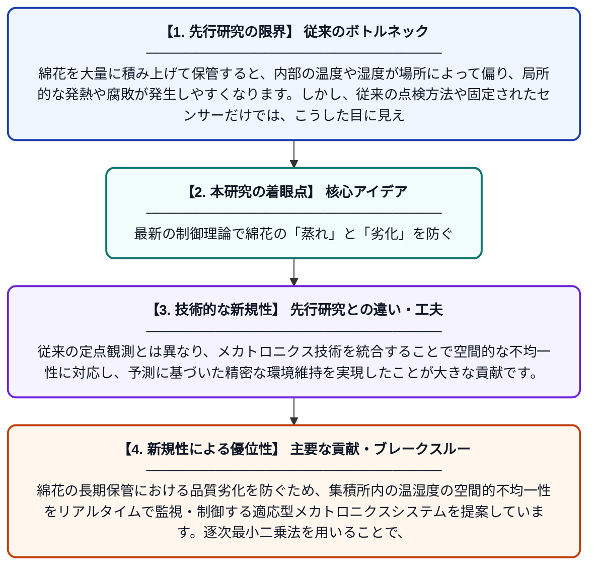

# 逐次最小二乗同定に基づく綿花集積所の温湿度条件の適応的メカトロニクス監視・制御

**Original Title**: *Adaptive Mechatronic Monitoring and Control of Thermal-Humidity Conditions in Stored Cotton Stacks Based on Recursive Least-Squares Identification*

> **💡 一言要約**: 最新の制御理論で綿花の「蒸れ」と「劣化」を防ぐ

| 項目 | 内容 |
|---|---|
| **著者** | I Sidikov, S Yuldashev |
| **掲載誌** | Intelligent Control and Automation 2026 |
| **アラートキーワード** | ICA |
| **原文リンク** | [https://www.scirp.org/journal/paperinformation%3Fpaperid%3D154734](https://www.scirp.org/journal/paperinformation%3Fpaperid%3D154734) |
| **PDF版要約** | [README.pdf](./README.pdf) |

---

## 📊 新規性の図解（先行研究との違いと本研究のブレークスルー）

## 📝 要約

綿花の長期保管における品質劣化を防ぐため、集積所内の温湿度の空間的不均一性をリアルタイムで監視・制御する適応型メカトロニクスシステムを提案しています。逐次最小二乗法を用いることで、複雑に変化する環境下でも正確な状態把握と最適な温度・湿度管理を可能にしました。

## ❓ どんな問題に取り組んだか

綿花を大量に積み上げて保管すると、内部の温度や湿度が場所によって偏り、局所的な発熱や腐敗が発生しやすくなります。しかし、従来の点検方法や固定されたセンサーだけでは、こうした目に見えない内部の危険な状態を早期に発見することが困難でした。

## ✨ 何が新しい？何がすごい？（新規性）

この研究の核心は、逐次最小二乗法（RLS）を用いて、保管環境の動的な変化をリアルタイムでモデル化し、適応的に制御する点にあります。従来の定点観測とは異なり、メカトロニクス技術を統合することで空間的な不均一性に対応し、予測に基づいた精密な環境維持を実現したことが大きな貢献です。

## 🎓 大学1年生向けの解説

綿花を大きな山にして置いておくと、実は中の方が熱を持ったり湿ったりして、放っておくとダメになってしまいます。この研究では、センサーとコンピュータを使って「今、山の中の状態がどうなっているか」を常に計算し、自動で調整する賢いシステムを作りました。いわば、綿花の山専用のハイテクな「全自動エアコン兼見守りロボット」のようなものです。これにより、大量の綿花を腐らせることなく安全に長持ちさせることができます。
