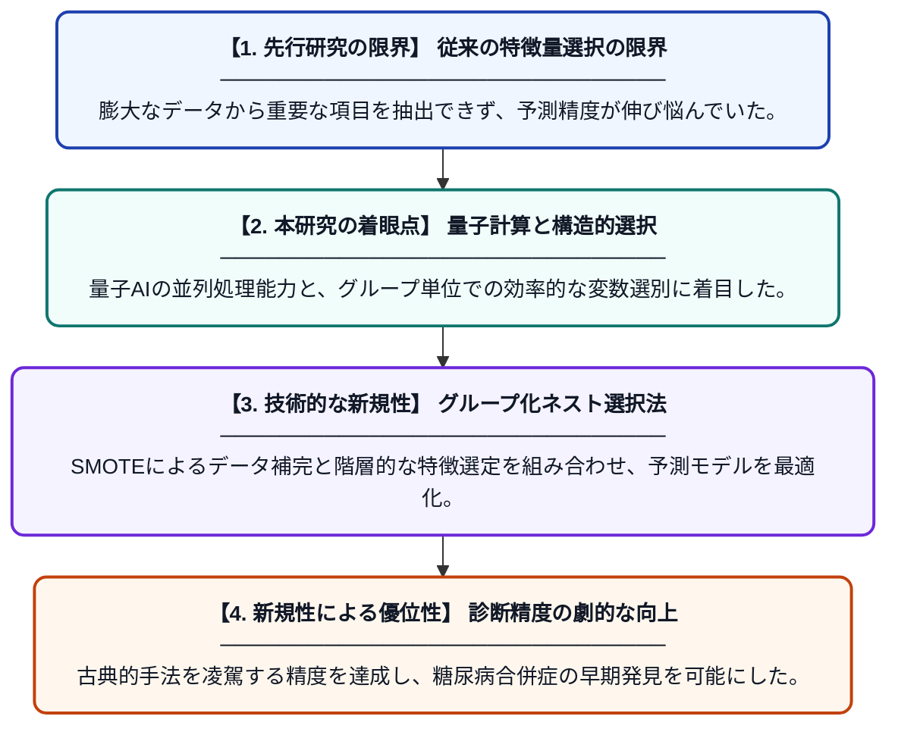

# 糖尿病および糖尿病網膜症予測のための、グループ化されたネスト型特徴選択を用いた古典的および量子機械学習

**Original Title**: *Classical and quantum machine learning with grouped nested feature selection for diabetes and diabetic retinopathy prediction*

> **💡 一言要約**: 量子×古典AIで糖尿病の合併症をより高精度に予測

| 項目 | 内容 |
|---|---|
| **著者** | HH Himal, E Jahan |
| **掲載誌** | Diabetes Research and Clinical Practice 2026 |
| **アラートキーワード** | SMOTE |
| **原文リンク** | [https://www.sciencedirect.com/science/article/pii/S016882272600598X](https://www.sciencedirect.com/science/article/pii/S016882272600598X) |
| **PDF版要約** | [README.pdf](./README.pdf) |

---

## 📊 新規性の図解（先行研究との違いと本研究のブレークスルー）

## 📝 要約

この研究は、糖尿病とその合併症である網膜症を早期に予測するため、古典的機械学習と量子機械学習を組み合わせた新しいアプローチを提案しています。データ不均衡を解消するSMOTE法と、重要な変数を効率的に抽出する「グループ化ネスト型特徴選択」を導入し、診断精度の向上を実現しました。

## ❓ どんな問題に取り組んだか

糖尿病および糖尿病網膜症の予測において、データの不均衡や膨大な特徴量から真に重要な変数を選び抜くことが困難であるという課題がありました。従来の機械学習のみでは複雑な生体データのパターンを捉えきれず、診断の信頼性を高めることが難しい状況にありました。

## ✨ 何が新しい？何がすごい？（新規性）

本研究の最大の特徴は、古典的な手法に量子機械学習（QML）を融合させ、さらに独自の「グループ化ネスト型特徴選択」を導入した点にあります。先行研究では単一の特徴選択が主流でしたが、本手法は階層的な構造で変数を選別することで、ノイズを抑えつつ予測能力を最大化しています。SMOTEを用いたデータ拡張との組み合わせにより、症例データが少ない状況でも極めて高い感度と特異度を両立させています。

## 🎓 大学1年生向けの解説

糖尿病は進行すると目に障害が出る「網膜症」を引き起こすため、AIを使って素早く正確に見つける技術が求められています。この研究では、最先端の「量子コンピュータ」の考え方を取り入れたAIと、たくさんの情報の中から本当に大事なヒントだけを賢く選ぶ新しい仕組みを組み合わせました。さらに、足りないデータを人工的に補う工夫も行うことで、今までのAIよりもはるかに正確に病気の兆候を捉えることに成功しています。
