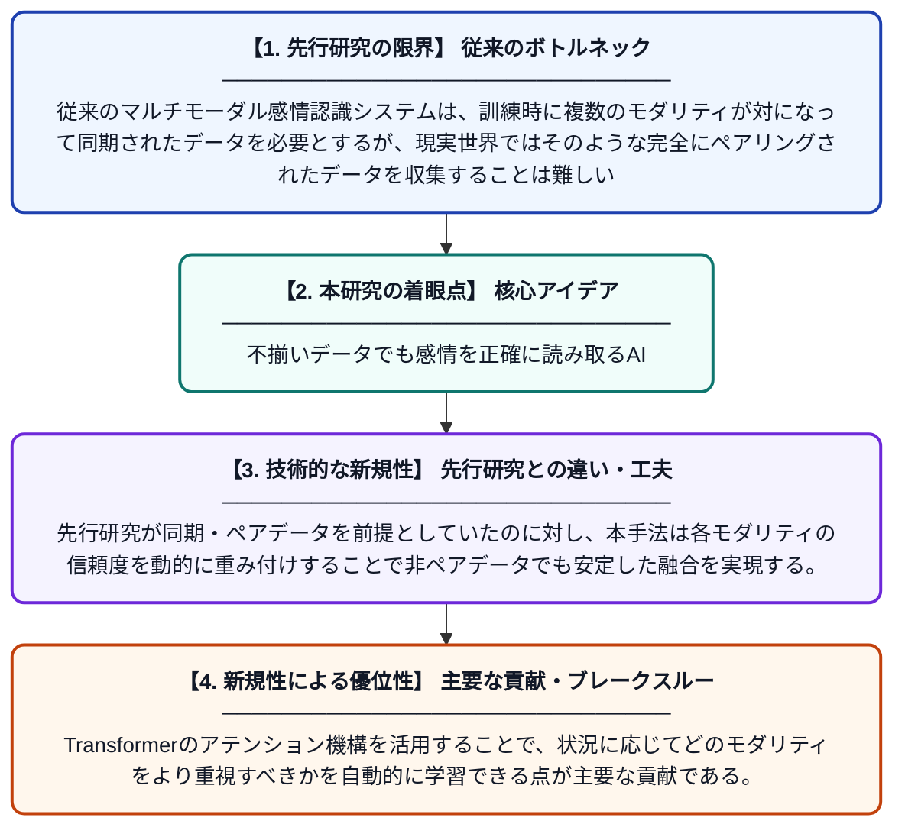

# 非ペアマルチモーダル感情認識のためのTransformerベース適応的決定融合

**Original Title**: *Transformer-Based Adaptive Decision Fusion for Non-Paired Multimodal Emotion Recognition*

> **💡 一言要約**: 不揃いデータでも感情を正確に読み取るAI

| 項目 | 内容 |
|---|---|
| **著者** | MK Ahmed, MA Ahmed |
| **掲載誌** | 2026 2nd International Symposium on AI-Driven 2026 |
| **アラートキーワード** | affective computing |
| **原文リンク** | [https://ieeexplore.ieee.org/abstract/document/11608092/](https://ieeexplore.ieee.org/abstract/document/11608092/) |
| **PDF版要約** | [README.pdf](./README.pdf) |

---

## 📊 新規性の図解（先行研究との違いと本研究のブレークスルー）

## 📝 要約

本論文は、音声・表情・テキストなど複数の情報源（モダリティ）を組み合わせて感情を認識するシステムにおいて、訓練データがペアリング・同期されていない場合でも機能する手法を提案する。Transformerアーキテクチャを活用した適応的な決定融合メカニズムにより、各モダリティの重要度を動的に調整しながら感情認識を行う。これにより、現実世界でよく起こる不完全・非同期なデータ環境での感情認識精度を向上させることを目指している。

## ❓ どんな問題に取り組んだか

従来のマルチモーダル感情認識システムは、訓練時に複数のモダリティが対になって同期されたデータを必要とするが、現実世界ではそのような完全にペアリングされたデータを収集することは難しい。データが欠損・非同期・非ペアの状況ではモデルの性能が大きく低下するという課題があった。

## ✨ 何が新しい？何がすごい？（新規性）

本研究は、ペアリングされていないマルチモーダルデータに対応するためにTransformerベースの適応的決定融合フレームワークを新たに提案した点が独自性として挙げられる。先行研究が同期・ペアデータを前提としていたのに対し、本手法は各モダリティの信頼度を動的に重み付けすることで非ペアデータでも安定した融合を実現する。Transformerのアテンション機構を活用することで、状況に応じてどのモダリティをより重視すべきかを自動的に学習できる点が主要な貢献である。

## 🎓 大学1年生向けの解説

人間の感情は表情・声・言葉など複数の手がかりから判断できますが、コンピュータにこれらを組み合わせて感情を理解させる研究があります。従来の方法では、これらの情報がきちんとセットになっていないと上手く動きませんでした。この研究では、バラバラのデータでも感情を認識できるよう、AIが自動的に「どの情報が今一番信頼できるか」を判断して組み合わせる仕組みを作りました。例えば、声のデータしかない場面でもちゃんと感情を推定できるようになります。
