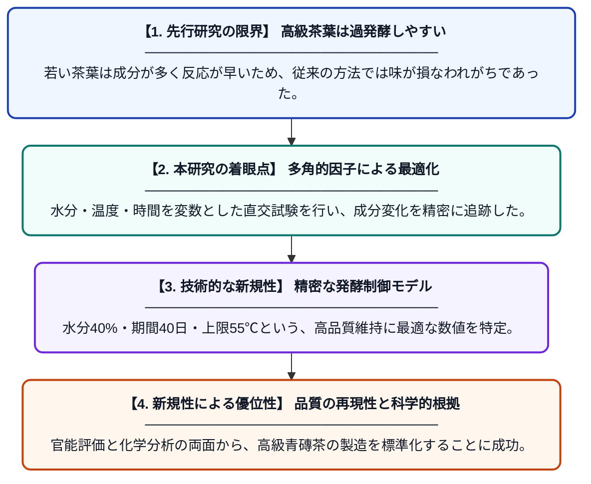

# 高嫩度な青磚茶の堆積発酵プロセスの最適化と品質分析

**Original Title**: *Optimization of pile-fermentation process and quality analysis of high-tenderness Qingzhuan tea*

> **💡 一言要約**: 高級茶葉で作る青磚茶の黄金発酵レシピを科学的に解明

| 項目 | 内容 |
|---|---|
| **著者** | Y He, P Liu, P Zheng, R Luo, S Gao, L Feng, Y Wang |
| **掲載誌** | Food Chemistry: X 2026 |
| **アラートキーワード** | optimization |
| **原文リンク** | [https://www.sciencedirect.com/science/article/pii/S2590157526012897](https://www.sciencedirect.com/science/article/pii/S2590157526012897) |
| **PDF版要約** | [README.pdf](./README.pdf) |

---

## 📊 新規性の図解（先行研究との違いと本研究のブレークスルー）

## 📝 要約

風味豊かな若い茶葉（一芽二・三葉）を用いた青磚茶の製造において、過発酵を防ぎつつ品質を最大限に引き出す堆積発酵の最適条件を特定しました。水分含有量、発酵温度、期間の相関を直交試験で解析し、官能評価と化学成分のバランスが最も優れた製造プロセスを確立しました。

## ❓ どんな問題に取り組んだか

青磚茶の品質は堆積発酵に依存しますが、従来の成熟した茶葉に比べ、成分が豊富な若い茶葉は発酵が進行しやすく、品質の制御が非常に困難でした。高級な原材料のポテンシャルを損なわずに、適切な発酵状態を維持するための具体的な指標が求められていました。

## ✨ 何が新しい？何がすごい？（新規性）

本研究は、管理が難しかった高嫩度茶葉に特化し、水分40%、発酵40日間、最高温度55℃という具体的な最適パラメーターを導き出した点が画期的です。単なる製造法の確立にとどまらず、カテキンやアミノ酸、香気成分の動態を網羅的に解析することで、品質向上と化学的変化の因果関係を明確にしました。これにより、高品質な黒茶の安定生産に向けた科学的根拠を提示しています。

## 🎓 大学1年生向けの解説

青磚茶（せいせんちゃ）という中国の伝統的なお茶は、茶葉を山のように積み上げて発酵させることで独特の風味を生み出します。しかし、柔らかくて美味しい高級な茶葉を使うと、発酵が進みすぎて味が台無しになってしまうのが大きな悩みでした。この研究では、温度や水分を細かく調整して実験を繰り返し、「最高に美味しくなるポイント」を突き止めました。これにより、誰でも美味しい高級なお茶を安定して作れるようになります。
