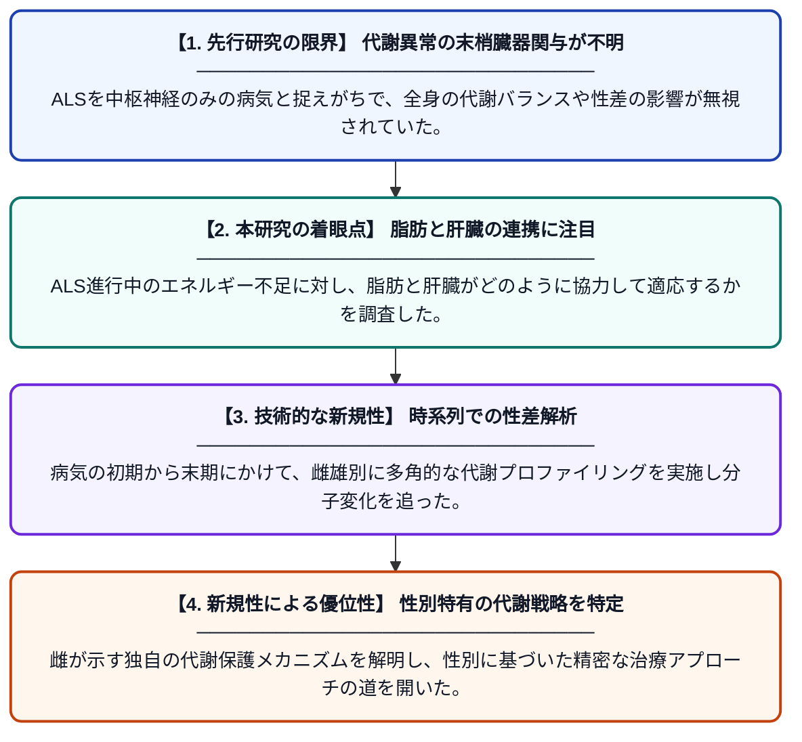

# TDP-43A315TマウスにおけるALS進行中の脂肪・肝臓の協調的代謝再編成と性差による末梢適応の解明

**Original Title**: *Coordinated adipose–liver metabolic remodelling reveals sex-specific peripheral adaptations during amyotrophic lateral sclerosis progression in TDP-43A315T mice*

> **💡 一言要約**: ALS進行には性別で異なる全身の代謝変化が関わっている

| 項目 | 内容 |
|---|---|
| **著者** | C Benito-Casado, Á Ferrer-Donato, G Barroso-García… |
| **掲載誌** | 2026 |
| **アラートキーワード** | ALS |
| **PDF** | [https://assets-eu.researchsquare.com/files/rs-11467142/v1/6a9d47ff-4858-47bf-b455-1c0f1505dd0a.pdf?c=1793176732](https://assets-eu.researchsquare.com/files/rs-11467142/v1/6a9d47ff-4858-47bf-b455-1c0f1505dd0a.pdf?c=1793176732) |
| **原文リンク** | [https://www.researchsquare.com/article/rs-11467142/latest.pdf](https://www.researchsquare.com/article/rs-11467142/latest.pdf) |
| **PDF版要約** | [README.pdf](./README.pdf) |

---

## 📊 新規性の図解（先行研究との違いと本研究のブレークスルー）

## 📝 要約

筋萎縮性側索硬化症（ALS）は全身性の代謝異常を伴う疾患ですが、末梢臓器の関与や性差については不明な点が多く残されています。本研究はALSモデルマウスを用い、病気の進行に伴って脂肪組織と肝臓が互いに連携しながら代謝を再構成していること、そしてその適応プロセスが雌雄で大きく異なることを明らかにしました。

## ❓ どんな問題に取り組んだか

ALSは単なる運動神経の病気ではなく全身のエネルギー代謝異常を伴いますが、これまで肝臓や脂肪といった末梢臓器の役割は十分に解明されていませんでした。特に、患者の性別によって病態の進行や代謝応答がどのように異なるのかという視点が欠けており、適切な治療ターゲットの特定を困難にしていました。

## ✨ 何が新しい？何がすごい？（新規性）

本研究はTDP-43A315T変異マウスを用い、脂肪組織と肝臓の「臓器間コミュニケーション」に焦点を当てた点が画期的です。病期ごとに詳細な解析を行った結果、雌（メス）は雄（オス）よりも脂肪燃焼やエネルギー維持の仕組みが柔軟に機能し、代謝の崩壊に対してより適応的であることを特定しました。これにより、ALSが全身性の代謝疾患であるという証拠を強固にし、性差を考慮した治療の重要性を科学的に示しました。

## 🎓 大学1年生向けの解説

ALSは筋肉が動かなくなる病気ですが、実は体の中のエネルギーをやりくりする「肝臓」や「脂肪」も大きく変化しています。この研究では、病気が進むときに体がどうやってエネルギー不足を補おうとするかを調べたところ、オスとメスでその方法が全く違うことがわかりました。メスの方がエネルギーの管理が上手で、病気に耐える力が強い可能性があり、この違いを知ることは将来の新しい治療法づくりにとても大切です。
