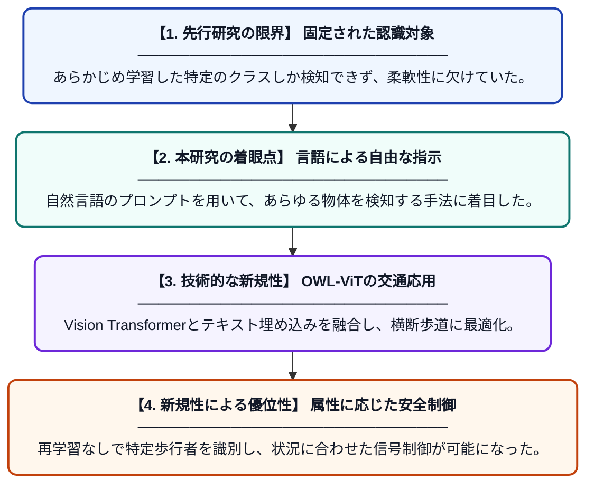

# OWL-ViTベースの歩行者検知を用いたスマート横断歩道制御

**Original Title**: *Smart Crosswalk Control Using OWL-ViT-Based Pedestrian Detection*

> **💡 一言要約**: 言葉で探す、次世代の賢い横断歩道検知システム

| 項目 | 内容 |
|---|---|
| **著者** | A Pučić, I Marković, I Lorencin |
| **掲載誌** | IEEE 24th International Symposium on … 2026 |
| **アラートキーワード** | Open-Vocabulary Object ... |
| **原文リンク** | [https://ieeexplore.ieee.org/abstract/document/11738563/](https://ieeexplore.ieee.org/abstract/document/11738563/) |
| **PDF版要約** | [README.pdf](./README.pdf) |

---

## 📊 新規性の図解（先行研究との違いと本研究のブレークスルー）

## 📝 要約

Vision Transformerを活用したオープン語彙検出モデル「OWL-ViT」を、スマート横断歩道の制御システムに応用する研究です。テキストによる指示（プロンプト）で対象を検知できるため、従来のシステムよりも柔軟に歩行者や特定の状況を識別できます。

## ❓ どんな問題に取り組んだか

従来の歩行者検知システムは、学習時に決めた特定の物体しか認識できない「クローズド語彙」の制限がありました。そのため、特殊な形状の移動補助具や、稀な状況下での歩行者を正確に捉えられないという課題がありました。

## ✨ 何が新しい？何がすごい？（新規性）

本研究の最大の特徴は、自然言語の指示で対象物を検出できるOWL-ViTを交通制御に導入した点にあります。追加の再学習を行うことなく、テキストを入力するだけで「車椅子の人」や「ベビーカー」など特定のカテゴリを即座に識別可能です。これにより、歩行者の属性に応じた信号時間の動的な延長など、高度で適応的な交通管理が実現します。

## 🎓 大学1年生向けの解説

従来の横断歩道センサーは、あらかじめ教えられた「人」という形しか見分けることができませんでした。この研究では、最新のAIを使って「言葉で指示したものを探す」技術を取り入れました。例えば「杖をついている人」と言葉で指示するだけで、その人をすぐに見つけ出し、安全に渡りきれるように信号の時間を調整するような、より優しい街づくりが可能になります。
