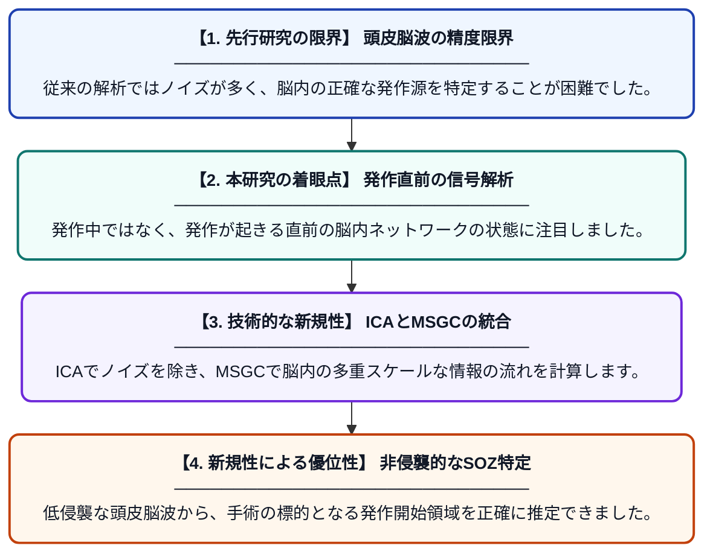

# 発作前の頭皮脳波を用いたソースレベル多重スケール・グレンジャー因果性による、薬剤耐性局在性てんかんの発作開始領域の特定

**Original Title**: *Source-Level Multiscale Granger Causality from Preictal Scalp EEG Identifies Candidate Seizure-Onset Zones in Drug-Resistant Focal Epilepsy*

> **💡 一言要約**: 頭皮脳波から発作の源を特定する新手法

| 項目 | 内容 |
|---|---|
| **著者** | S Kasradze, R Parajuli, G Lomidze, L Epremidze… |
| **掲載誌** | Brain Sciences 2026 |
| **アラートキーワード** | independent component ... |
| **原文リンク** | [https://www.mdpi.com/2076-3425/16/11/1176](https://www.mdpi.com/2076-3425/16/11/1176) |
| **PDF版要約** | [README.pdf](./README.pdf) |

---

## 📊 新規性の図解（先行研究との違いと本研究のブレークスルー）

## 📝 要約

薬剤耐性てんかん患者の頭皮脳波を解析し、発作直前のデータから発作開始領域（SOZ）を特定する新手法を開発しました。独立成分分析（ICA）でノイズを除去した信号に対し、脳内信号源レベルで多重スケール・グレンジャー因果性を用いることで、手術部位の決定に役立つ情報の抽出に成功しました。

## ❓ どんな問題に取り組んだか

薬剤耐性てんかんの手術では発作開始領域（SOZ）の特定が不可欠ですが、従来の頭皮脳波解析はノイズに弱く空間解像度が低いという課題がありました。特に、手術部位を正確に決定するためには、しばしば頭蓋内に電極を埋め込むなどの身体的負担が大きい検査が必要とされていました。

## ✨ 何が新しい？何がすごい？（新規性）

本研究の新規性は、ICAによる徹底したノイズ除去と、信号源レベルでの「多重スケール・グレンジャー因果性（MSGC）」を組み合わせた点にあります。単一の周波数だけでなく複数の時間スケールで脳領域間の情報流を評価することで、発作直前のわずか20秒のデータからSOZを高精度に推定することを可能にしました。これにより、非侵襲的な頭皮脳波のみで、侵襲的検査に近い詳細な発作源情報を提供できる可能性を示した点が大きな貢献です。

## 🎓 大学1年生向けの解説

てんかんの手術を成功させるには、脳のどの部分から発作が始まっているかを正確に見つける必要があります。これまでは脳に直接電極を刺さないと難しい場合がありましたが、この研究は頭の外側に貼る脳波計のデータを高度な数学的処理（MSGC）で分析し、脳の内部で電気がどう流れているかを計算しました。発作が起きる直前のたった20秒間の脳の状態を分析するだけで、原因部位を予測できます。将来、患者さんの体に負担をかけずに手術の成功率を高めることが期待されています。
