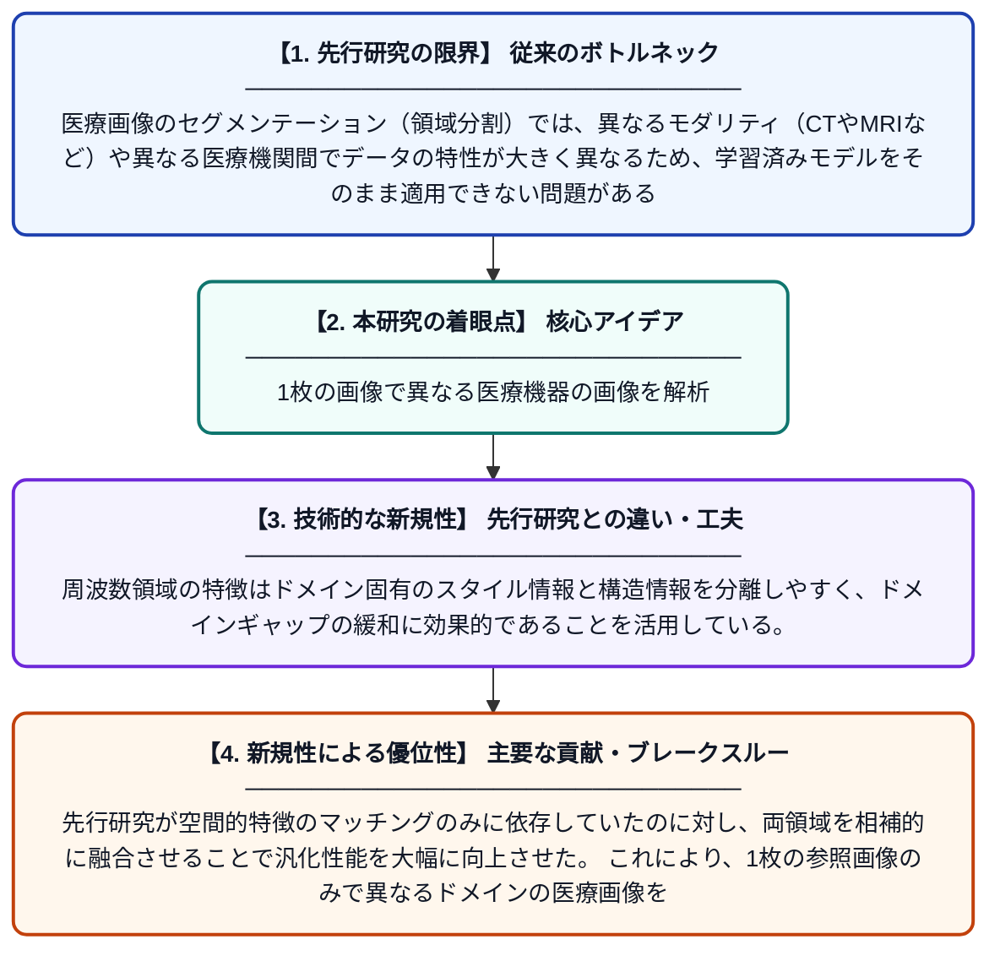

# クロスドメイン・ワンショット医療画像セグメンテーションのための周波数・空間協調マッチング

**Original Title**: *Frequency-Spatial Collaborative Matching for Cross-Domain One-Shot Medical Image Segmentation*

> **💡 一言要約**: 1枚の画像で異なる医療機器の画像を解析

| 項目 | 内容 |
|---|---|
| **著者** | C Jia, J Xue, S Mao, H Pei, K Dong, K Lu |
| **掲載誌** | IEEE Journal of Biomedical and Health Informatics |
| **アラートキーワード** | one shot |
| **原文リンク** | [https://pubmed.ncbi.nlm.nih.gov/42519853/](https://pubmed.ncbi.nlm.nih.gov/42519853/) |
| **PDF版要約** | [README.pdf](./README.pdf) |

---

## 📊 新規性の図解（先行研究との違いと本研究のブレークスルー）

## 📝 要約

本論文は、異なる撮影装置や施設間での医療画像セグメンテーションに対応するクロスドメイン・ワンショット手法を提案する。周波数領域と空間領域を協調的に活用することで、ドメイン間のギャップを効果的に橋渡しする新しいマッチングフレームワークを構築している。たった1枚の参照画像から未知のドメインの臓器・病変領域を精度よく検出・分割することを目指している。

## ❓ どんな問題に取り組んだか

医療画像のセグメンテーション（領域分割）では、異なるモダリティ（CTやMRIなど）や異なる医療機関間でデータの特性が大きく異なるため、学習済みモデルをそのまま適用できない問題がある。さらに、医療現場では正解ラベル付きデータが極めて少なく、わずか1枚の参照画像だけでモデルを機能させるワンショット学習の実現が強く求められている。既存のクロスドメイン少数ショット手法はドメインシフトへの対応が不十分で、精度に限界があった。

## ✨ 何が新しい？何がすごい？（新規性）

本研究は、空間領域だけでなく周波数領域の情報を組み合わせた「周波数・空間協調マッチング」という新しいアプローチを提案する点が独自性である。周波数領域の特徴はドメイン固有のスタイル情報と構造情報を分離しやすく、ドメインギャップの緩和に効果的であることを活用している。先行研究が空間的特徴のマッチングのみに依存していたのに対し、両領域を相補的に融合させることで汎化性能を大幅に向上させた。これにより、1枚の参照画像のみで異なるドメインの医療画像を高精度にセグメンテーションできる実用的なフレームワークを実現している。

## 🎓 大学1年生向けの解説

病院では体の内部をCTやMRIなど様々な機械で撮影しますが、機械が違うと画像の見た目も大きく変わってしまいます。AIにその画像の中の臓器や病変を見つけさせようとしても、機械ごとに一から大量のデータで学習し直す必要があり、とても大変です。この研究では、たった1枚の見本画像があれば、別の機械で撮った画像でも正しく領域を見つけられるAIを作りました。その秘訣は、画像を「光の強さの分布（周波数）」と「見た目の形（空間）」の2つの側面から同時に分析し、機械の違いを乗り越えることです。これにより、データが少ない医療現場でも使える実用的な技術の実現に近づきました。
