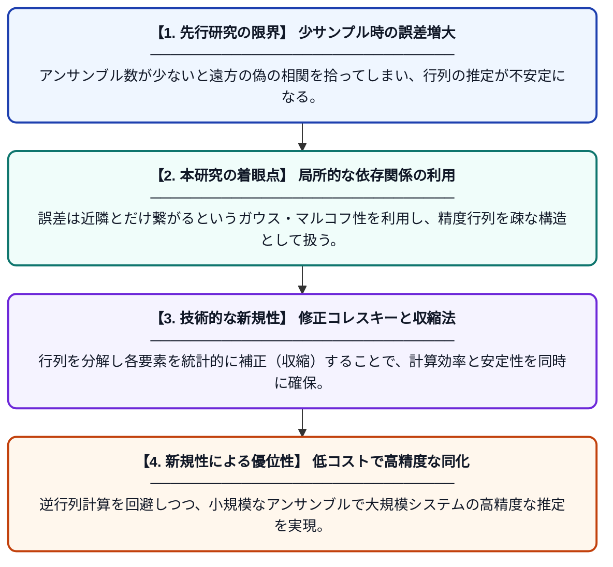

# 修正コレスキー分解による精度行列の収縮推定器に基づいたアンサンブル・カルマンフィルタの実装

**Original Title**: *An ensemble Kalman filter implementation based on shrinkage estimators of the precision matrix via modified Cholesky decomposition*

> **💡 一言要約**: 少数の計算で高精度な気象予測を可能にする新アルゴリズム

| 項目 | 内容 |
|---|---|
| **著者** | ED Niño‐Ruiz |
| **掲載誌** | Quarterly Journal of the Royal Meteorological Society 2026 |
| **アラートキーワード** | Markov random"  fields |
| **原文リンク** | [https://rmets.onlinelibrary.wiley.com/doi/abs/10.1002/qj.70335](https://rmets.onlinelibrary.wiley.com/doi/abs/10.1002/qj.70335) |
| **PDF版要約** | [README.pdf](./README.pdf) |

---

## 📊 新規性の図解（先行研究との違いと本研究のブレークスルー）

## 📝 要約

地球物理学的な誤差フィールドが持つガウス・マルコフ確率場の性質を利用し、精度行列（分散共分散行列の逆行列）を効率的に推定する新しいアンサンブル・カルマンフィルタを提案しています。修正コレスキー分解と収縮推定を組み合わせることで、少ない計算資源でも高次元なデータ同化を安定して行うことが可能です。

## ❓ どんな問題に取り組んだか

アンサンブル・カルマンフィルタ（EnKF）では、少数のサンプルから巨大な共分散行列を推定する際に生じるサンプリング誤差が、予測精度の低下やフィルタの破綻を招くという課題がありました。特に、高次元な地球物理データにおいて、逆行列である精度行列を安定かつ正確に求めることは計算負荷が非常に高い問題でした。

## ✨ 何が新しい？何がすごい？（新規性）

精度行列を修正コレスキー分解し、その各成分に対して収縮（shrinkage）推定を適用するという独自のアプローチを採用しました。これにより、ガウス・マルコフ確率場の特徴である「条件付き独立性（遠くの地点とは直接影響し合わない）」を数学的に自然に組み込むことができます。先行研究と異なり、行列の逆計算を直接行う必要がないため、数値的な安定性が飛躍的に向上し、非常に小さなアンサンブルサイズでも高次元の状態推定が可能になった点が最大の貢献です。

## 🎓 大学1年生向けの解説

天気予報などのシミュレーションでは、現在の「正解のデータ」をいかに正確に作るかが重要ですが、観測データには必ず誤差が含まれます。この研究では、その誤差のパターンの計算を「近くの場所どうしは影響し合うが、遠くは直接関係ない」というルールを使って賢く簡略化する方法を開発しました。具体的には、複雑な行列計算を効率的な形に分解し、少ないシミュレーション回数でも正確な結果が出るよう工夫しています。これにより、スパコンの計算時間を節約しながら、より精度の高い予測ができるようになります。
