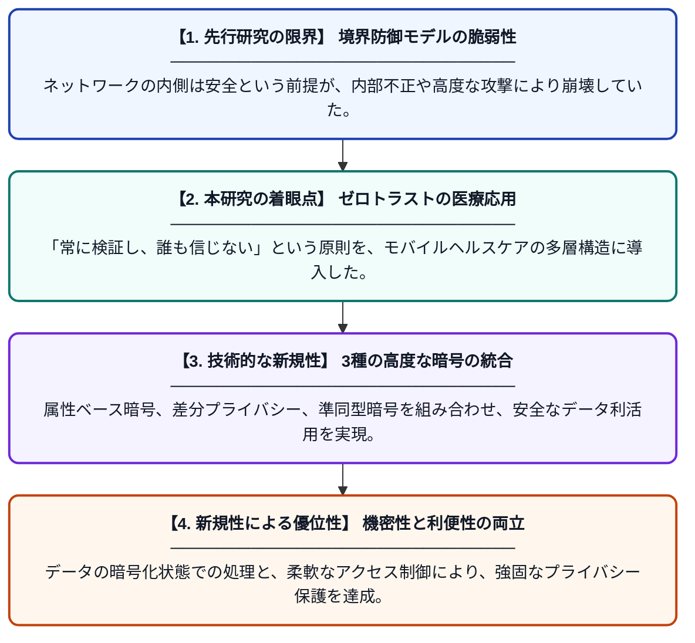

# ゼロトラスト原則を用いたプライバシー保護型モバイルヘルスケアアプリケーション

**Original Title**: *Privacy-Preserving Mobile Healthcare Applications Using Zero-Trust Principles*

> **💡 一言要約**: ゼロトラストで守る、次世代の医療アプリ基盤

| 項目 | 内容 |
|---|---|
| **著者** | RK Jadeja |
| **掲載誌** | IEEE World Skills Conference on Universal Data … 2026 |
| **アラートキーワード** | differential privacy |
| **原文リンク** | [https://ieeexplore.ieee.org/abstract/document/11767089/](https://ieeexplore.ieee.org/abstract/document/11767089/) |
| **PDF版要約** | [README.pdf](./README.pdf) |

---

## 📊 新規性の図解（先行研究との違いと本研究のブレークスルー）

## 📝 要約

モバイルヘルスケアにおけるセキュリティを強化するため、ゼロトラスト原則に基づいた包括的な信頼基盤を提案する論文です。属性ベース暗号、差分プライバシー、準同型暗号を統合し、認証から通信、データ記録までの各層で高度なプライバシー保護を実現しています。

## ❓ どんな問題に取り組んだか

モバイルヘルスケアでは極めて機密性の高い患者データが扱われますが、従来の「境界防御」モデルでは内部不正や高度なサイバー攻撃を防ぎきれないという課題があります。また、データの利活用と個人のプライバシー保護をいかに両立させるかが大きな壁となっていました。

## ✨ 何が新しい？何がすごい？（新規性）

属性ベース暗号(ABE)、差分プライバシー、準同型暗号という3つの強力な技術を組み合わせ、モバイル環境に最適化された包括的な「ゼロトラスト・アーキテクチャ」を構築した点が革新的です。先行研究が個別の要素技術に留まっていたのに対し、本研究は認証からデータ処理までを一貫してカバーする多層防御モデルを体系化しました。これにより、データを暗号化したまま分析しつつ、適切な権限を持つユーザーのみにアクセスを許可する柔軟な運用が可能になっています。

## 🎓 大学1年生向けの解説

スマホで健康状態を管理するのは便利ですが、もしデータが漏れたら大変です。この研究は「誰も、何も信じない（ゼロトラスト）」という考え方を使い、あらゆるアクセスを厳重にチェックする仕組みを作りました。最新の高度な暗号技術を組み合わせることで、たとえデータがサーバーにあっても、管理者ですら内容を勝手に見られないほど強力にプライバシーを守ります。大学1年生の皆さんが将来使う医療アプリの、安全な土台を作るような研究です。
