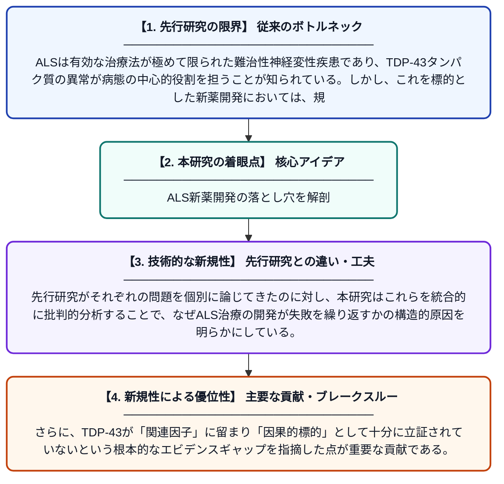

# ALS治療におけるTDP-43を標的とした戦略：規制上のハードル、試験デザインの欠陥、そしてCTx1000に関する因果的エビデンスの欠如

**Original Title**: *Targeting TDP-43 in ALS: Regulatory hurdles, trial design deficiencies, and the causal evidence gap for CTx1000*

> **💡 一言要約**: ALS新薬開発の落とし穴を解剖

| 項目 | 内容 |
|---|---|
| **著者** | MAS Guth |
| **掲載誌** | Drug Discovery Today 2026 |
| **アラートキーワード** | ALS |
| **原文リンク** | [https://www.sciencedirect.com/science/article/pii/S1359644626001571](https://www.sciencedirect.com/science/article/pii/S1359644626001571) |
| **PDF版要約** | [README.pdf](./README.pdf) |

---

## 📊 新規性の図解（先行研究との違いと本研究のブレークスルー）

## 📝 要約

筋萎縮性側索硬化症（ALS）の治療において、大多数の患者に共通するTDP-43異常を標的とした精密医療アプローチが注目されている。本論文は、新規治療薬CTx1000を事例として、規制当局の審査における問題点や臨床試験デザインの歴史的な欠陥を分析している。特に、TDP-43を因果的治療標的として位置づけるためのエビデンスの不足を批判的に検討している。

## ❓ どんな問題に取り組んだか

ALSは有効な治療法が極めて限られた難治性神経変性疾患であり、TDP-43タンパク質の異常が病態の中心的役割を担うことが知られている。しかし、これを標的とした新薬開発においては、規制上の障壁や臨床試験の設計上の欠陥が繰り返し障害となっており、有望な候補薬が承認に至らない事例が続いている。

## ✨ 何が新しい？何がすごい？（新規性）

本論文は、CTx1000という具体的な治療候補を題材に、ALS創薬における規制・試験設計・因果エビデンスという三つの課題を体系的に整理した点が新しい。先行研究がそれぞれの問題を個別に論じてきたのに対し、本研究はこれらを統合的に批判的分析することで、なぜALS治療の開発が失敗を繰り返すかの構造的原因を明らかにしている。さらに、TDP-43が「関連因子」に留まり「因果的標的」として十分に立証されていないという根本的なエビデンスギャップを指摘した点が重要な貢献である。

## 🎓 大学1年生向けの解説

ALSとは、筋肉を動かす神経が徐々に壊れていく病気で、全身が動かせなくなってしまう難しい病気です。患者さんの多くで「TDP-43」というタンパク質が異常な状態になっており、これを治療の標的にする薬の開発が進んでいます。この論文では、新しい薬「CTx1000」を例に挙げながら、なぜALSの薬がなかなか承認されないのかを調べています。薬を承認してもらうためのルール（規制）の難しさや、患者さんを対象にした試験のやり方の問題点、そしてそもそもTDP-43が本当に病気の原因なのかというエビデンスが足りないことを指摘しています。この研究を通じて、ALS治療薬開発の課題を整理し、今後の研究の方向性を示すことが目指されています。
