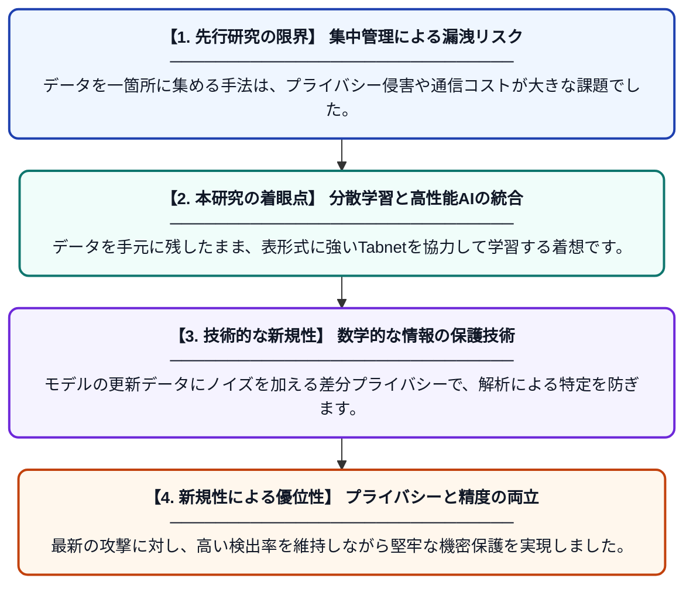

# セキュアなIoTアーキテクチャにおけるインテリジェントな侵入検知のためのプライバシー配慮型連合Tabnetフレームワーク

**Original Title**: *A Privacy-Aware Federated Tabnet Framework for Intelligent Intrusion Detection in Secure IoT Architectures*

> **💡 一言要約**: 連合学習×TabnetでIoTの安全と秘密を守る

| 項目 | 内容 |
|---|---|
| **著者** | K Yadav, KM Raju, SM Basha, P Sudheer, K Pallavi |
| **掲載誌** | … International Conference on … 2026 |
| **アラートキーワード** | differential privacy |
| **原文リンク** | [https://ieeexplore.ieee.org/abstract/document/11746636/](https://ieeexplore.ieee.org/abstract/document/11746636/) |
| **PDF版要約** | [README.pdf](./README.pdf) |

---

## 📊 新規性の図解（先行研究との違いと本研究のブレークスルー）

## 📝 要約

IoT機器のデータを外部に送信せずに学習を行う連合学習（Federated Learning）と、表形式データに強いTabnetを組み合わせた新しい侵入検知フレームワークを提案しています。さらに差分プライバシーを導入することで、学習過程におけるモデルの更新情報からのプライバシー漏洩を数学的に防いでいます。

## ❓ どんな問題に取り組んだか

IoTデバイスはサイバー攻撃の標的になりやすい一方で、収集されるデータには個人のプライバシーが含まれるため、データを一箇所に集めてAIを学習させることが困難でした。また、従来の侵入検知システムでは、高度化する攻撃に対する検知精度とプライバシー保護を両立させることが大きな課題となっていました。

## ✨ 何が新しい？何がすごい？（新規性）

本研究は、表形式データの扱いに優れた深層学習モデルであるTabnetを連合学習の枠組みに初めて効果的に統合し、IoT特有のデータ形式に最適化させました。モデル更新時に差分プライバシー（Differential Privacy）を適用することで、分散学習中の通信内容から元の学習データが推測されるリスクを大幅に低減しています。最新のEdge-IIoTsetデータセットを用いた検証により、プライバシーを保護しつつ高い検知精度を維持できることを実証しました。

## 🎓 大学1年生向けの解説

インターネットに繋がる家電などのIoT機器を、ハッカーの攻撃から守るための研究です。各機器が持っている大切なデータを外に漏らさないように、それぞれの場所でAIを少しずつ賢くし、その知恵だけを共有する「連合学習」という仕組みを使っています。さらに、共有する情報に特殊なノイズを加えることで、徹底的にプライバシーを守りながら、悪い通信を素早く見つけることができる賢いAIを開発しました。
