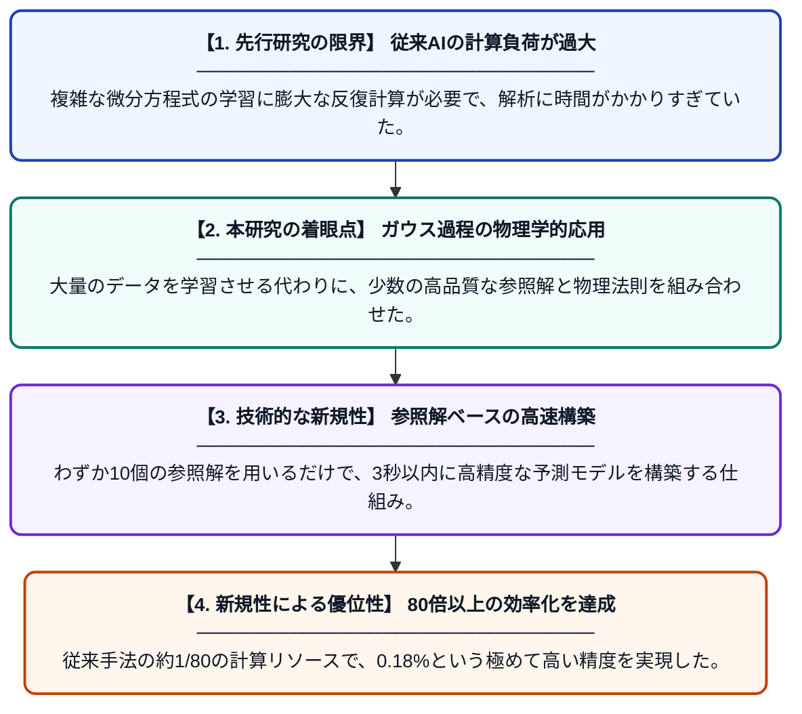

# 非ダルシー多孔質媒体中における熱放射MHDダスティ・マックスウェル・ナノ流体の流れに対する物理学に基づいた機械学習アプローチ

**Original Title**: *Physics-informed machine learning approach for radiative MHD dusty Maxwell nanofluid flow over a stretching/shrinking surface in a non-Darcy porous medium: A …*

> **💡 一言要約**: 物理AIでナノ流体解析を80倍高速化し、精度も向上

| 項目 | 内容 |
|---|---|
| **著者** | B Ahmad, M Abubakar, A Sultan, SB Hussain… |
| **掲載誌** | AIMS Mathematics 2026 |
| **アラートキーワード** | gaussian process |
| **原文リンク** | [https://www.aimspress.com/article/doi/10.3934/math.20261395](https://www.aimspress.com/article/doi/10.3934/math.20261395) |
| **PDF版要約** | [README.pdf](./README.pdf) |

---

## 📊 新規性の図解（先行研究との違いと本研究のブレークスルー）

## 📝 要約

複雑な物理現象を伴うナノ流体の流れを予測するため、物理学の法則を取り入れた機械学習手法を提案した研究です。特にガウス過程回帰を用いることで、従来のニューラルネットワークよりも極めて少ない計算量で、高精度な流体解析を実現しました。

## ❓ どんな問題に取り組んだか

磁場や熱放射の影響を受ける複雑なナノ流体の挙動解析は、従来の数値手法や単純なニューラルネットワークでは計算コストが非常に高く、実用化の壁となっていました。特に、微分方程式を解くためのAI学習には、膨大な反復計算と時間が必要であるという課題がありました。

## ✨ 何が新しい？何がすごい？（新規性）

本研究の新規性は、微分残差のみに頼る従来のニューラルネットワークの代わりに、少数の参照解を活用したガウス過程（GP）を採用した点にあります。このアプローチにより、わずか10個の参照データから3秒未満で0.18%という高い予測精度を達成しました。従来のネットワーク学習が875回の評価を必要とするのに対し、本手法はわずか11回で計算コストの「元が取れる」という、圧倒的な計算効率を証明しました。

## 🎓 大学1年生向けの解説

特殊な液体（ナノ流体）が複雑な環境でどう動くかを、数学とAIを使って予測する研究です。これまではスーパーコンピュータを使って何時間も計算していましたが、この研究では「物理学のルール」をAIに賢く教えることで、普通のPCでも一瞬で答えが出るようにしました。特に「ガウス過程」という、少ないヒントから正解を導く数学の技を使うことで、驚くほど正確で速いシミュレーションが可能になりました。これにより、新しい冷却システムなどの開発が劇的にスムーズになります。
