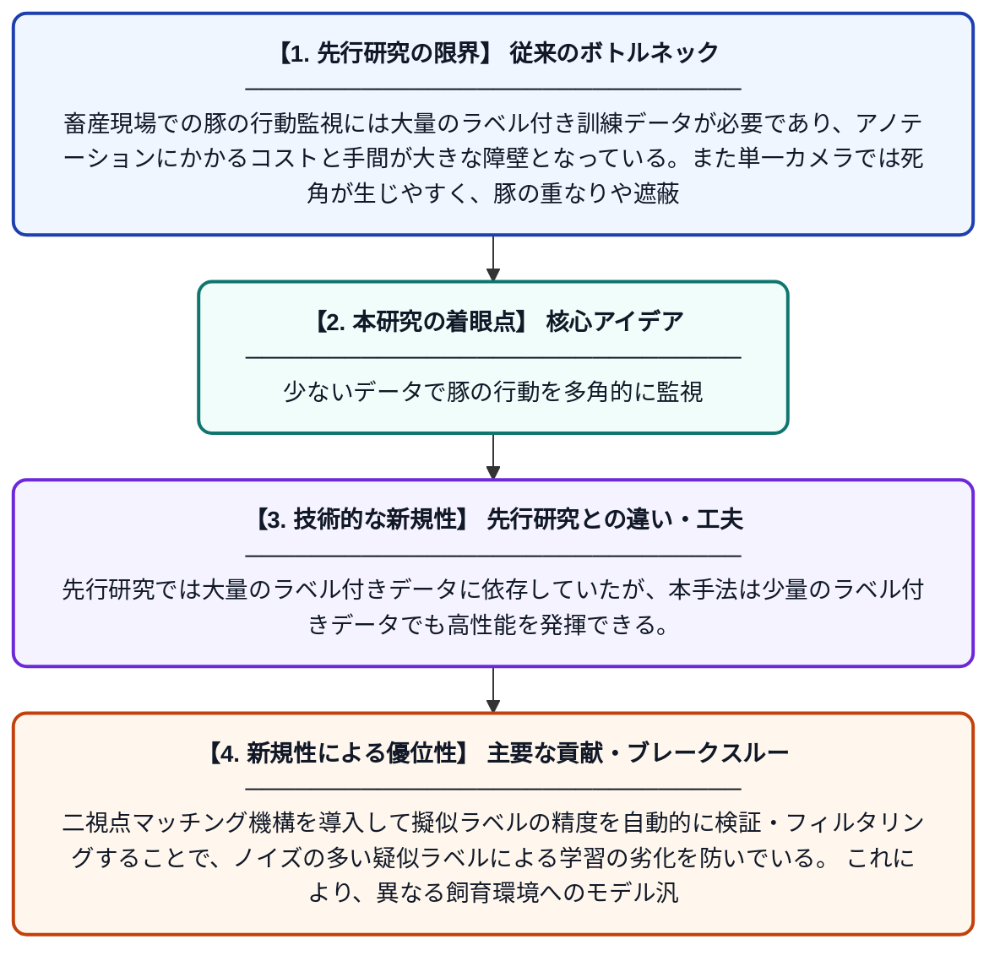

# 教師-学生型半教師あり学習を用いた豚の行動モニタリングにおける多視点映像融合とモデル汎化の改善

**Original Title**: *Improving multi-view video fusion and model generalization in pig behavior monitoring with teacher–student semi-supervised learning*

> **💡 一言要約**: 少ないデータで豚の行動を多角的に監視

| 項目 | 内容 |
|---|---|
| **著者** | S Wan, J Li, F Xue, T Han, Y Sha, L Qin |
| **掲載誌** | Computers and Electronics in Agriculture 2026 |
| **アラートキーワード** | Semi supervise |
| **原文リンク** | [https://www.sciencedirect.com/science/article/pii/S0168169926007520](https://www.sciencedirect.com/science/article/pii/S0168169926007520) |
| **PDF版要約** | [README.pdf](./README.pdf) |

---

## 📊 新規性の図解（先行研究との違いと本研究のブレークスルー）

## 📝 要約

本研究は、豚の行動監視において複数カメラ映像を効果的に統合するための半教師あり学習フレームワークを提案している。教師モデルと学生モデルを組み合わせた構造により、少量のラベル付きデータから高精度な行動認識を実現する。二視点マッチング機構により擬似ラベルの品質を検証・フィルタリングし、モデルの汎化性能を向上させた。

## ❓ どんな問題に取り組んだか

畜産現場での豚の行動監視には大量のラベル付き訓練データが必要であり、アノテーションにかかるコストと手間が大きな障壁となっている。また単一カメラでは死角が生じやすく、豚の重なりや遮蔽により正確な行動認識が困難である。さらに環境変化や個体差に対するモデルの汎化性能の低さも実用上の課題となっている。

## ✨ 何が新しい？何がすごい？（新規性）

本研究は、教師-学生型の半教師あり学習と多視点映像融合を組み合わせた新しいフレームワークを提案している点が独自である。先行研究では大量のラベル付きデータに依存していたが、本手法は少量のラベル付きデータでも高性能を発揮できる。二視点マッチング機構を導入して擬似ラベルの精度を自動的に検証・フィルタリングすることで、ノイズの多い疑似ラベルによる学習の劣化を防いでいる。これにより、異なる飼育環境へのモデル汎化性能も大幅に改善された。

## 🎓 大学1年生向けの解説

豚の農場では、豚が病気になったり喧嘩したりしていないか、カメラで行動を自動的に見守るシステムが研究されています。しかし、AIにたくさんの「これは何の行動です」という教師データを用意するのはとても大変です。この研究では、先生役のAIと生徒役のAIを組み合わせて、少ないデータからでも学習できる仕組みを作りました。さらに複数のカメラ映像を使うことで、豚が重なって見えにくい場面でも正確に行動を認識できるようになりました。これにより、農家の手間を減らしながら豚の健康管理を自動化できる可能性が広がります。
