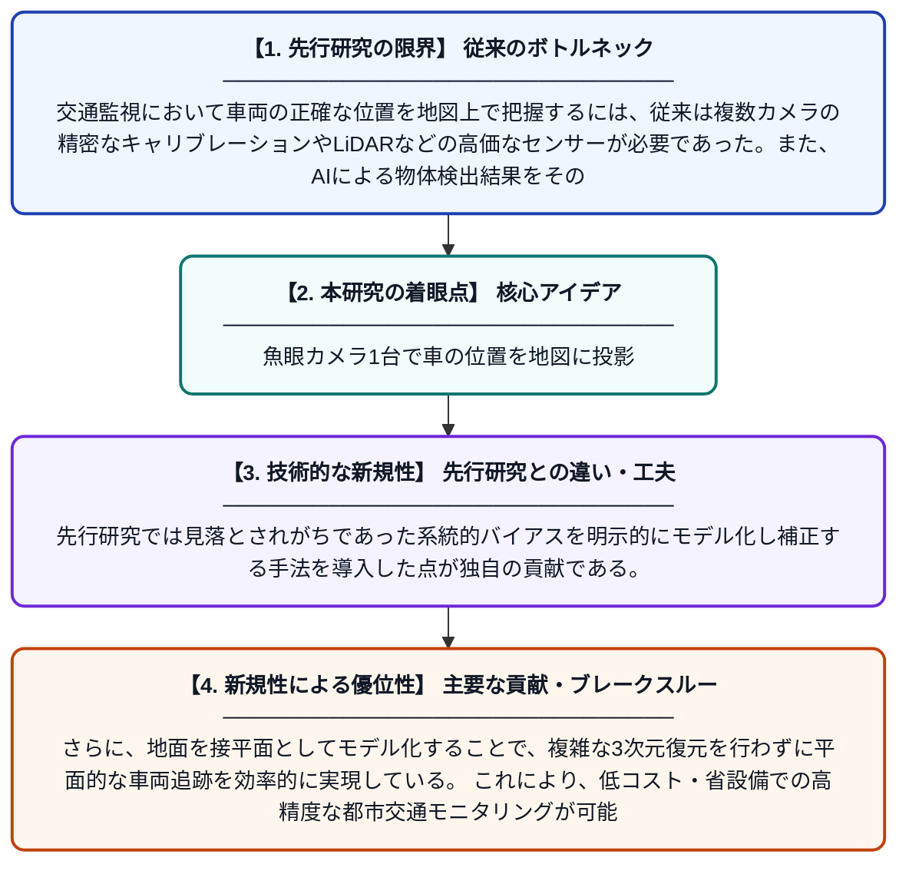

# 単眼魚眼カメラを用いたAI検出に基づく地上物体のバイアス補正付き確率的ジオロケーション

**Original Title**: *Bias-corrected probabilistic geolocation of terrestrial objects from AI-driven detections using a monocular fisheye camera*

> **💡 一言要約**: 魚眼カメラ1台で車の位置を地図に投影

| 項目 | 内容 |
|---|---|
| **著者** | HD Guimaraynz, T Tashtoush, DE Oliva, SA Ibáñez |
| **掲載誌** | Measurement Science and Technology 2026 |
| **アラートキーワード** | Multi Camera Tracking |
| **原文リンク** | [https://iopscience.iop.org/article/10.1088/1361-6501/ae90d1/meta](https://iopscience.iop.org/article/10.1088/1361-6501/ae90d1/meta) |
| **PDF版要約** | [README.pdf](./README.pdf) |

---

## 📊 新規性の図解（先行研究との違いと本研究のブレークスルー）

## 📝 要約

本論文は、都市交差点に設置された単眼魚眼カメラ（全方位カメラ）を用いて、AIが検出した車両などの地上物体の位置を地図上に確率的に推定する手法を提案している。メカニカルスキャンや複数カメラのキャリブレーションを必要とせず、継続的なモニタリングを実現する。さらに、推定位置に含まれるバイアス誤差を補正する仕組みを組み込むことで、精度の高い位置推定を達成している。

## ❓ どんな問題に取り組んだか

交通監視において車両の正確な位置を地図上で把握するには、従来は複数カメラの精密なキャリブレーションやLiDARなどの高価なセンサーが必要であった。また、AIによる物体検出結果をそのまま実世界座標に変換する際には系統的なバイアス誤差が生じやすく、信頼性の高い位置推定が困難であった。

## ✨ 何が新しい？何がすごい？（新規性）

本研究は、単一の魚眼カメラのみを用いて全方位的な視野を確保しつつ、AIの検出結果から地上物体の位置を確率分布として推定するという新しいアプローチを採用している。先行研究では見落とされがちであった系統的バイアスを明示的にモデル化し補正する手法を導入した点が独自の貢献である。さらに、地面を接平面としてモデル化することで、複雑な3次元復元を行わずに平面的な車両追跡を効率的に実現している。これにより、低コスト・省設備での高精度な都市交通モニタリングが可能となった。

## 🎓 大学1年生向けの解説

街の交差点に広角の丸いレンズ（魚眼レンズ）を持つカメラを1台設置するだけで、カメラが映した車の位置を地図上に正確に示す技術です。AIがカメラ映像から車を自動検出し、その位置情報を計算で実際の地面の座標に変換します。ただし、この変換には誤差（ズレ）が生じやすいため、そのズレを補正する仕組みも一緒に開発しました。従来は複数のカメラや高価な機器が必要でしたが、この研究では1台のカメラで済むためコストを大幅に抑えられます。交通流の把握や自動運転の研究など、幅広い応用が期待される技術です。
