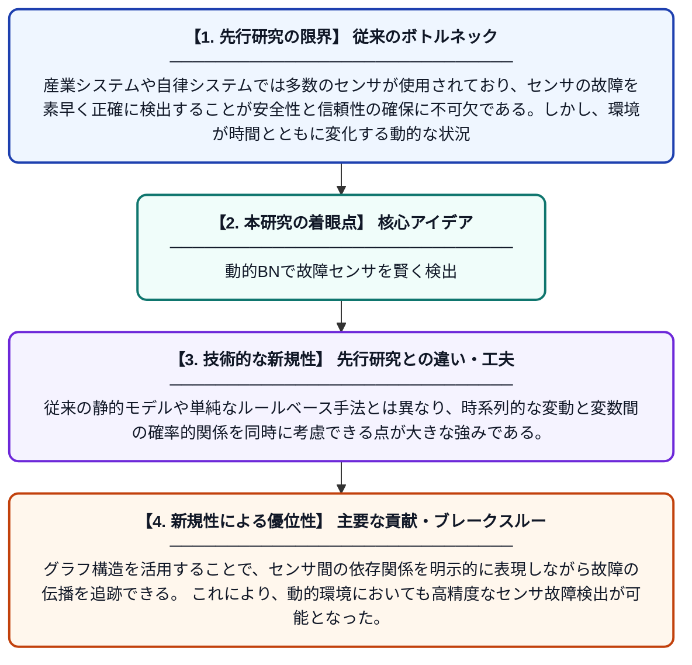

# 動的環境における動的ベイジアンネットワークを用いた故障センサの検出

**Original Title**: *Detection of Faulty Sensors Based on a Dynamic Bayesian Network in a Dynamic Environment*

> **💡 一言要約**: 動的BNで故障センサを賢く検出

| 項目 | 内容 |
|---|---|
| **著者** | A Rezaee |
| **掲載誌** | 2026 |
| **アラートキーワード** | bayesian network |
| **PDF** | [https://www.preprints.org/frontend/manuscript/2ba3fffbeb1ab33f1437f3a1fba803c1/download_pub](https://www.preprints.org/frontend/manuscript/2ba3fffbeb1ab33f1437f3a1fba803c1/download_pub) |
| **原文リンク** | [https://www.preprints.org/frontend/manuscript/2ba3fffbeb1ab33f1437f3a1fba803c1/download_pub](https://www.preprints.org/frontend/manuscript/2ba3fffbeb1ab33f1437f3a1fba803c1/download_pub) |
| **PDF版要約** | [README.pdf](./README.pdf) |

---

## 📊 新規性の図解（先行研究との違いと本研究のブレークスルー）

## 📝 要約

本研究では、複雑なハイブリッドシステムをベイジアンネットワーク（BN）としてモデル化し、動的環境下での故障センサの検出手法を提案している。グラフベースの構造的機械学習モデルを活用することで、変数間の関係を効率的に表現しながら異常を検知する仕組みを構築している。動的ベイジアンネットワークを用いることで、時系列変化を考慮したより精度の高いセンサ故障診断を実現している。

## ❓ どんな問題に取り組んだか

産業システムや自律システムでは多数のセンサが使用されており、センサの故障を素早く正確に検出することが安全性と信頼性の確保に不可欠である。しかし、環境が時間とともに変化する動的な状況では、静的なモデルでは故障を正確に判断することが難しいという課題がある。特に複雑なハイブリッドシステムでは、変数間の相互関係が複雑になるため、従来手法では対応が困難であった。

## ✨ 何が新しい？何がすごい？（新規性）

本研究は、複雑なハイブリッドシステムを動的ベイジアンネットワーク（DBN）としてモデル化するという新しいアプローチを採用している点が独自性である。従来の静的モデルや単純なルールベース手法とは異なり、時系列的な変動と変数間の確率的関係を同時に考慮できる点が大きな強みである。グラフ構造を活用することで、センサ間の依存関係を明示的に表現しながら故障の伝播を追跡できる。これにより、動的環境においても高精度なセンサ故障検出が可能となった。

## 🎓 大学1年生向けの解説

センサとは温度や圧力などを測る装置のことで、工場や自動車など多くの場面で使われています。このセンサが壊れると誤った情報が伝わり、大きな事故につながる恐れがあります。この研究では「ベイジアンネットワーク」という確率を使った図の仕組みを使って、センサが正常か故障しているかを自動で判断する方法を開発しました。特に状況が時間とともに変化する「動的な環境」でも正確に判断できるのが特長です。身近な例で言えば、天気予報が過去の天気パターンから明日の天気を予測するように、過去のデータの流れからセンサの異常を見つけ出すイメージです。
