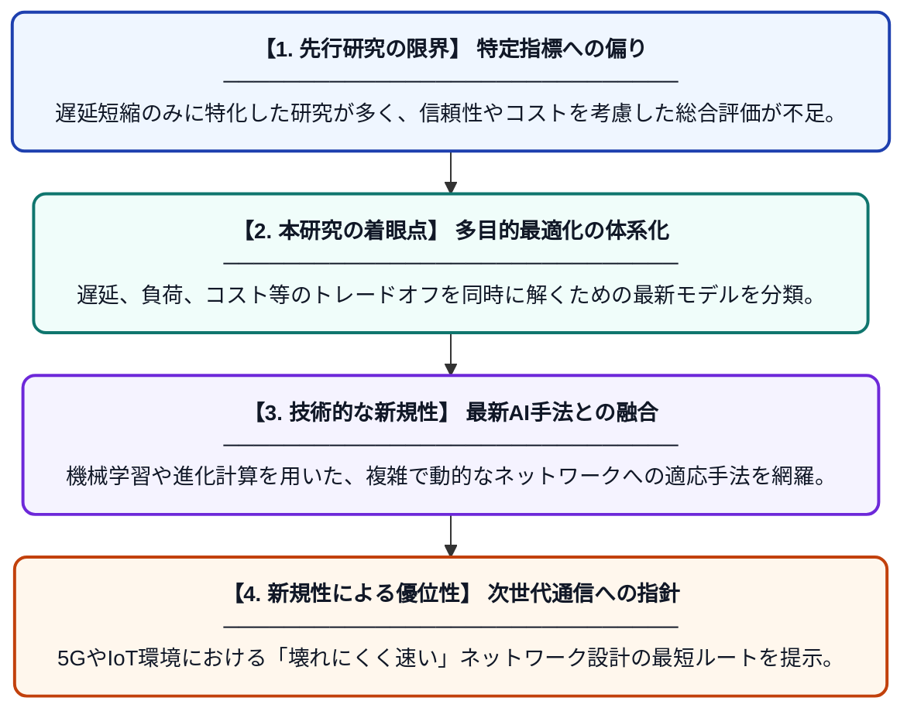

# SDNにおけるコントローラ配置：最適化モデル、ネットワーク性能、および今後の研究方向に関する包括的レビュー

**Original Title**: *Controller Placement in SDN: A Comprehensive Review of Optimization Models, Network Performance, and Future Research Directions*

> **💡 一言要約**: SDNの司令塔をどこに置く？最適配置の決定版レビュー

| 項目 | 内容 |
|---|---|
| **著者** | B Mohapatra |
| **掲載誌** | Journal of Intelligent Decision Making and Information … 2026 |
| **アラートキーワード** | optimization |
| **PDF** | [https://www.jidmis.org/index.php/jidmis/article/download/6078/2599](https://www.jidmis.org/index.php/jidmis/article/download/6078/2599) |
| **原文リンク** | [https://www.jidmis.org/index.php/jidmis/article/download/6078/2599](https://www.jidmis.org/index.php/jidmis/article/download/6078/2599) |
| **PDF版要約** | [README.pdf](./README.pdf) |

---

## 📊 新規性の図解（先行研究との違いと本研究のブレークスルー）

## 📝 要約

SDN（ソフトウェア定義ネットワーク）の根幹をなす「コントローラ配置問題（CPP）」について、最新の最適化モデルや評価指標を体系的にまとめたレビュー論文です。コントローラの配置がネットワークの遅延、信頼性、スケーラビリティに与える影響を分析し、将来の研究課題を提示しています。

## ❓ どんな問題に取り組んだか

SDNでは制御機能が集中化されていますが、コントローラを物理的にどこへ配置するかによって、ネットワーク全体の通信遅延や耐障害性が大きく変わります。しかし、多様なネットワーク環境や要件（QoS、コスト、エネルギー効率など）を同時に満たすための最適な配置手法はまだ確立されておらず、知見が断片化していました。

## ✨ 何が新しい？何がすごい？（新規性）

本論文は、従来の数学的最適化手法から、近年注目されている機械学習やメタヒューリスティクスを用いた手法まで、コントローラ配置に関する膨大な研究を多角的に分類・比較しています。単なる手法の列挙ではなく、ネットワーク性能への具体的な影響度を定量的に評価し、5G/6GやIoTといった次世代インフラへの適用可能性を論じている点が画期的です。これにより、研究者が直面している複雑なトレードオフ関係を整理し、進むべき明確な指針を示しています。

## 🎓 大学1年生向けの解説

インターネットの通信を管理する「司令塔（コントローラ）」をどこに設置すれば、一番効率よく通信できるかを考える研究です。例えば、広い学校の中に1台だけ先生（コントローラ）を置くとき、どこに立っていれば全員に素早く指示が出せるかという問題に似ています。この論文は、世界中の頭の良い人たちが考えた「最高の置き場所」の決め方を全部集めて、どれが一番優れているかを分かりやすく解説しています。これからの超高速な通信を作るための重要なヒントが詰まっています。
