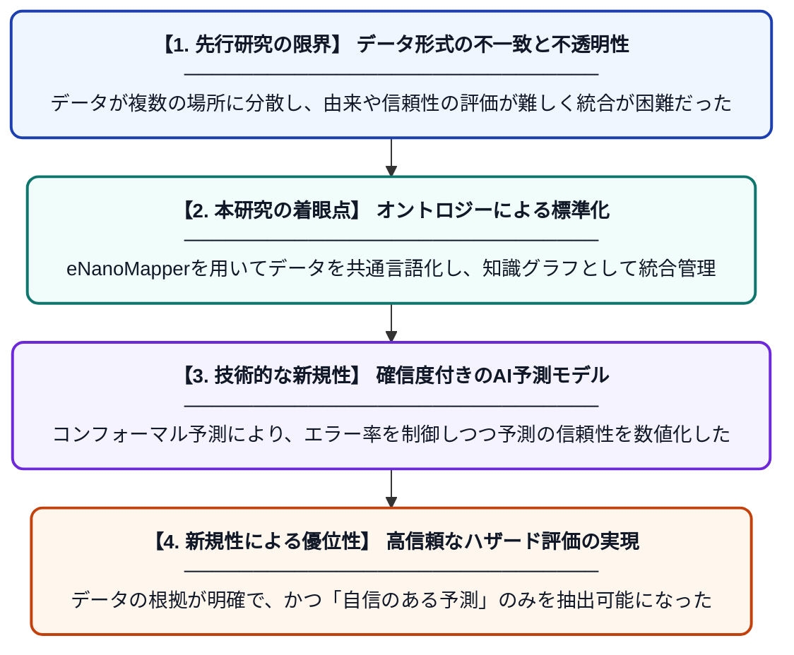

# オントロジーに基づいたナノ毒性データの統合：抗菌ハザードスクリーニングのためのプロバンス対応知識グラフとコンフォーマル予測

**Original Title**: *Ontology-grounded nanotoxicity data federation with a provenance-aware knowledge graph and conformal prediction for antimicrobial hazard screening*

> **💡 一言要約**: AIと知識グラフでナノ素材の毒性を高精度に予測

| 項目 | 内容 |
|---|---|
| **著者** | P Singh, P Pandey, V Chandrasekar, AV Singh… |
| **掲載誌** | Scientific Reports 2026 |
| **アラートキーワード** | Ontology |
| **原文リンク** | [https://www.nature.com/articles/s41598-026-73889-7](https://www.nature.com/articles/s41598-026-73889-7) |
| **PDF版要約** | [README.pdf](./README.pdf) |

---

## 📊 新規性の図解（先行研究との違いと本研究のブレークスルー）

## 📝 要約

複数の公共データベースからナノ材料の毒性データを統合し、eNanoMapperオントロジーを用いて標準化した知識グラフを構築する手法を提案しました。このシステムはデータの由来（プロバンス）を厳密に管理し、コンフォーマル予測を活用することで、高い信頼性と確信度を伴う抗菌ハザード予測を実現しています。

## ❓ どんな問題に取り組んだか

ナノ材料の安全性データは世界中の異なるデータベースに散在しており、記述形式がバラバラであるため統合が困難です。また、従来のAI予測では「その予測がどの程度信頼できるか」という確信度が不明確であり、ハザード評価における実用上の障壁となっていました。

## ✨ 何が新しい？何がすごい？（新規性）

本研究の核心は、eNanoMapperオントロジーを用いて異なるデータソースを統一的なスキーマへ変換し、情報の由来を追跡可能な「プロバンス対応知識グラフ」を構築した点にあります。先行研究とは異なり、予測の不確実性を数学的に保証する「コンフォーマル予測」をパイプラインに組み込むことで、エラー率を制御した信頼性の高いスクリーニングを可能にしました。これにより、データの透明性と予測精度の両立という課題を解決しています。

## 🎓 大学1年生向けの解説

ナノ材料は非常に小さな物質で、医療や工業の分野で期待されていますが、毒性がないかを確認するのはとても大変です。この研究では、バラバラに保存されていた過去の実験結果を、共通のルール（オントロジー）を使って一つの大きな「知恵の網（知識グラフ）」としてまとめました。さらに、AIが「この材料は安全です」と答えるだけでなく、「その予測がどれくらい自信があるか」まで教えてくれる仕組みを作ったことで、より確実に安全な材料を見つけられるようになりました。
