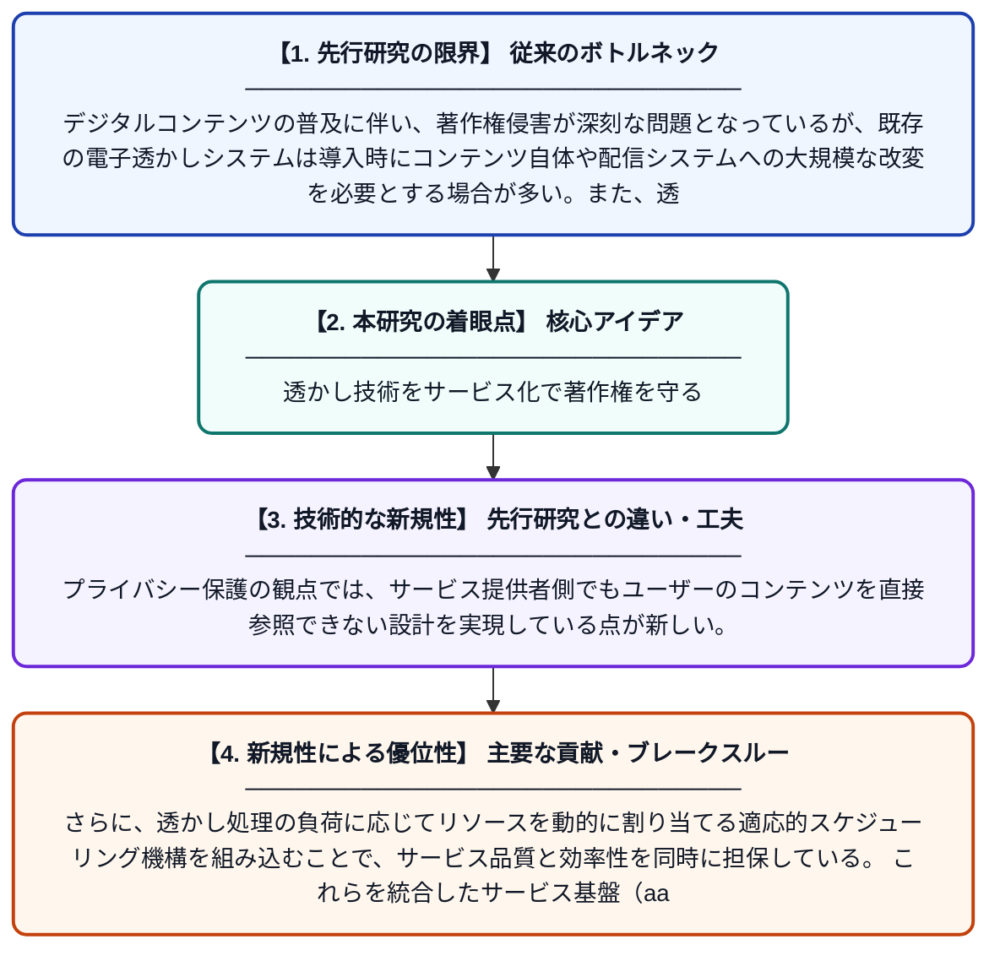

# NWaaS: 適応的リソーススケジューリングを備えた非侵襲型プライバシー保護電子透かしサービスシステム

**Original Title**: *NWaaS: A Non-Intrusive and Privacy-Preserving Watermarking-As-a-Service System With Adaptive Resource Scheduling*

> **💡 一言要約**: 透かし技術をサービス化で著作権を守る

| 項目 | 内容 |
|---|---|
| **著者** | H An, Q Ren, G Hua, T Li, Y Guo, Y Ma, H Cao, Y Fang |
| **掲載誌** | IEEE Transactions on Dependable and Secure Computing 2026 |
| **アラートキーワード** | Secure Computing |
| **原文リンク** | [https://ieeexplore.ieee.org/abstract/document/11625983/](https://ieeexplore.ieee.org/abstract/document/11625983/) |
| **PDF版要約** | [README.pdf](./README.pdf) |

---

## 📊 新規性の図解（先行研究との違いと本研究のブレークスルー）

## 📝 要約

本論文では、デジタルコンテンツの著作権保護を目的とした電子透かし技術をクラウドサービスとして提供するシステム「NWaaS」を提案している。このシステムは、元のコンテンツや透かし処理に干渉しない非侵襲的な設計と、ユーザーのプライバシーを保護する仕組みを兼ね備えている。さらに、適応的なリソーススケジューリングにより、サービスの効率性とスケーラビリティを実現している。

## ❓ どんな問題に取り組んだか

デジタルコンテンツの普及に伴い、著作権侵害が深刻な問題となっているが、既存の電子透かしシステムは導入時にコンテンツ自体や配信システムへの大規模な改変を必要とする場合が多い。また、透かし処理をサードパーティに委託する際、ユーザーのプライバシーやコンテンツの機密性が漏洩するリスクがある。加えて、大規模なサービス環境での処理リソースの効率的な管理も課題となっている。

## ✨ 何が新しい？何がすごい？（新規性）

NWaaSは、既存のシステムを改変せずに電子透かしを導入できる「非侵襲型」アーキテクチャを採用しており、先行研究と比較して導入コストを大幅に削減している。プライバシー保護の観点では、サービス提供者側でもユーザーのコンテンツを直接参照できない設計を実現している点が新しい。さらに、透かし処理の負荷に応じてリソースを動的に割り当てる適応的スケジューリング機構を組み込むことで、サービス品質と効率性を同時に担保している。これらを統合したサービス基盤（aaS）として包括的に設計した点が本研究の主要な貢献である。

## 🎓 大学1年生向けの解説

電子透かしとは、写真や動画などのデジタルコンテンツに見えない形で「所有者情報」を埋め込む技術で、著作権の証明に使われます。この論文では、その電子透かしをインターネット経由でサービスとして手軽に利用できる仕組みを作りました。ポイントは、既存のシステムをほとんど変えなくてよいこと、コンテンツの内容がサービス業者に漏れないこと、そして大勢が同時に使っても処理が遅くならないように自動でコンピュータの力を調整することです。ちょうど、翻訳サービスや決済サービスのように、透かし技術を「使いやすいクラウドサービス」に仕立てたイメージです。
