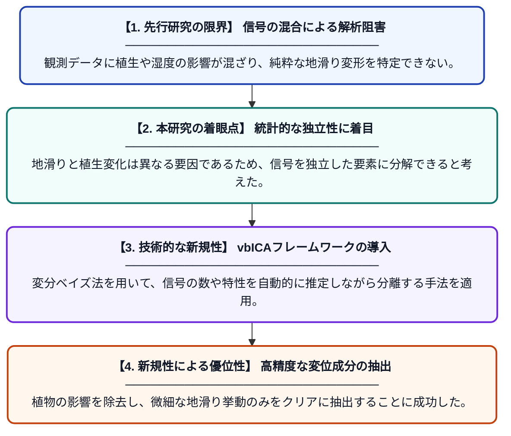

# 変分ベイズ独立成分分析を用いた緩慢な地滑り変形と植生指数の分離

**Original Title**: *Advisors: Mong-Han Huang, Gimena Chaves Fitzgerald*

> **💡 一言要約**: vbICAで地滑りと植生の変化を鮮やかに分離

| 項目 | 内容 |
|---|---|
| **著者** | K Cox |
| **アラートキーワード** | independent component ... |
| **PDF** | [https://www.geol.umd.edu/undergraduate/paper/cox.pdf](https://www.geol.umd.edu/undergraduate/paper/cox.pdf) |
| **原文リンク** | [https://www.geol.umd.edu/undergraduate/paper/cox.pdf](https://www.geol.umd.edu/undergraduate/paper/cox.pdf) |
| **PDF版要約** | [README.pdf](./README.pdf) |

---

## 📊 新規性の図解（先行研究との違いと本研究のブレークスルー）

## 📝 要約

この研究は、変分ベイズ独立成分分析（vbICA）を適用することで、地表の信号から緩慢な地滑り（SML）による変形成分と植生指数（NDVI）成分を分離する枠組みを構築しました。これにより、複雑に混ざり合った観測データから特定の要因による変動を精度よく抽出することが可能になります。

## ❓ どんな問題に取り組んだか

地表の変動を衛星データなどで観測する際、地滑りによる物理的な変形と、植物の成長や季節変化による信号が混ざり合ってしまう課題があります。これらを正確に区別できないと、地滑りのリスク評価やメカニズムの解析に誤りが生じる可能性があります。

## ✨ 何が新しい？何がすごい？（新規性）

従来の独立成分分析（ICA）に統計的な推定を組み合わせた「変分ベイズ独立成分分析（vbICA）」を採用した点が画期的です。この手法により、未知の信号源の数を柔軟に推定しながら、SML変形とNDVIという性質の異なる成分を統計的に分離するフレームワークを確立しました。地質学的な変動と生物学的な変動を高度なアルゴリズムで分離したことが主要な貢献です。

## 🎓 大学1年生向けの解説

地面がゆっくり動く「地滑り」を空から観察するとき、地面の動き以外にも草木の成長などのノイズが混ざってしまいます。この研究では、カクテルパーティーの中で特定の人の声だけを聞き分けるような技術（vbICA）を使って、ノイズを取り除きました。その結果、「植物の変化」と「地面の動き」を別々に見ることに成功したのです。これによって、地滑りがいつ、どのように起きているかをより正確に知ることができます。
