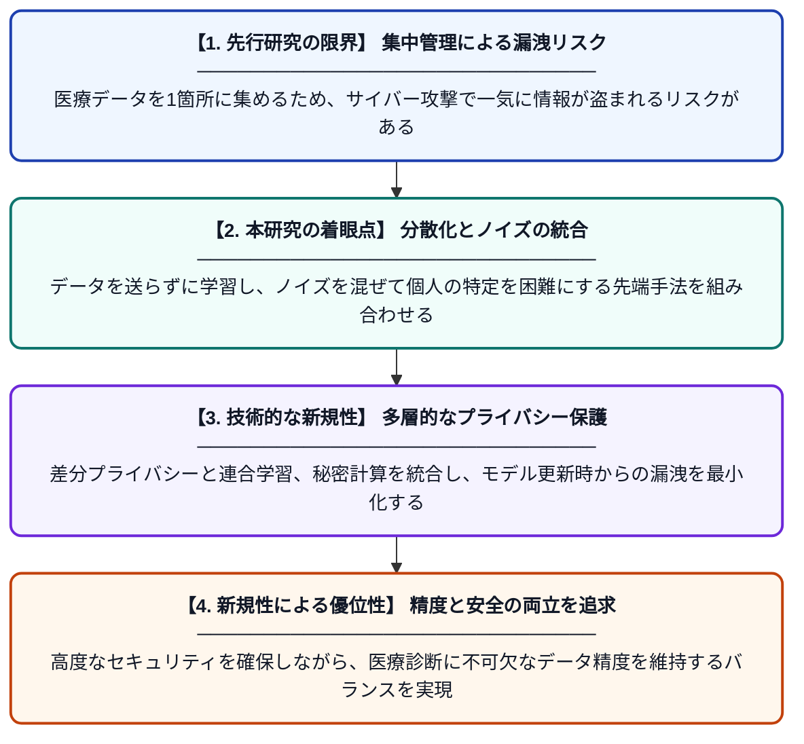

# 遠隔患者モニタリングにおけるデータセキュリティ、プライバシー、および倫理的課題

**Original Title**: *Data Security, Privacy, and Ethical Challenges in Remote Patient Monitoring*

> **💡 一言要約**: 遠隔医療を守る最新技術と倫理のジレンマを解明

| 項目 | 内容 |
|---|---|
| **著者** | JP Zoya, MI Khan |
| **掲載誌** | Wearable Biosensors and Remote Patient Monitoring 2026 |
| **アラートキーワード** | differential privacy |
| **PDF** | [https://www.researchgate.net/profile/Syed-Nazar-Raza/publication/417534370_Wearable_Biosensors_and_Remote_Patient_Monitoring/links/6aed4e4d6d07a224060d1360/Wearable-Biosensors-and-Remote-Patient-Monitoring.pdf#page=208](https://www.researchgate.net/profile/Syed-Nazar-Raza/publication/417534370_Wearable_Biosensors_and_Remote_Patient_Monitoring/links/6aed4e4d6d07a224060d1360/Wearable-Biosensors-and-Remote-Patient-Monitoring.pdf#page=208) |
| **原文リンク** | [https://www.researchgate.net/profile/Syed-Nazar-Raza/publication/417534370_Wearable_Biosensors_and_Remote_Patient_Monitoring/links/6aed4e4d6d07a224060d1360/Wearable-Biosensors-and-Remote-Patient-Monitoring.pdf#page=208](https://www.researchgate.net/profile/Syed-Nazar-Raza/publication/417534370_Wearable_Biosensors_and_Remote_Patient_Monitoring/links/6aed4e4d6d07a224060d1360/Wearable-Biosensors-and-Remote-Patient-Monitoring.pdf#page=208) |
| **PDF版要約** | [README.pdf](./README.pdf) |

---

## 📊 新規性の図解（先行研究との違いと本研究のブレークスルー）

## 📝 要約

遠隔患者モニタリング（RPM）におけるセキュリティとプライバシーの重要課題を整理し、差分プライバシーや連合学習などの先端技術の有効性を論じた論文です。これらの技術が抱えるプライバシー保護と精度のトレードオフ、および実装上の倫理的障壁について包括的に分析しています。

## ❓ どんな問題に取り組んだか

遠隔患者モニタリングの普及に伴い、個人のバイタルデータが漏洩・悪用されるリスクが深刻化しています。差分プライバシーなどの保護技術は有効ですが、データの精度低下や新たな攻撃手法による情報漏洩といった技術的課題が依然として残っています。

## ✨ 何が新しい？何がすごい？（新規性）

本論文は、2026年時点の最新技術を対象に、差分プライバシーによるノイズ付加と連合学習におけるモデル更新のリスクを複合的に評価した点が画期的です。単なる技術紹介に留まらず、プライバシーの強度を高めることで診断精度が損なわれる現象を定量的に分析し、次世代RPMに必要な多層的な防御モデルを提案しています。これにより、技術と倫理の調和を図るための具体的なガイドラインを提示しました。

## 🎓 大学1年生向けの解説

家で健康状態をチェックできる『遠隔モニタリング』はとても便利ですが、誰にも知られたくない病気の情報が盗まれるのは怖いです。この論文では、情報をわざと少しだけ加工して本人だと分からないようにする技術や、データを一箇所に集めずにAIを育てる方法を解説しています。ただ、情報を加工しすぎるとお医者さんの診断が不正確になることもあるため、安全と正確さをどう両立させるかが最大の研究テーマです。
