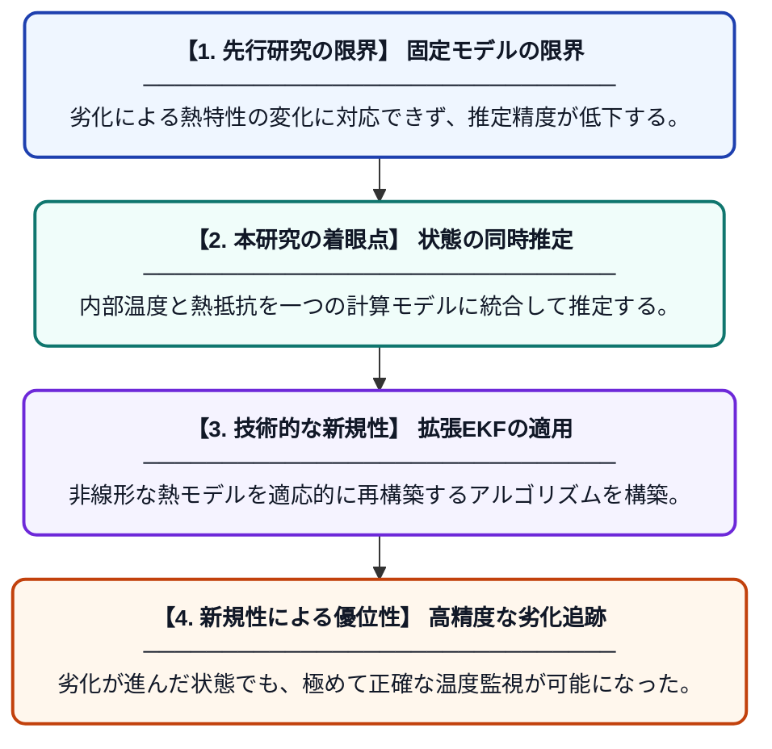

# 拡張カルマンフィルタの拡張による蒸着金属膜コンデンサの界面劣化を考慮した適応型熱モニタリング

**Original Title**: *Adaptive Thermal Monitoring of Metallized Film Capacitors via Augmented Extended Kalman Filter for Interface Degradation*

> **💡 一言要約**: 劣化による熱変化を捉える高度なコンデンサ監視技術

| 項目 | 内容 |
|---|---|
| **著者** | Y Yang, S Gao, J Song |
| **掲載誌** | IEEE 7th International Conference on Advanced … 2026 |
| **アラートキーワード** | kalman filter |
| **原文リンク** | [https://ieeexplore.ieee.org/abstract/document/11745727/](https://ieeexplore.ieee.org/abstract/document/11745727/) |
| **PDF版要約** | [README.pdf](./README.pdf) |

---

## 📊 新規性の図解（先行研究との違いと本研究のブレークスルー）

## 📝 要約

蒸着金属膜コンデンサの劣化に伴う熱特性の変化をリアルタイムで追跡するため、拡張カルマンフィルタを用いた新しい推定手法を提案しています。内部温度と変化の遅い境界熱抵抗を同時に推定することで、精度の高い熱モニタリングを実現しました。

## ❓ どんな問題に取り組んだか

蒸着金属膜コンデンサは使用に伴い界面が劣化し、熱特性が変化するため、従来の固定パラメータを用いたモデルでは内部温度を正確に推定することが困難でした。特に、経年変化による熱抵抗の増大を考慮したリアルタイムの温度監視手法が不足していました。

## ✨ 何が新しい？何がすごい？（新規性）

従来のカルマンフィルタを拡張し、内部の過渡的な温度変化だけでなく、長期的に変化する「境界熱抵抗」を状態ベクトルに組み込んだ点が画期的です。これにより、素子の劣化状態に応じて推定モデルを自己適応させることが可能になりました。先行研究では困難だった、劣化の進行と温度推定精度の維持を両立させています。

## 🎓 大学1年生向けの解説

コンデンサは電気を蓄える部品ですが、使っているうちに少しずつ熱を持ちやすくなり劣化していきます。この研究は、その「古くなり具合」と「中の温度」を、センサーを直接差し込まなくても計算で正確に当てる手法を開発したものです。古くなって熱の逃げにくさが変わっても、このシステムなら自動で調整して正しい温度を教えてくれます。これにより、故障する前に交換時期を知ることができるようになります。
