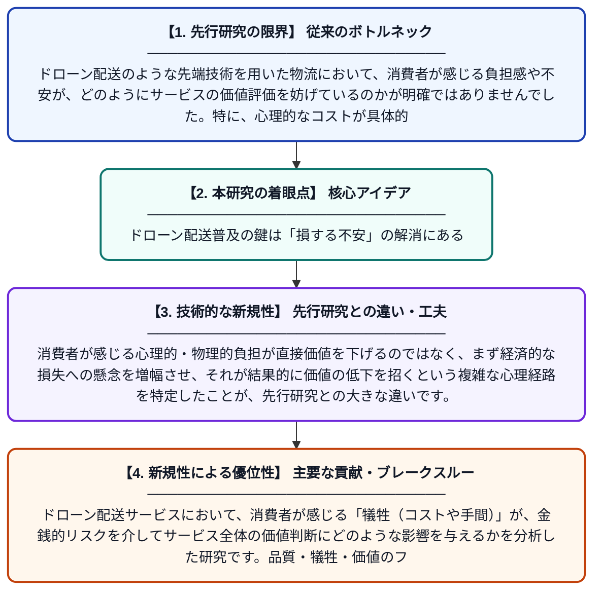

# ドローン配送における消費者の価値知覚：テクノロジーを介した物流におけるリスクの再概念化

**Original Title**: *Consumer Value Perception in Drone Delivery: Re-Conceptualizing Risk in Technology-Mediated Logistics*

> **💡 一言要約**: ドローン配送普及の鍵は「損する不安」の解消にある

| 項目 | 内容 |
|---|---|
| **著者** | Y Lee, YJ Shen, WP Hu |
| **掲載誌** | Sage Open 2026 |
| **アラートキーワード** | logistics |
| **PDF** | [https://journals.sagepub.com/doi/pdf/10.1177/21582440261499956](https://journals.sagepub.com/doi/pdf/10.1177/21582440261499956) |
| **原文リンク** | [https://journals.sagepub.com/doi/pdf/10.1177/21582440261499956](https://journals.sagepub.com/doi/pdf/10.1177/21582440261499956) |
| **PDF版要約** | [README.pdf](./README.pdf) |

---

## 📊 新規性の図解（先行研究との違いと本研究のブレークスルー）

## 📝 要約

ドローン配送サービスにおいて、消費者が感じる「犠牲（コストや手間）」が、金銭的リスクを介してサービス全体の価値判断にどのような影響を与えるかを分析した研究です。品質・犠牲・価値のフレームワークを用い、新しい物流技術の採用プロセスにおける心理メカニズムを明らかにしています。

## ❓ どんな問題に取り組んだか

ドローン配送のような先端技術を用いた物流において、消費者が感じる負担感や不安が、どのようにサービスの価値評価を妨げているのかが明確ではありませんでした。特に、心理的なコストが具体的なリスク認識にどう変化し、最終的な利用意欲を削ぐのかというプロセスを解明する必要がありました。

## ✨ 何が新しい？何がすごい？（新規性）

本研究は、従来の品質・犠牲・価値の枠組みに「金銭的リスク」という仲介要素を組み込んだ点が画期的です。消費者が感じる心理的・物理的負担が直接価値を下げるのではなく、まず経済的な損失への懸念を増幅させ、それが結果的に価値の低下を招くという複雑な心理経路を特定したことが、先行研究との大きな違いです。

## 🎓 大学1年生向けの解説

ドローンで荷物が届くのは便利そうですが、「途中で壊れたら？」「損をしない？」といった不安を感じる人も多いはずです。この研究は、私たちがドローン配送に対して感じる『手間や不安』が、どうやって『使う価値があるか』の判断につながるのかを詳しく調べました。結果として、新しい技術を使うときには、単に便利なだけでなく『損をする心配がないこと』が評価にとても大きな影響を与えることが分かりました。
