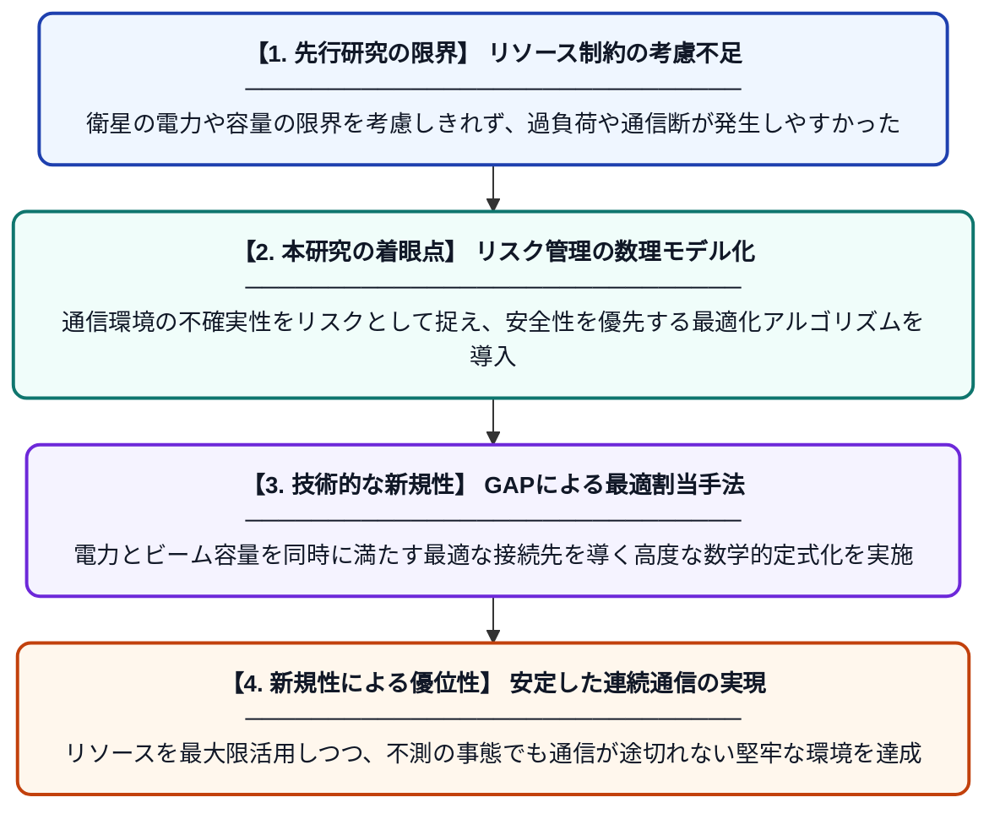

# NTN-Connectシミュレータを用いた非地上系ネットワークにおけるリスクを考慮したハンドオーバー管理手法

**Original Title**: *Risk-Aware Handover Management Approach for Non-Terrestrial Networks with the NTN-Connect Simulator*

> **💡 一言要約**: 衛星通信の途切れを防ぐ、リスク回避型の接続切り替え技術

| 項目 | 内容 |
|---|---|
| **著者** | M Almekhlafi, A Lesage-Landry, GK Kurt |
| **掲載誌** | arXiv preprint arXiv:2611.21027 2026 |
| **アラートキーワード** | generalized assignment ... |
| **PDF** | [https://arxiv.org/pdf/2611.21027](https://arxiv.org/pdf/2611.21027) |
| **原文リンク** | [https://arxiv.org/pdf/2611.21027](https://arxiv.org/pdf/2611.21027) |
| **PDF版要約** | [README.pdf](./README.pdf) |

---

## 📊 新規性の図解（先行研究との違いと本研究のブレークスルー）

## 📝 要約

非地上系ネットワーク（NTN）において、通信の安定性を高めるために不確実性を考慮したハンドオーバー管理手法を提案しています。衛星の電力予算や通信容量の制約を考慮しつつ、ユーザーを最適な衛星に割り当てる整数線形計画法モデルを構築し、専用シミュレータでその有効性を検証しています。

## ❓ どんな問題に取り組んだか

人工衛星を用いた通信（NTN）では、衛星が高速で移動するため頻繁に接続先を切り替える「ハンドオーバー」が発生します。しかし、衛星の電力や通信容量には限界があり、これらを考慮せずに切り替えを行うと、通信が不安定になったり切断されたりする課題がありました。

## ✨ 何が新しい？何がすごい？（新規性）

本研究の最大の貢献は、通信断絶のリスクを最小化する「リスク意識型」の最適化モデルをNTNに導入したことです。ユーザー割り当てを数学的な「一般化割当問題（GAP）」として定式化し、電力とビーム容量の制約を厳密に解く手法を開発しました。さらに、開発した「NTN-Connectシミュレータ」により、現実的な動的環境下での高精度な評価を実現しています。

## 🎓 大学1年生向けの解説

空にある人工衛星を使ってインターネットをする際、衛星は猛スピードで動いているため、スマホの接続先を次々と隣の衛星へバトンタッチさせる必要があります。しかし、一つの衛星に接続が集中すると、パンクして通信が止まってしまうかもしれません。この研究は、どの衛星に繋ぐのが一番安全で効率的かを数学を使って瞬時に判断する仕組みを作りました。これにより、移動中でも途切れない安定した衛星通信が可能になります。
