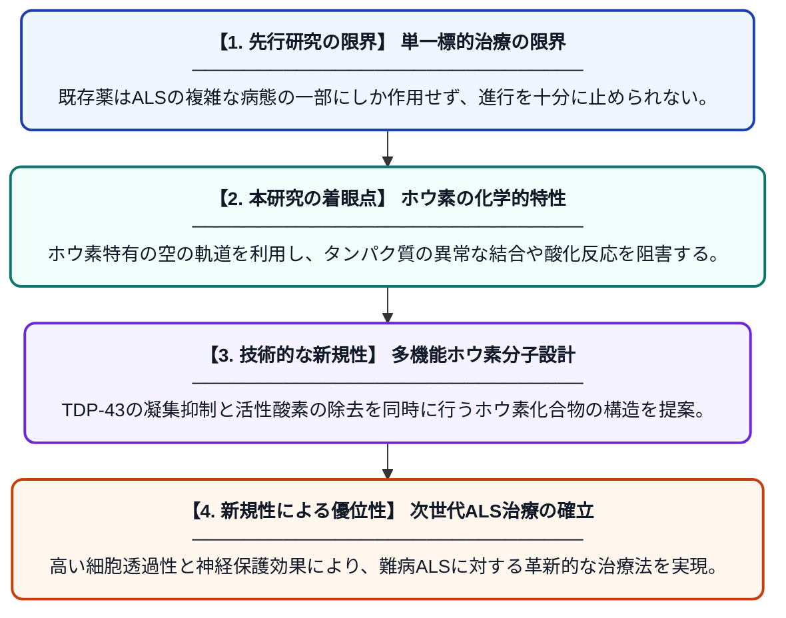

# ホウ素と神経のつながり：治癒不可能な筋萎縮性側索硬化症（ALS）治療におけるホウ素含有分子の可能性

**Original Title**: *The Boron–Neuron Connection: The Potential of Boron‐Containing Molecules for Treating Incurable Amyotrophic Lateral Sclerosis*

> **💡 一言要約**: ホウ素の力でALSの難病治療に挑む新アプローチ

| 項目 | 内容 |
|---|---|
| **著者** | N Sanghai, B Vuong, MSK Afridi, S Leggett, H Roghzai… |
| **掲載誌** | ChemMedChem 2026 |
| **アラートキーワード** | ALS |
| **PDF** | [https://chemistry-europe.onlinelibrary.wiley.com/doi/pdf/10.1002/cmdc.70554](https://chemistry-europe.onlinelibrary.wiley.com/doi/pdf/10.1002/cmdc.70554) |
| **原文リンク** | [https://chemistry-europe.onlinelibrary.wiley.com/doi/pdf/10.1002/cmdc.70554](https://chemistry-europe.onlinelibrary.wiley.com/doi/pdf/10.1002/cmdc.70554) |
| **PDF版要約** | [README.pdf](./README.pdf) |

---

## 📊 新規性の図解（先行研究との違いと本研究のブレークスルー）

## 📝 要約

ALS（筋萎縮性側索硬化症）の主な原因であるTDP-43タンパク質の凝集体や酸化ストレスに対し、ホウ素含有分子を用いた新たな治療アプローチを提案する研究です。ホウ素化合物の特異な化学的性質が、神経細胞の保護や病理プロセスの抑制にどのように寄与できるかを網羅的に論じています。

## ❓ どんな問題に取り組んだか

ALSは進行性の神経変性疾患であり、現在も根本的な治療法が見つかっていません。特にTDP-43タンパク質の蓄積や過剰な酸化ストレスが細胞を死に至らしめますが、これらを効果的に制御し、血液脳関門を通過して作用する安全な薬剤の開発が急務となっています。

## ✨ 何が新しい？何がすごい？（新規性）

本論文は、創薬において見落とされがちだった「ホウ素」という元素が持つユニークな電子構造と結合特性に着目した点が画期的です。ボロン酸などのホウ素含有分子が、従来の炭素化合物では難しかった標的タンパク質との可逆的な結合や、強力な抗酸化作用、そして優れた脳内移行性を両立できることを示しました。これにより、ALSの多面的な病態を一分子で制御できる可能性を提示しています。

## 🎓 大学1年生向けの解説

ALSは全身の筋肉が動かなくなってしまう非常に深刻な病気で、脳の中にゴミが溜まったり、細胞が「酸化」してボロボロになったりすることが原因です。この論文では、ガラスの材料などにも使われる「ホウ素」を含んだ新しいタイプの薬が、そのゴミを掃除し、細胞が壊れるのを防ぐ強力な味方になることを説明しています。ホウ素には他の物質にはない特殊な性質があり、これまでの薬では届かなかった脳の深い場所まで効果を届けることが期待されています。
