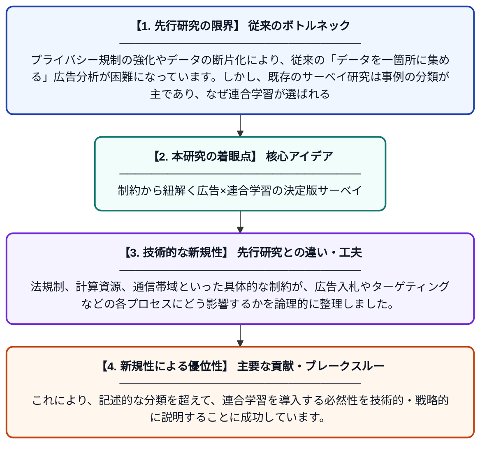

# 広告およびデジタルマーケティングにおける連合学習：包括的サーベイ

**Original Title**: *Federated Learning in Advertising and Digital Marketing: A Comprehensive Survey*

> **💡 一言要約**: 制約から紐解く広告×連合学習の決定版サーベイ

| 項目 | 内容 |
|---|---|
| **著者** | Z Wang, SM Sarkar |
| **掲載誌** | Knowledge-Based Systems 2026 |
| **アラートキーワード** | Federated Learning |
| **原文リンク** | [https://www.sciencedirect.com/science/article/pii/S0950705126019970](https://www.sciencedirect.com/science/article/pii/S0950705126019970) |
| **PDF版要約** | [README.pdf](./README.pdf) |

---

## 📊 新規性の図解（先行研究との違いと本研究のブレークスルー）

## 📝 要約

広告とデジタルマーケティング分野における連合学習の適用を「制約駆動型」の視点から分析した包括的なサーベイ論文です。単なる事例紹介に留まらず、法規制や技術的制限がどのように連合学習の採用を決定づけているのかを体系的に明らかにしています。

## ❓ どんな問題に取り組んだか

プライバシー規制の強化やデータの断片化により、従来の「データを一箇所に集める」広告分析が困難になっています。しかし、既存のサーベイ研究は事例の分類が主であり、なぜ連合学習が選ばれるのかという根本的な制約に基づいた深い分析が不足していました。

## ✨ 何が新しい？何がすごい？（新規性）

本論文は「制約（Constraints）」を軸にした新しい分析フレームワークを導入している点が極めて独創的です。法規制、計算資源、通信帯域といった具体的な制約が、広告入札やターゲティングなどの各プロセスにどう影響するかを論理的に整理しました。これにより、記述的な分類を超えて、連合学習を導入する必然性を技術的・戦略的に説明することに成功しています。

## 🎓 大学1年生向けの解説

インターネット広告の世界では、皆さんのプライバシーを守りながら興味に合った情報を届けることが難しくなっています。そこで、データを一箇所に集めずに学習する「連合学習」という技術が注目されています。この論文は、難しい法律や技術の制限がある中で、どのようにこの新しい技術を使えば広告を便利に、かつ安全に運用できるかをまとめたガイドブックのようなものです。
