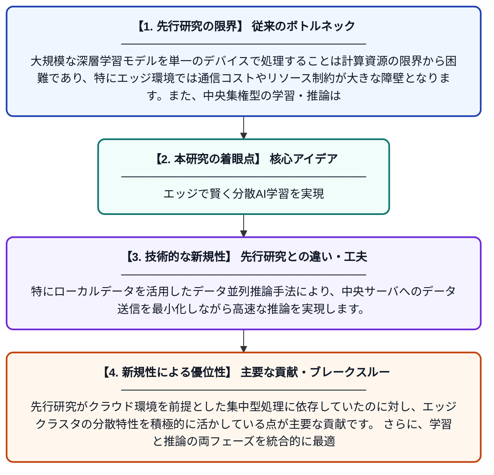

# エッジクラスタを活用したデータ並列・特徴マップ並列による効率的な分散学習・推論

**Original Title**: *Efficient distributed training and inference based on data and feature map parallelism via leveraging edge clusters*

> **💡 一言要約**: エッジで賢く分散AI学習を実現

| 項目 | 内容 |
|---|---|
| **著者** | H Guo, C Zhang, X Wang, J Fei, J Li, Y Du, J Cao |
| **掲載誌** | Cluster Computing 2026 |
| **アラートキーワード** | distributed deep learning ... |
| **原文リンク** | [https://link.springer.com/article/10.1007/s10586-026-06343-y](https://link.springer.com/article/10.1007/s10586-026-06343-y) |
| **PDF版要約** | [README.pdf](./README.pdf) |

---

## 📊 新規性の図解（先行研究との違いと本研究のブレークスルー）

## 📝 要約

本論文は、エッジクラスタ環境において深層学習モデルの分散学習と推論を効率化する手法を提案しています。データ並列と特徴マップ並列を組み合わせることで、複数デバイス間での計算を最適化します。特に、ローカルデータに基づくデータ並列推論手法により、中央集権型の深層学習が抱える課題を克服することを目指しています。

## ❓ どんな問題に取り組んだか

大規模な深層学習モデルを単一のデバイスで処理することは計算資源の限界から困難であり、特にエッジ環境では通信コストやリソース制約が大きな障壁となります。また、中央集権型の学習・推論はデータプライバシーやレイテンシの面でも問題を抱えています。これらの課題に対応する効率的な分散処理戦略が求められています。

## ✨ 何が新しい？何がすごい？（新規性）

本研究は、データ並列と特徴マップ並列を組み合わせたハイブリッドな分散手法をエッジクラスタ上で実現する点が新しいアプローチです。特にローカルデータを活用したデータ並列推論手法により、中央サーバへのデータ送信を最小化しながら高速な推論を実現します。先行研究がクラウド環境を前提とした集中型処理に依存していたのに対し、エッジクラスタの分散特性を積極的に活かしている点が主要な貢献です。さらに、学習と推論の両フェーズを統合的に最適化する設計により、実用的な展開可能性を高めています。

## 🎓 大学1年生向けの解説

AIの学習には膨大な計算が必要ですが、一台のコンピュータでは処理しきれないことがあります。この研究では、スマホ基地局などの「エッジ」と呼ばれる身近な場所にある複数のコンピュータを連携させてAIを効率よく学習・動作させる方法を提案しています。データを複数の機器に分けて同時に処理する「データ並列」と、AIの内部計算を分割する「特徴マップ並列」という二つの工夫を組み合わせることで、速く・省エネに動かせるようにしています。データをクラウドに送らずに近くで処理するため、プライバシー面でも安心です。
