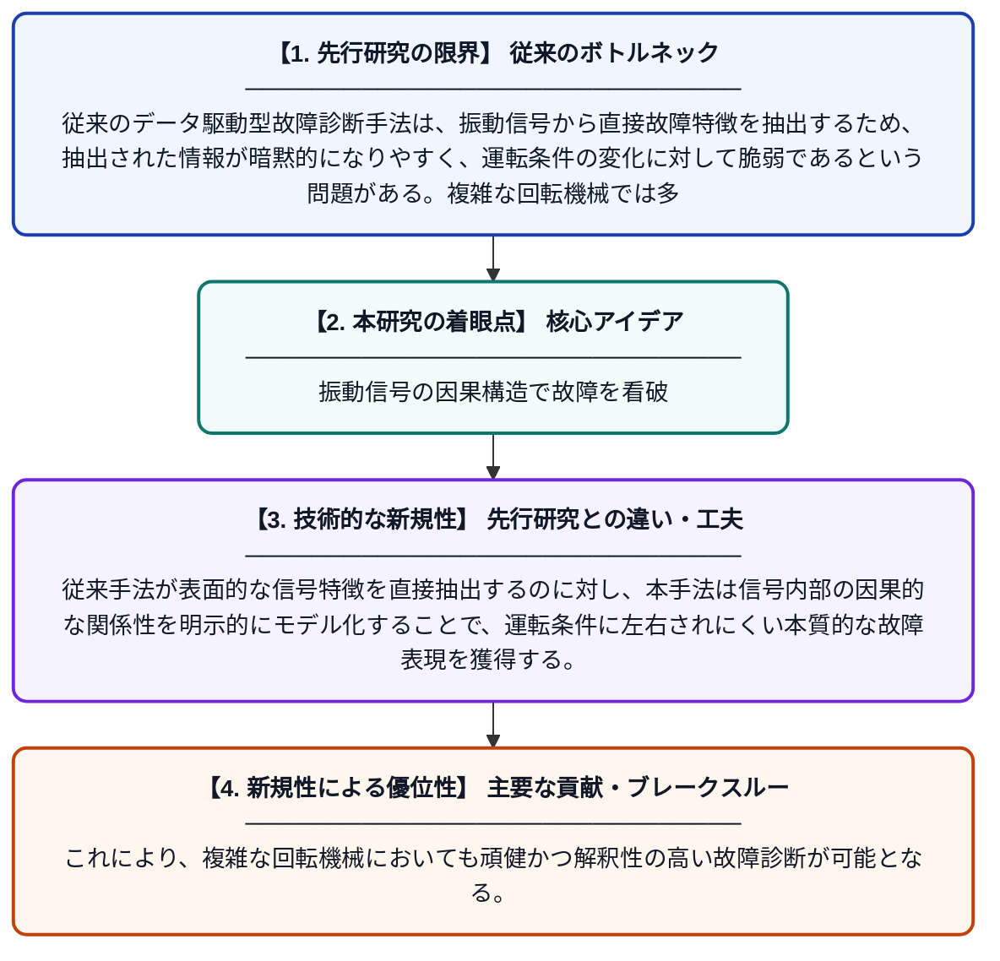

# 複雑な回転機械の故障診断のための振動信号における内部因果構造表現学習

**Original Title**: *Inner-causal structure representation learning of vibration signal for fault diagnosis of complex rotating machinery*

> **💡 一言要約**: 振動信号の因果構造で故障を看破

| 項目 | 内容 |
|---|---|
| **著者** | Y Liu, W Cheng, W Wen, Q Fang, H Wu, Y Wang |
| **掲載誌** | Advanced Engineering Informatics 2026 |
| **アラートキーワード** | representation learning |
| **原文リンク** | [https://www.sciencedirect.com/science/article/pii/S1474034626007470](https://www.sciencedirect.com/science/article/pii/S1474034626007470) |
| **PDF版要約** | [README.pdf](./README.pdf) |

---

## 📊 新規性の図解（先行研究との違いと本研究のブレークスルー）

## 📝 要約

本論文は、回転機械の故障診断において、振動信号から直接特徴を抽出する従来手法の限界を克服するため、信号内部の因果構造を学習する新たなアプローチを提案している。運転条件の変化に影響されにくい本質的な故障情報を抽出することで、より頑健な診断を実現する。データ駆動型の枠組みを用いつつ、信号の内部構造に着目することで従来法の課題を解決している。

## ❓ どんな問題に取り組んだか

従来のデータ駆動型故障診断手法は、振動信号から直接故障特徴を抽出するため、抽出された情報が暗黙的になりやすく、運転条件の変化に対して脆弱であるという問題がある。複雑な回転機械では多様な動作環境下での診断精度の維持が特に困難であり、信頼性の高い故障検出の実現が大きな課題となっている。

## ✨ 何が新しい？何がすごい？（新規性）

本研究は、振動信号の「内部因果構造」に着目した表現学習という新しい視点を導入している点が独自である。従来手法が表面的な信号特徴を直接抽出するのに対し、本手法は信号内部の因果的な関係性を明示的にモデル化することで、運転条件に左右されにくい本質的な故障表現を獲得する。これにより、複雑な回転機械においても頑健かつ解釈性の高い故障診断が可能となる。

## 🎓 大学1年生向けの解説

工場にある大きな機械（モーターや歯車など）が壊れそうになると、振動（ゆれ）のパターンが変わります。この研究は、その振動データをコンピュータに学習させて故障を自動で見つける方法を改良したものです。従来の方法は機械の動かし方（速さや負荷）が変わると診断が難しくなる問題がありましたが、この研究では振動信号の中にある『原因と結果のつながり（因果構造）』を学ばせることで、どんな状況でも正確に故障を見つけられるようにしました。
